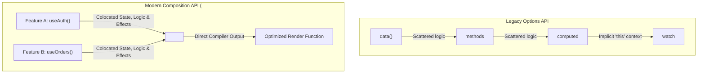
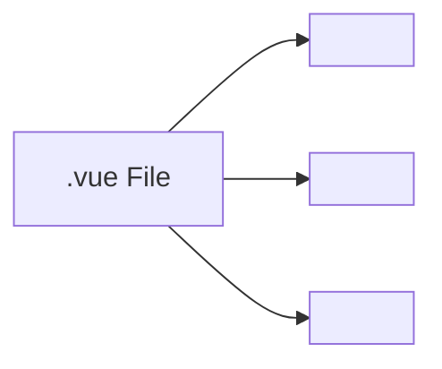
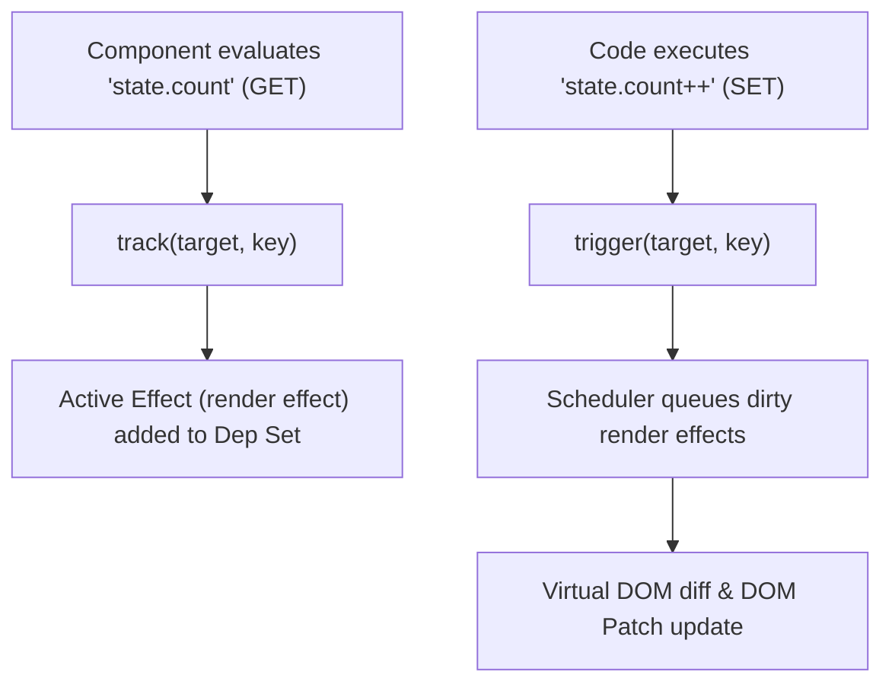
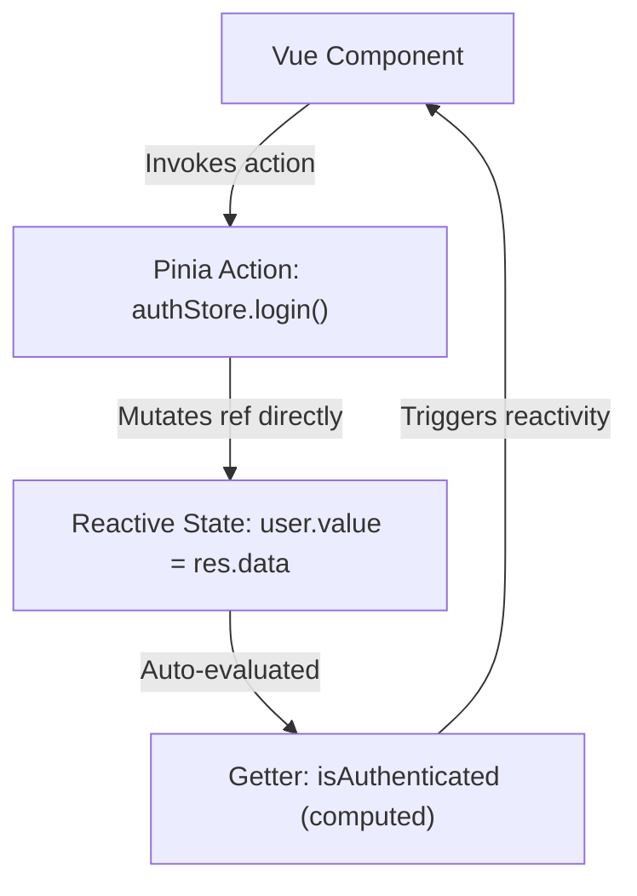
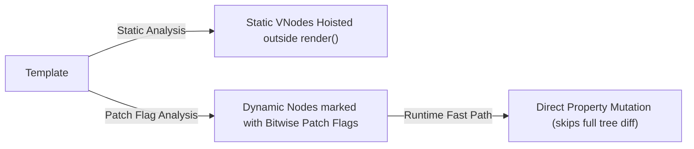

# Learn Vue 3: From Zero to Staff Frontend Architect

[]()
[]()
[](LICENSE)

> A masterclass on modern Vue 3 Composition API (`<script setup>`), Proxy-based Reactivity engine internals, composables architecture, Pinia state management, compiler optimization flags, and enterprise testing.

---

## Table of Contents
1. [Stage 1: Absolute Beginner Foundations & Vue 3 Architecture](#1-stage-1-absolute-beginner-foundations--vue-3-architecture)
2. [Stage 2: The Reactivity Engine Deep Dive (`ref`, `reactive`, `watchEffect`)](#2-stage-2-the-reactivity-engine-deep-dive-ref-reactive-watcheffect)
3. [Stage 3: Component Architecture, Typed Props, Emits & `defineModel`](#3-stage-3-component-architecture-typed-props-emits--definemodel)
4. [Stage 4: Production Composables Engineering & Async State](#4-stage-4-production-composables-engineering--async-state)
5. [Stage 5: Enterprise State Management with Pinia & Vue Router 4](#5-stage-5-enterprise-state-management-with-pinia--vue-router-4)
6. [Stage 6: Compiler Optimizations, Teleport, Suspense & SSR](#6-stage-6-compiler-optimizations-teleport-suspense--ssr)
7. [Stage 7: Staff Vue Architect Interview Handbook & Production Cheatsheet](#7-stage-7-staff-vue-architect-interview-handbook--production-cheatsheet)

---

## Architectural Comparison: Options API vs. Composition API



---

## 1. Stage 1: Absolute Beginner Foundations & Vue 3 Architecture

### 1.1 The Single-File Component (SFC) Anatomy
Vue Single-File Components (`.vue` files) encapsulate structure, reactive logic, and scoped styles in a single cohesive unit:



### 1.2 Line-by-Line Code Breakdown: Modern Metric Card Component
```vue
<script setup lang="ts">
import { ref, computed } from 'vue';

// 1. Reactive state initialization with ref()
const requestCount = ref<number>(14280);
const errorCount = ref<number>(12);
const isRefreshing = ref<boolean>(false);

// 2. Pure memoized derived state with computed()
const errorRatePercentage = computed<string>(() => {
  if (requestCount.value === 0) return '0.00%';
  return ((errorCount.value / requestCount.value) * 100).toFixed(3) + '%';
});

// 3. Methods / Event handlers
async function refreshTelemetry() {
  isRefreshing.value = true;
  try {
    await new Promise((resolve) => setTimeout(resolve, 800));
    requestCount.value += Math.floor(Math.random() * 500);
  } finally {
    isRefreshing.value = false;
  }
}
</script>

<template>
  <div class="metric-card">
    <div class="header">
      <span class="label">Ingress Traffic</span>
      <span class="badge font-mono">{{ errorRatePercentage }} error</span>
    </div>
    <div class="metric-value font-mono">
      {{ requestCount.toLocaleString() }}
    </div>
    <div class="actions">
      <button :disabled="isRefreshing" @click="refreshTelemetry">
        <span v-if="isRefreshing">Querying cluster...</span>
        <span v-else>Sync Telemetry</span>
      </button>
    </div>
  </div>
</template>

<style scoped>
.metric-card {
  padding: 1.5rem;
  background: #0f172a;
  border: 1px solid #1e293b;
  border-radius: 1rem;
  color: #f8fafc;
}
.header {
  display: flex;
  justify-content: space-between;
  align-items: center;
}
.metric-value {
  font-size: 2rem;
  font-weight: 700;
  margin-top: 0.5rem;
}
</style>
```

| Syntax construct | Underlying Mechanism | Architectural Purpose |
| :--- | :--- | :--- |
| `<script setup lang="ts">` | Compile-time SFC syntactic sugar | Top-level variables and functions are automatically exposed directly to the template without `return {}`. |
| `ref<number>(14280)` | Reactive reference wrapper object (`{ value: ... }`) | Wraps primitive values in an object whose `.value` getter/setter triggers dependency tracking. |
| `computed(...)` | Cached dependency evaluation | Only recalculates when `errorCount` or `requestCount` dependencies mutate. |
| `:disabled="isRefreshing"` | `v-bind` directive shorthand | Dynamically binds HTML button disabled attribute to reactive boolean. |
| `@click="refreshTelemetry"` | `v-on` event listener shorthand | Binds click event handler with automatic event-cleanup when component unmounts. |
| `<style scoped>` | PostCSS attribute scoping (`data-v-xxxxxx`) | Isolates CSS rules to this component only, preventing global leakage. |

---

## 2. Stage 2: The Reactivity Engine Deep Dive (`ref`, `reactive`, `watchEffect`)

### 2.1 The Dependency Tracking Lifecycle (`track` & `trigger`)
Vue 3 replaces Vue 2's `Object.defineProperty` with native JavaScript `Proxy` objects:



### 2.2 `ref()` vs. `reactive()`: Architectural Decision Matrix

```ts
import { ref, reactive, toRefs, isRef } from 'vue';

// 1. ref() works for both primitives and objects
const count = ref(0);
count.value++; // .value required in JS, auto-unwrapped in <template>

// 2. reactive() creates deep Proxy only for objects (cannot wrap primitives)
const state = reactive({
  user: { name: 'Elena', role: 'Architect' },
  preferences: { theme: 'dark' }
});

// CAVEAT: Destructuring reactive() breaks reactivity!
// const { name } = state.user; // Reactivity lost!

// SOLUTION: Use toRefs() to preserve reactive links
const { user, preferences } = toRefs(state);
// user.value.name remains reactive!
```

### 2.3 `watch()` vs. `watchEffect()`
```ts
import { ref, watch, watchEffect } from 'vue';

const query = ref('');
const results = ref<string[]>([]);

// 1. Explicit watch: Lazy, provides oldValue and newValue
watch(query, (newVal, oldVal) => {
  console.log(`Query changed from "${oldVal}" to "${newVal}"`);
});

// 2. watchEffect: Eagerly runs immediately, automatically tracks any accessed reactive property
const stopWatcher = watchEffect((onCleanup) => {
  const controller = new AbortController();

  onCleanup(() => {
    // Abort pending fetch when query changes before response arrives
    controller.abort();
  });

  fetch(`/api/search?q=${encodeURIComponent(query.value)}`, { signal: controller.signal })
    .then(res => res.json())
    .then(data => { results.value = data; })
    .catch(() => {});
});

// Stop watcher when needed
// stopWatcher();
```

---

## 3. Stage 3: Component Architecture, Typed Props, Emits & `defineModel`

### 3.1 Vue 3.4+ Two-Way Binding with `defineModel()`
Prior to Vue 3.4, two-way component binding required declaring `modelValue` in `props` and firing `update:modelValue` via `emit`. Vue 3.4 simplifies this with `defineModel`:

```vue
<!-- components/SearchInput.vue -->
<script setup lang="ts">
// Declares two-way bound model with modifiers
const model = defineModel<string>({ required: true });
const [limit, limitModifiers] = defineModel<number>('limit', { default: 10 });
</script>

<template>
  <div class="search-box">
    <input 
      v-model="model" 
      type="text" 
      placeholder="Search data..."
      class="input-field" 
    />
    <span class="limit-indicator">Max: {{ limit }}</span>
  </div>
</template>
```

**Parent Component Consumer:**
```vue
<script setup lang="ts">
import { ref } from 'vue';
import SearchInput from './components/SearchInput.vue';

const searchQuery = ref('');
const resultLimit = ref(25);
</script>

<template>
  <!-- Native clean two-way synchronization -->
  <SearchInput v-model="searchQuery" v-model:limit="resultLimit" />
  <p>Active Query: {{ searchQuery }}</p>
</template>
```

---

## 4. Stage 4: Production Composables Engineering & Async State

### 4.1 Production Composable: `useFetch` with Cache & Abort Support
```ts
// composables/useFetch.ts
import { ref, isRef, unref, watchEffect, type Ref } from 'vue';

interface UseFetchOptions {
  immediate?: boolean;
}

export function useFetch<T>(url: string | Ref<string>, options: UseFetchOptions = { immediate: true }) {
  const data = ref<T | null>(null);
  const error = ref<Error | null>(null);
  const isLoading = ref<boolean>(false);

  let controller: AbortController | null = null;

  async function execute() {
    // Abort inflight request
    if (controller) controller.abort();
    controller = new AbortController();

    isLoading.value = true;
    error.value = null;

    try {
      const targetUrl = unref(url);
      const res = await fetch(targetUrl, { signal: controller.signal });
      if (!res.ok) throw new Error(`HTTP error ${res.status}: ${res.statusText}`);
      data.value = await res.json();
    } catch (err: any) {
      if (err.name !== 'AbortError') {
        error.value = err;
      }
    } finally {
      isLoading.value = false;
    }
  }

  // Re-fetch automatically if reactive URL changes
  if (isRef(url)) {
    watchEffect(() => {
      execute();
    });
  } else if (options.immediate) {
    execute();
  }

  return { data, error, isLoading, refetch: execute };
}
```

### 4.2 Production Composable: `useLocalStorage`
```ts
// composables/useLocalStorage.ts
import { ref, watch } from 'vue';

export function useLocalStorage<T>(key: string, fallbackValue: T) {
  const readValue = (): T => {
    try {
      const item = window.localStorage.getItem(key);
      return item ? JSON.parse(item) : fallbackValue;
    } catch {
      return fallbackValue;
    }
  };

  const storedValue = ref<T>(readValue()) as Ref<T>;

  watch(
    storedValue,
    (newVal) => {
      try {
        window.localStorage.setItem(key, JSON.stringify(newVal));
      } catch (err) {
        console.warn(`Failed to persist key "${key}" to localStorage:`, err);
      }
    },
    { deep: true }
  );

  return storedValue;
}
```

---

## 5. Stage 5: Enterprise State Management with Pinia & Vue Router 4

### 5.1 The Modern Pinia Store Architecture (Setup Stores)
Pinia replaces Vuex, offering full TypeScript inference without mutations or magic string action dispatches:



#### Production Pinia Auth Store
```ts
// stores/auth.ts
import { defineStore } from 'pinia';
import { ref, computed } from 'vue';

export interface User {
  id: string;
  email: string;
  role: 'ADMIN' | 'ENGINEER' | 'VIEWER';
}

export const useAuthStore = defineStore('auth', () => {
  // State
  const currentUser = ref<User | null>(null);
  const token = ref<string | null>(localStorage.getItem('auth_token'));
  const isAuthenticating = ref<boolean>(false);

  // Getters (computed)
  const isAuthenticated = computed(() => currentUser.value !== null && token.value !== null);
  const isAdmin = computed(() => currentUser.value?.role === 'ADMIN');

  // Actions
  async function login(credentials: { email: string; pass: string }) {
    isAuthenticating.value = true;
    try {
      const res = await fetch('/api/login', {
        method: 'POST',
        headers: { 'Content-Type': 'application/json' },
        body: JSON.stringify(credentials)
      });
      const data = await res.json();
      currentUser.value = data.user;
      token.value = data.token;
      localStorage.setItem('auth_token', data.token);
    } finally {
      isAuthenticating.value = false;
    }
  }

  function logout() {
    currentUser.value = null;
    token.value = null;
    localStorage.removeItem('auth_token');
  }

  return {
    currentUser,
    token,
    isAuthenticating,
    isAuthenticated,
    isAdmin,
    login,
    logout
  };
});
```

---

## 6. Stage 6: Compiler Optimizations, Teleport, Suspense & SSR

### 6.1 Compiler-Informed Virtual DOM (Patch Flags & Hoisting)
Unlike standard Virtual DOM diffing (which compares the entire virtual tree node by node), Vue 3's template compiler analyzes template structure statically:



- **Patch Flags**: Dynamic nodes receive a bitmask flag (e.g., `1 /* TEXT */`, `2 /* CLASS */`, `8 /* PROPS */`), allowing the runtime patcher to bypass static child nodes completely.
- **Static Hoisting**: Elements without reactive bindings are hoisted out of the `render` function and instantiated once, reducing memory allocations to $O(1)$.

---


---

## Comprehensive Production Vue 3 Component & Composable Gallery

### 1. Enterprise Generic Data Table Component (`DataTable.vue`)
Demonstrates Vue 3.3+ generic component types (`generic="T extends Record<string, any>"`), dynamic scoped slots, and sort tracking:

```vue
<!-- components/DataTable.vue -->
<script setup lang="ts" generic="T extends Record<string, any>">
import { ref, computed } from 'vue';

interface Column<K> {
  key: keyof K;
  header: string;
  sortable?: boolean;
}

const props = defineProps<{
  items: T[];
  columns: Column<T>[];
  pageSize?: number;
}>();

const emit = defineEmits<{
  (e: 'row-click', item: T): void;
}>();

const sortKey = ref<keyof T | null>(null);
const sortAscending = ref<boolean>(true);
const currentPage = ref<number>(1);
const effectivePageSize = props.pageSize || 10;

function toggleSort(key: keyof T) {
  if (sortKey.value === key) {
    sortAscending.value = !sortAscending.value;
  } else {
    sortKey.value = key;
    sortAscending.value = true;
  }
}

const sortedItems = computed(() => {
  if (!sortKey.value) return props.items;
  return [...props.items].sort((a, b) => {
    const valA = a[sortKey.value!];
    const valB = b[sortKey.value!];
    if (valA === valB) return 0;
    const res = valA > valB ? 1 : -1;
    return sortAscending.value ? res : -res;
  });
});

const paginatedItems = computed(() => {
  const start = (currentPage.value - 1) * effectivePageSize;
  return sortedItems.value.slice(start, start + effectivePageSize);
});

const totalPages = computed(() => Math.ceil(props.items.length / effectivePageSize));
</script>

<template>
  <div class="table-container">
    <table class="data-table">
      <thead>
        <tr>
          <th 
            v-for="col in columns" 
            :key="String(col.key)"
            :class="{ sortable: col.sortable }"
            @click="col.sortable && toggleSort(col.key)"
          >
            {{ col.header }}
            <span v-if="sortKey === col.key">{{ sortAscending ? '▲' : '▼' }}</span>
          </th>
        </tr>
      </thead>
      <tbody>
        <tr 
          v-for="(item, idx) in paginatedItems" 
          :key="idx" 
          @click="emit('row-click', item)"
        >
          <td v-for="col in columns" :key="String(col.key)">
            <!-- Scoped Slot fallback with default raw text -->
            <slot :name="`cell-${String(col.key)}`" :item="item" :value="item[col.key]">
              {{ item[col.key] }}
            </slot>
          </td>
        </tr>
      </tbody>
    </table>

    <div class="pagination">
      <button :disabled="currentPage === 1" @click="currentPage--">Prev</button>
      <span>Page {{ currentPage }} of {{ totalPages }}</span>
      <button :disabled="currentPage >= totalPages" @click="currentPage++">Next</button>
    </div>
  </div>
</template>

<style scoped>
.table-container {
  overflow-x: auto;
  border: 1px solid #1e293b;
  border-radius: 0.75rem;
  background: #0f172a;
}
.data-table {
  width: 100%;
  border-collapse: collapse;
  color: #f1f5f9;
}
th, td {
  padding: 0.75rem 1rem;
  text-align: left;
  border-bottom: 1px solid #1e293b;
}
th.sortable {
  cursor: pointer;
  user-select: none;
}
th.sortable:hover {
  color: #38bdf8;
}
.pagination {
  display: flex;
  justify-content: space-between;
  align-items: center;
  padding: 0.75rem 1rem;
}
</style>
```

---

### 2. Accessible Teleport Modal Dialog (`ModalDialog.vue`)
Mounts directly to `document.body` while maintaining reactive bindings and keyboard focus trapping:

```vue
<!-- components/ModalDialog.vue -->
<script setup lang="ts">
import { onMounted, onUnmounted } from 'vue';

const isOpen = defineModel<boolean>('isOpen', { required: true });

defineProps<{
  title?: string;
}>();

function handleKeydown(e: KeyboardEvent) {
  if (e.key === 'Escape' && isOpen.value) {
    isOpen.value = false;
  }
}

onMounted(() => {
  window.addEventListener('keydown', handleKeydown);
});

onUnmounted(() => {
  window.removeEventListener('keydown', handleKeydown);
});
</script>

<template>
  <Teleport to="body">
    <Transition name="fade">
      <div v-if="isOpen" class="modal-overlay" @click.self="isOpen = false">
        <div class="modal-card" role="dialog" aria-modal="true">
          <header class="modal-header">
            <h3 v-if="title">{{ title }}</h3>
            <button class="close-btn" @click="isOpen = false">&times;</button>
          </header>
          <div class="modal-body">
            <slot />
          </div>
          <footer class="modal-footer">
            <slot name="footer">
              <button class="btn-cancel" @click="isOpen = false">Cancel</button>
              <button class="btn-confirm" @click="isOpen = false">Confirm</button>
            </slot>
          </footer>
        </div>
      </div>
    </Transition>
  </Teleport>
</template>

<style scoped>
.modal-overlay {
  position: fixed;
  inset: 0;
  background: rgba(15, 23, 42, 0.75);
  backdrop-filter: blur(6px);
  display: flex;
  align-items: center;
  justify-content: center;
  z-index: 999;
}
.modal-card {
  background: #1e293b;
  border: 1px solid #334155;
  border-radius: 1rem;
  max-width: 32rem;
  width: 90%;
  padding: 1.5rem;
  box-shadow: 0 25px 50px -12px rgba(0, 0, 0, 0.5);
}
.modal-header {
  display: flex;
  justify-content: space-between;
  align-items: center;
  margin-bottom: 1rem;
}
.fade-enter-active, .fade-leave-active {
  transition: opacity 0.2s ease;
}
.fade-enter-from, .fade-leave-to {
  opacity: 0;
}
</style>
```

---

### 3. Production Composable: `useWebSocket` with Heartbeat & Reconnection
A reactive WebSocket composable with exponential backoff retry and heartbeat ping:

```ts
// composables/useWebSocket.ts
import { ref, onUnmounted, type Ref } from 'vue';

export interface UseWebSocketOptions {
  autoReconnect?: boolean;
  heartbeatIntervalMs?: number;
  maxRetries?: number;
}

export function useWebSocket<T = any>(url: string, options: UseWebSocketOptions = {}) {
  const { autoReconnect = true, heartbeatIntervalMs = 30000, maxRetries = 5 } = options;

  const data = ref<T | null>(null) as Ref<T | null>;
  const isConnected = ref<boolean>(false);
  const error = ref<Event | null>(null);

  let socket: WebSocket | null = null;
  let retryCount = 0;
  let heartbeatTimer: any = null;

  function connect() {
    socket = new WebSocket(url);

    socket.onopen = () => {
      isConnected.value = true;
      retryCount = 0;
      startHeartbeat();
    };

    socket.onmessage = (event) => {
      try {
        data.value = JSON.parse(event.data);
      } catch {
        data.value = event.data as any;
      }
    };

    socket.onerror = (err) => {
      error.value = err;
    };

    socket.onclose = () => {
      isConnected.value = false;
      stopHeartbeat();
      if (autoReconnect && retryCount < maxRetries) {
        retryCount++;
        const timeout = Math.min(1000 * 2 ** retryCount, 15000);
        setTimeout(connect, timeout);
      }
    };
  }

  function startHeartbeat() {
    stopHeartbeat();
    heartbeatTimer = setInterval(() => {
      if (socket && socket.readyState === WebSocket.OPEN) {
        socket.send(JSON.stringify({ type: 'ping' }));
      }
    }, heartbeatIntervalMs);
  }

  function stopHeartbeat() {
    if (heartbeatTimer) clearInterval(heartbeatTimer);
  }

  function send(payload: any) {
    if (socket && socket.readyState === WebSocket.OPEN) {
      socket.send(typeof payload === 'string' ? payload : JSON.stringify(payload));
    }
  }

  function close() {
    autoReconnect && (options.autoReconnect = false);
    stopHeartbeat();
    if (socket) socket.close();
  }

  connect();

  onUnmounted(() => {
    close();
  });

  return { data, isConnected, error, send, close };
}
```

---

### 4. Custom Debounced Ref with `customRef`
```ts
// composables/useDebouncedRef.ts
import { customRef } from 'vue';

export function useDebouncedRef<T>(value: T, delayMs: number = 300) {
  let timeoutId: any = null;

  return customRef((track, trigger) => {
    return {
      get() {
        track();
        return value;
      },
      set(newValue: T) {
        clearTimeout(timeoutId);
        timeoutId = setTimeout(() => {
          value = newValue;
          trigger();
        }, delayMs);
      }
    };
  });
}
```


### 5. Automated Component Testing with Vitest & `@vue/test-utils`
Production unit test suite testing props, emits, user interactions, and async updates:

```ts
// tests/DataTable.spec.ts
import { describe, it, expect } from 'vitest';
import { mount } from '@vue/test-utils';
import DataTable from '../src/components/DataTable.vue';

describe('DataTable.vue', () => {
  const sampleItems = [
    { id: 1, name: 'Service Alpha', latency: 12 },
    { id: 2, name: 'Service Beta', latency: 45 },
    { id: 3, name: 'Service Gamma', latency: 8 },
  ];

  const columns = [
    { key: 'name', header: 'Service', sortable: true },
    { key: 'latency', header: 'P99 Latency', sortable: true },
  ];

  it('renders table headers and row items correctly', () => {
    const wrapper = mount(DataTable, {
      props: { items: sampleItems, columns, pageSize: 5 },
    });

    expect(wrapper.text()).toContain('Service Alpha');
    expect(wrapper.text()).toContain('Service Beta');
    expect(wrapper.findAll('tbody tr')).toHaveLength(3);
  });

  it('sorts records ascending and descending when clicking sortable header', async () => {
    const wrapper = mount(DataTable, {
      props: { items: sampleItems, columns },
    });

    const latencyHeader = wrapper.findAll('th').find((th) => th.text().includes('P99 Latency'));
    expect(latencyHeader).toBeDefined();

    // 1. First click: Sort ascending (8ms, 12ms, 45ms)
    await latencyHeader!.trigger('click');
    let rows = wrapper.findAll('tbody tr');
    expect(rows[0].text()).toContain('Service Gamma'); // 8ms

    // 2. Second click: Sort descending (45ms, 12ms, 8ms)
    await latencyHeader!.trigger('click');
    rows = wrapper.findAll('tbody tr');
    expect(rows[0].text()).toContain('Service Beta'); // 45ms
  });

  it('emits row-click event with payload when clicking a row', async () => {
    const wrapper = mount(DataTable, {
      props: { items: sampleItems, columns },
    });

    await wrapper.find('tbody tr').trigger('click');
    expect(wrapper.emitted('row-click')).toBeTruthy();
    expect(wrapper.emitted('row-click')![0][0]).toEqual(sampleItems[0]);
  });
});
```


## 7. Stage 7: Staff Vue Architect Interview Handbook & Production Cheatsheet

### 50 Staff-Level Vue 3 Interview Questions & Answers

#### Q1: How does Vue 3's Proxy-based reactivity differ from Vue 2's `Object.defineProperty`?
**Answer:** Vue 2 used `Object.defineProperty` to convert existing object keys into getters and setters. This had fundamental limitations: it could not intercept property additions, deletions, or direct array index assignments (`arr[0] = newVal`), requiring `Vue.set()` workarounds. Vue 3 uses native ES6 `Proxy`, which intercepts all operations (including property additions, deletions, `in` checks, and array mutations) on the root object dynamically without recursive initial walk.

#### Q2: Why is `.value` required when manipulating a `ref` in JavaScript but omitted in templates?
**Answer:** JavaScript primitives (numbers, booleans, strings) are passed by value, not by reference. To make a primitive reactive, Vue must wrap it in an object (`{ value: primitive }`). In template expressions, Vue's compiler automatically unwraps top-level `ref` properties, so you can write `{{ count }}` instead of `{{ count.value }}`.

#### Q3: What happens when you destructure a `reactive()` object and how do you prevent it?
**Answer:** Destructuring a `reactive()` object strips the outer Proxy wrapper and assigns values to plain local variables, completely severing dependency tracking. To safely destructure properties while maintaining reactivity, use `toRefs(reactiveObject)`, which wraps each individual key in a reactive `ref`.

#### Q4: What are Patch Flags in Vue 3's template compiler?
**Answer:** Patch flags are numerical bitwise flags generated by the compiler attached to VNodes indicating which specific parts of an element are dynamic (e.g., text, classes, styles, or specific props). During re-renders, the diff algorithm inspects `vnode.patchFlag` and performs a bitwise AND check, updating only the exact mutated attribute and skipping diffing on static attributes.

#### Q5: What is the purpose of `shallowRef()` and when should it be used over `ref()`?
**Answer:** `ref()` performs deep reactive conversion for objects using `reactive()`. For large datasets (e.g., 10,000 rows from a REST API or large WebGL/Three.js scene graphs), deep reactivity adds significant Proxy wrapping overhead. `shallowRef()` only tracks mutations to the root `.value` pointer itself (`data.value = newArray`), providing $O(1)$ performance for large immutable data updates.

#### Q6: How does `computed()` achieve caching and dirty checking?
**Answer:** A `computed` property creates an internal reactive effect with a `dirty` flag. When first accessed, it evaluates the getter, caches the returned value, and sets `dirty = false`. When any tracked reactive dependency mutates, the effect's scheduler flips `dirty = true` without re-evaluating the getter immediately. The getter re-evaluates only when next accessed by a consumer.

#### Q7: What is the difference between `v-if` and `v-show` at the DOM and lifecycle level?
**Answer:** `v-if` is true conditional rendering: it mounts and unmounts the component and its children, invoking `onMounted` and `onUnmounted` lifecycle hooks and destroying DOM nodes. `v-show` always renders the component in the DOM and simply toggles the CSS `display: none;` property without triggering lifecycle mount/unmount hooks.

#### Q8: How does `<Teleport>` work and what problem does it solve?
**Answer:** `<Teleport to="body">` allows rendering a component's DOM tree into a different part of the DOM outside the component's parent container (e.g., mounting modals, tooltips, or toast notifications directly under `document.body`), while preserving the component's logical parent-child relationship for props, inject/provide, and reactive state.

#### Q9: What is the difference between `provide` / `inject` and Pinia?
**Answer:** `provide` / `inject` is intended for scoped component tree dependency injection (e.g., passing configuration down from a parent form or design system container to deeply nested child inputs without prop drilling). Pinia is a global, centralized state container featuring devtools time-travel inspection, SSR hydration support, and persistent state plugins.

#### Q10: How does `<KeepAlive>` cache component instances?
**Answer:** `<KeepAlive>` stores unmounted component VNodes in an in-memory cache map rather than destroying them. When a cached component is deactivated, it triggers the `onDeactivated` hook; when re-inserted, it triggers `onActivated` without rerunning `onMounted`.

#### Q11: What is the difference between `watch` with `{ immediate: true }` and `watchEffect`?
**Answer:** Both run immediately upon creation. However, `watch` requires explicit dependency declaration and provides both old and new values. `watchEffect` automatically tracks all reactive properties accessed during its synchronous execution and does not provide previous values.

#### Q12: How do you implement custom two-way component binding with modifiers in Vue 3.4+?
**Answer:** Using `const [model, modifiers] = defineModel({ set(value) { if (modifiers.capitalize) return value.toUpperCase(); return value; } })`.

#### Q13: What is the role of `triggerRef()`?
**Answer:** Manually forces dependency effects to trigger for a `shallowRef()` after mutating internal nested properties without reassigning `.value`.

#### Q14: How does Vue prevent infinite loops when a watcher mutates its own dependency?
**Answer:** Vue's effect scheduler maintains an execution count for each effect during a single flush. If an effect triggers more than 100 recursive executions within one tick, Vue terminates execution and throws a recursion warning.

#### Q15: What is the difference between `useAttrs()` and `defineProps()`?
**Answer:** `defineProps` declares explicitly expected component inputs. Any attribute passed to a component that is not declared in `defineProps` falls into fallthrough attributes (`useAttrs()`), which by default are automatically applied to the component's single root template element.

#### Q16: How do you disable automatic fallthrough attribute inheritance?
**Answer:** Set `defineOptions({ inheritAttrs: false });` in `<script setup>`. You can then bind `$attrs` explicitly to a specific child element using `v-bind="$attrs"`.

#### Q17: What does `nextTick()` do and when should it be used?
**Answer:** In Vue, reactive state changes do not update the DOM synchronously; Vue batches DOM updates until the next microtask tick. `await nextTick()` pauses execution until Vue has flushed the microtask queue and finished updating the real DOM.

#### Q18: What is the purpose of `customRef()`?
**Answer:** `customRef()` allows developers to create custom reactive refs with explicit control over `track` and `trigger` timing, such as building a debounced or throttled reactive input ref.

#### Q19: How do you optimize large lists in Vue 3?
**Answer:** Use Virtual Scrolling (rendering only visible rows in the viewport, e.g., `@tanstack/vue-virtual`), apply `shallowRef()` to avoid deep Proxy overhead, and guarantee unique, stable primitive `:key` identifiers on items.

#### Q20: Why should `:key` never be an array index on dynamic lists?
**Answer:** Using the array index as a key confuses the Virtual DOM diffing algorithm when items are inserted, reordered, or deleted, leading to state persistence bugs across reused child component instances.

#### Q21: What is the purpose of `<Suspense>` in Vue 3?
**Answer:** `<Suspense>` coordinates nested asynchronous dependencies (e.g., components with top-level `await` in `<script setup>`), rendering a fallback loading template until all async components have resolved.

#### Q22: What are Single-File Component Scoped Styles and how are they implemented?
**Answer:** `<style scoped>` compiles CSS by appending a unique deterministic attribute selector (e.g., `[data-v-7ba5bd90]`) to all generated CSS rules and stamping matching attributes on component elements.

#### Q23: How do you target child component elements from scoped parent styles?
**Answer:** Use the `:deep()` pseudo-selector: `:deep(.child-class) { color: red; }`.

#### Q24: How do you target slotted content in scoped styles?
**Answer:** Use the `:slotted()` pseudo-selector: `:slotted(.slot-item) { padding: 1rem; }`.

#### Q25: How do you target root elements of the global document from scoped styles?
**Answer:** Use the `:global()` pseudo-selector: `:global(body.dark-mode) { background: #000; }`.

#### Q26: What is the difference between `toRef` and `toRefs`?
**Answer:** `toRef(object, 'key')` creates a reactive ref linked to a single property of an object. `toRefs(object)` converts all properties of an object into an object of refs.

#### Q27: What is `unref()`?
**Answer:** `unref(val)` is syntactic sugar for `isRef(val) ? val.value : val`, allowing composables to accept either plain values or reactive refs interchangeably.

#### Q28: What is `toValue()` in Vue 3.3+?
**Answer:** `toValue(val)` normalizes refs, getters, and plain values: if passed a ref, it returns `.value`; if passed a function/getter, it invokes the function; if passed a primitive, it returns the primitive.

#### Q29: How do you dynamically bind multiple attributes at once?
**Answer:** Pass an object to `v-bind` without an argument: `<button v-bind="{ id: 'btn-1', disabled: true }">`.

#### Q30: What is the difference between event modifiers `.prevent`, `.stop`, and `.capture`?
**Answer:** `.prevent` calls `event.preventDefault()`; `.stop` calls `event.stopPropagation()`; `.capture` attaches the listener in the capture phase rather than bubbling phase.

#### Q31: How do you listen to native DOM events on component root elements?
**Answer:** In Vue 3, any undeclared event listener in `defineEmits` (e.g., `@click`) automatically falls through and binds to the component's root element as a native DOM event.

#### Q32: What is the purpose of `markRaw()`?
**Answer:** `markRaw(object)` marks an object so that it can never be converted into a reactive Proxy, used for third-party class instances (e.g., Leaflet maps, Chart.js instances, Monaco editors) where reactivity proxies cause internal crashes.

#### Q33: How does Vue Router 4 handle 404 routes?
**Answer:** Using a catch-all dynamic route path: `{ path: '/:pathMatch(.*)*', name: 'NotFound', component: NotFound }`.

#### Q34: What is the execution order of Vue Router navigation guards?
**Answer:** 
1. Navigation triggered.
2. Call `beforeRouteLeave` in deactivated components.
3. Call global `beforeEach` guards.
4. Call `beforeRouteUpdate` in reused components.
5. Call `beforeEnter` in route configs.
6. Resolve async route components.
7. Call `beforeRouteEnter` in activated components.
8. Call global `beforeResolve` guards.
9. Navigation confirmed.
10. Call global `afterEach` hooks.

#### Q35: How do you handle lazy-loaded routes in Vue Router?
**Answer:** Using dynamic imports: `component: () => import('./views/Dashboard.vue')`.

#### Q36: How does Pinia handle server-side rendering (SSR) hydration?
**Answer:** Pinia stores state in a root store registry on the server. On request completion, the state is serialized into a global window payload (`window.__PINIA_STATE__`) and rehydrated into the client Pinia instance during client bootstrapping.

#### Q37: What is the difference between `$patch` and direct property mutation in Pinia?
**Answer:** Direct property mutation updates state immediately. `$patch({ ... })` batches multiple state mutations into a single subscriber notification, reducing unnecessary subscriber updates.

#### Q38: How do you reset a Pinia Setup Store?
**Answer:** In Setup Stores, `$reset()` is not automatically provided; developers must create their own reset function or export an initial state function.

#### Q39: What is the difference between `v-memo` and `v-once`?
**Answer:** `v-once` renders an element and its children exactly once on initial load and skips all subsequent updates permanently. `v-memo="[valA, valB]"` memoizes a sub-tree and re-renders it only when specified dependencies change, optimizing large virtual lists.

#### Q40: What are Dynamic Components and how are they rendered?
**Answer:** `<component :is="activeComponent" />`, where `activeComponent` is a reactive reference to a component definition or string tag.

#### Q41: How do you prevent reactivity loss when using web workers with Vue?
**Answer:** Strip Vue proxies before posting messages to workers: `worker.postMessage(JSON.parse(JSON.stringify(reactiveData)))` or `toRaw(reactiveData)`.

#### Q42: What does `toRaw()` do?
**Answer:** Returns the underlying plain JavaScript object from a Vue reactive Proxy wrapper.

#### Q43: What is the difference between `shallowReactive` and `reactive`?
**Answer:** `reactive` deeply converts all nested objects into Proxies; `shallowReactive` only intercepts property access on the root level.

#### Q44: What are the lifecycle hooks in Vue 3 Composition API?
**Answer:** `onBeforeMount`, `onMounted`, `onBeforeUpdate`, `onUpdated`, `onBeforeUnmount`, `onUnmounted`, `onErrorCaptured`, `onActivated`, `onDeactivated`.

#### Q45: Why is `beforeCreate` and `created` absent in `<script setup>`?
**Answer:** `<script setup>` executes during the component's creation phase; any code placed in the top-level script executes at the timing of `beforeCreate` and `created`.

#### Q46: How do you handle global error handling in Vue 3?
**Answer:** Use `app.config.errorHandler = (err, instance, info) => { ... }` on the application root instance.

#### Q47: What is the difference between Slots and Scoped Slots in Vue 3?
**Answer:** In Vue 3, all slots are compiled as functions that receive parameters (scoped slots). Default slots are simply scoped slots that do not consume parameters.

#### Q48: How do you test Vue components with Vitest?
**Answer:** Use `@vue/test-utils` (`mount(MyComponent, { props: { ... } })`) and trigger user interactions with `await wrapper.find('button').trigger('click')`.

#### Q49: What is the purpose of `defineOptions()` in Vue 3.3+?
**Answer:** Allows declaring component metadata (such as `name`, `inheritAttrs`) directly inside `<script setup>` without needing an auxiliary second `<script>` tag.

#### Q50: Why is Vue 3 preferred for high-performance enterprise applications?
**Answer:** Vue 3 combines the ergonomics of declarative templates with the power of modern Composition API, compiler-informed Virtual DOM optimizations (static hoisting, patch flags), zero-configuration TypeScript inference, lightweight runtime footprint (~16KB gzipped), and a first-class ecosystem with Pinia and Vue Router.

---

### Production Vue 3 Cheatsheet

| Composition API Function | Primary Purpose | Code Pattern |
| :--- | :--- | :--- |
| `ref(initial)` | Primitive & object reactive wrapper | `const count = ref(0); count.value++;` |
| `reactive(obj)` | Deep Proxy object | `const user = reactive({ name: 'Elena' });` |
| `computed(fn)` | Cached memoized derived state | `const total = computed(() => price.value * qty.value);` |
| `watch(source, cb)` | Lazy change observer with old/new values | `watch(id, (newId) => fetchItem(newId));` |
| `watchEffect(fn)` | Eager auto-tracking effect with cleanup | `watchEffect((onCleanup) => { ... });` |
| `defineModel()` | Two-way binding macro | `const value = defineModel<string>();` |
| `toRefs(obj)` | Safely destructure reactive object | `const { name } = toRefs(userState);` |
| `shallowRef(init)` | Performance optimization for large datasets | `const list = shallowRef([]); list.value = next;` |

---

### Contributing & License
Maintained with ❤️ by Manthan Ank. Distributed under the MIT License.
