# Learn Vue 🟢

<div align="center">

[](https://opensource.org/licenses/MIT)
[](https://vuejs.org/)
[](https://github.com/TheLearningHubOrg/learn-vue/actions/workflows/ci.yml)
[](https://github.com/TheLearningHubOrg/learn-vue/releases)
[](https://pinia.vuejs.org/)
[](https://vite.dev/)

**From your first single-file component to staff-level Vue architecture, backed by a tested TypeScript starter project.**  
Composition API with `<script setup>`, the Proxy-based reactivity system, typed props, events, slots and `defineModel`, composables, Pinia, Vue Router, the template compiler, SSR and production deployment.

[Getting Started](#1-stage-1-setup-project-anatomy--the-rendering-model) • [Components](#2-stage-2-components-templates-props--events) • [Reactivity](#3-stage-3-reactivity--state) • [Composables & Routing](#4-stage-4-composables-data-fetching--routing) • [Pinia & Testing](#5-stage-5-pinia-forms--testing) • [Compiler & SSR](#6-stage-6-compiler-ssr-performance--deployment) • [Interview Prep](#7-stage-7-staff-vue-architect-interview-handbook--cheatsheet)

<br/>

<a href="https://www.buymeacoffee.com/manthanank"></a>

</div>

---

## 🗺️ 7-Stage Pedagogical Roadmap

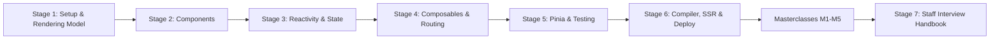

| Stage | Focus Domain | Core Concepts & Engineering Outcomes |
| :--- | :--- | :--- |
| **Stage 1** | **Setup, Project Anatomy & the Rendering Model** | `npm create vue@latest`, Vite dev server vs `vite build`, SFC blocks (`<script setup>`, `<template>`, `<style scoped>`), `createApp().use().mount()`, template → render function → VNode → DOM. Outcome: run, read and build the starter. |
| **Stage 2** | **Components, Templates, Props & Events** | Directives (`v-if`, `v-for` + `:key`, `v-on` modifiers, `v-model` modifiers), `defineProps<T>()` with reactive destructure, `defineEmits` tuple syntax, `defineModel()`, default/named/scoped slots with `defineSlots`, fallthrough attrs, typed `provide`/`inject`. Outcome: a typed component library for a task board. |
| **Stage 3** | **Reactivity & State** | `track`/`trigger`, `ref` vs `reactive`, unwrapping rules, `computed` caching, `watch` vs `watchEffect`, flush timing, `nextTick`, `shallowRef`/`markRaw`, lifecycle hooks, `useTemplateRef`. Outcome: the `useTasks` composable and its tests. |
| **Stage 4** | **Composables, Data Fetching & Routing** | Composable conventions, `MaybeRefOrGetter` + `toValue`, abortable `useFetch`, `useLocalStorage`, `effectScope`/`onScopeDispose`, Vue Router lazy routes and navigation guards. |
| **Stage 5** | **Pinia, Forms & Testing** | Setup vs option stores, `storeToRefs`, an auth store, Vitest + Vue Test Utils (`mount`, `trigger`, `emitted`, `setValue`). |
| **Stage 6** | **Compiler, SSR, Performance & Deployment** | Patch flags, static caching, `Teleport`, `Suspense`, hydration mismatches, cross-request state, multi-stage Docker image on unprivileged nginx. |
| **Masterclasses** | **Reactivity internals, generic components, accessible overlays, real-time composables, flagship dashboard** | Dependency graph and scheduler internals, `generic="T"` components, `Teleport` dialogs with focus handling, WebSocket and `customRef` composables, an end-to-end blueprint. |
| **Stage 7** | **Staff Interview Handbook** | 52 interview Q&As across core concepts, internals, architecture and debugging scenarios, plus a one-page cheatsheet. |

**Language of the examples.** Every example and the starter project use **TypeScript** inside Vue single-file components. Vue's own tooling (`create-vue`, `vue-tsc`, Volar, Pinia, Vue Router) is written for and tested with TypeScript, the official scaffolder offers it by default, and type-based `defineProps<T>()` / `defineEmits<T>()` only exist with `lang="ts"`. Tests use Vitest, the runner the Vue team maintains alongside Vite.

---

## 🆕 Vue Versions, What's New & Migration

### V.1 Release Timeline

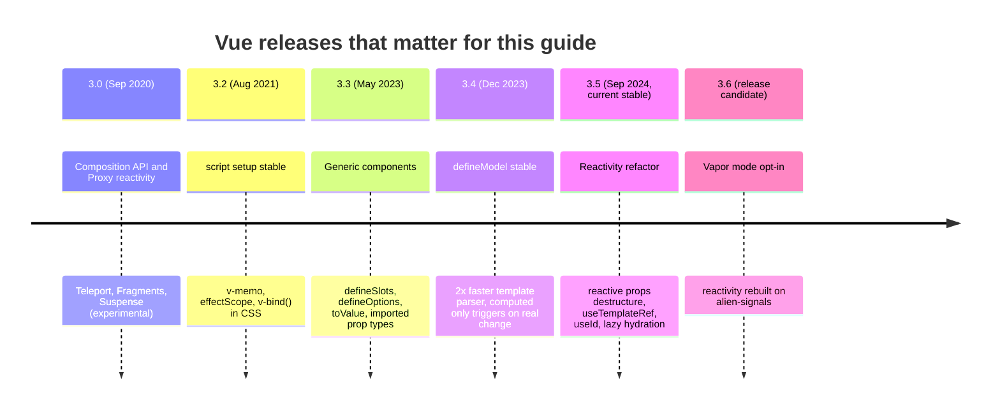

### V.2 Compatibility Matrix

Vue supports only the latest minor of the current major, so "supported" below means "receives fixes".

| Vue | Released | Supported until | Node for tooling | Matching tooling | Notes |
| --- | --- | --- | --- | --- | --- |
| 3.6 | release candidate | not yet released | 20.19+ / 22.12+ | Vite 8, `@vitejs/plugin-vue` 6 | Vapor mode is opt-in per component. Do not ship RCs to production. |
| 3.5 | Sep 2024 | current stable | 20.19+ / 22.12+ (Vite 8), 22.12+ (Vitest 5) | Vite 8, Pinia 4, Vue Router 5, vue-tsc 3 | Target of this guide and the starter. |
| 3.4 | Dec 2023 | superseded by 3.5 | 18+ | Vite 5, Pinia 2, Vue Router 4 | Upgrade is drop-in for almost every app. |
| 2.7 | Jul 2022 | end of life on 31 Dec 2023 | 14+ | Vue CLI / Vite 4 | Backports Composition API to Vue 2. No more security fixes. |

### V.3 What's New in 3.5

#### Reactive props destructure

Before 3.5, destructuring `defineProps()` copied the values once and lost reactivity, so you used `withDefaults` and `props.x`. In 3.5 the compiler rewrites each destructured name into a `__props.name` access, so the variable stays reactive and defaults use normal JavaScript syntax.

```vue
<!-- before (3.4) -->
<script setup lang="ts">
const props = withDefaults(defineProps<{ size?: number }>(), { size: 16 });
const px = computed(() => `${props.size}px`);
</script>
```

```vue
<!-- after (3.5) -->
<script setup lang="ts">
import { computed, watch } from 'vue';
const { size = 16 } = defineProps<{ size?: number }>();
const px = computed(() => `${size}px`);
// Passing `size` itself to watch() would pass a number. Wrap it in a getter.
watch(() => size, (next) => console.log('size changed', next));
</script>
```

#### `useTemplateRef()`

Template refs used to require a `ref()` whose variable name matched the `ref` attribute. `useTemplateRef` looks the element up by a string key, so the variable can have any name and the lookup works inside composables.

```vue
<!-- before -->
<script setup lang="ts">
import { onMounted, ref } from 'vue';
const search = ref<HTMLInputElement | null>(null);
onMounted(() => search.value?.focus());
</script>
<template><input ref="search" /></template>
```

```vue
<!-- after -->
<script setup lang="ts">
import { onMounted, useTemplateRef } from 'vue';
const input = useTemplateRef<HTMLInputElement>('search');
onMounted(() => input.value?.focus());
</script>
<template><input ref="search" /></template>
```

#### `useId()`

Generates ids that are stable between server render and hydration, which hand-rolled counters are not.

```vue
<script setup lang="ts">
import { useId } from 'vue';
const id = useId();
</script>

<template>
  <label :for="id">Email</label>
  <input :id="id" type="email" />
</template>
```

#### `onWatcherCleanup()` and watcher `pause` / `resume`

Cleanup no longer has to come through the callback's third argument, so helper functions called from a watcher can register their own cleanup. Watch handles now also expose `pause()` and `resume()`.

```ts
// before
watch(id, (value, _old, onCleanup) => {
  const controller = new AbortController();
  onCleanup(() => controller.abort());
  fetch(`/api/items/${value}`, { signal: controller.signal });
});
```

```ts
// after
import { onWatcherCleanup, ref, watch } from 'vue';

const id = ref(1);
const { pause, resume, stop } = watch(id, (value) => {
  const controller = new AbortController();
  onWatcherCleanup(() => controller.abort());
  fetch(`/api/items/${value}`, { signal: controller.signal });
});
```

#### Deferred Teleport and lazy hydration

`<Teleport defer>` resolves its target after the current render, so the target may be rendered later in the same template. Async components can choose when to hydrate during SSR.

```vue
<script setup lang="ts">
import { defineAsyncComponent, hydrateOnVisible } from 'vue';

const Comments = defineAsyncComponent({
  loader: () => import('./Comments.vue'),
  hydrate: hydrateOnVisible(), // hydrate only when scrolled into view
});
</script>

<template>
  <Teleport defer to="#sidebar"><p>Rendered into the sidebar</p></Teleport>
  <aside id="sidebar"></aside>
  <Comments />
</template>
```

#### Reactivity refactor

The dependency tracking system was rewritten around doubly linked lists of dependency links and version counters. The Vue team reported about 56% lower memory use and much faster operations on large, deeply reactive arrays, with no API change. [M1](#m1-masterclass-inside-the-reactivity-system) explains the data structures.

### V.4 Migration Guide (3.4 → 3.5, and Vue 2 → 3)

```bash
# 3.4 -> 3.5: drop-in upgrade, then update the tooling that pins Vue's compiler.
npm install vue@^3.5 pinia@latest vue-router@latest
npm install -D @vitejs/plugin-vue@latest vue-tsc@latest vite@latest vitest@latest @vue/test-utils@latest
npx vue-tsc --noEmit         # type errors surface stricter emit / slot typings
npx vitest run               # test suite should pass unchanged
```

After the upgrade you can delete `withDefaults` calls one component at a time by switching to destructured defaults; both styles keep working.

For Vue 2 applications, the path that keeps the app running during the move is the migration build:

```bash
npm install vue@^3.5 @vue/compat@^3.5
npm install -D @vitejs/plugin-vue@latest
```

```ts
// vite.config.ts during the migration only
import { defineConfig } from 'vite';
import vue from '@vitejs/plugin-vue';

export default defineConfig({
  resolve: { alias: { vue: '@vue/compat' } },
  plugins: [
    vue({ template: { compilerOptions: { compatConfig: { MODE: 2 } } } }),
  ],
});
```

Run the app, fix each deprecation warning the compat build logs, switch individual components to `compatConfig: { MODE: 3 }`, and remove the alias once the console is clean.

### V.5 Deprecations & Breaking Changes

| Version | Deprecated / removed | Replacement | What breaks and how to fix it |
| --- | --- | --- | --- |
| 3.0 | `Vue.set`, `Vue.delete`, `$set` | Plain assignment and `delete` | Proxies see new keys and deletions; delete the helper calls. |
| 3.0 | Filters (`{{ price \| currency }}`) | Functions or `computed` | Template compile error; call `formatCurrency(price)` instead. |
| 3.0 | `.sync` modifier, `model` option | `v-model:propName` | Rename `:title.sync` to `v-model:title` and emit `update:title`. |
| 3.0 | `$listeners`, `$on`/`$off`/`$once` | Listeners live in `$attrs`; use `mitt` or props for event buses | Global event buses stop working; move to props/emits, `provide`/`inject` or a store. |
| 3.0 | `v-if` and `v-for` precedence | `v-if` now wins on the same element | `v-if` can no longer see the `v-for` variable; move the `v-for` to a wrapping `<template>`. |
| 3.4 | Reactivity Transform (`$ref`, `$computed`) | Plain `ref()`, or Vue Macros if you must keep it | Removed from core; compile error on `$ref`. |
| 3.5 | `propsDestructure` compiler flag | On by default | Delete the flag from `vite.config.ts`. |
| Ecosystem | Vuex | Pinia | Vuex is in maintenance mode; port modules to setup stores (see [Stage 5](#5-stage-5-pinia-forms--testing)). |
| Ecosystem | Vue 2.7 | Vue 3.5 | No security fixes since 31 Dec 2023; plan the migration build path above. |

## 📋 Table of Contents

- [🆕 Vue Versions, What's New & Migration](#-vue-versions-whats-new--migration)
- [1. Stage 1: Setup, Project Anatomy & the Rendering Model](#1-stage-1-setup-project-anatomy--the-rendering-model)
  - [1.1 What Vue Is and the Problem It Solves](#11-what-vue-is-and-the-problem-it-solves)
  - [1.2 Installing the Toolchain and Creating a Project](#12-installing-the-toolchain-and-creating-a-project)
  - [1.3 Project Anatomy: Every File in the Starter](#13-project-anatomy-every-file-in-the-starter)
  - [1.4 The Single-File Component (SFC) Anatomy](#14-the-single-file-component-sfc-anatomy)
  - [1.5 Line-by-Line Breakdown: A Metric Card Component](#15-line-by-line-breakdown-a-metric-card-component)
  - [1.6 Bootstrapping the Application in `main.ts`](#16-bootstrapping-the-application-in-maints)
  - [1.7 The Rendering Model: Template → Render Function → Virtual DOM → DOM](#17-the-rendering-model-template--render-function--virtual-dom--dom)
  - [1.8 Options API vs Composition API](#18-options-api-vs-composition-api)
  - [1.9 Vite: Dev Server vs Production Build, Environment Variables](#19-vite-dev-server-vs-production-build-environment-variables)
  - [1.10 Pitfalls](#110-pitfalls)
  - [1.11 Best Practices](#111-best-practices)
  - [1.12 Hands-on Exercise](#112-hands-on-exercise)
- [2. Stage 2: Components, Templates, Props & Events](#2-stage-2-components-templates-props--events)
  - [2.1 Template Syntax and Directives](#21-template-syntax-and-directives)
  - [2.2 Conditional and List Rendering](#22-conditional-and-list-rendering)
  - [2.3 Event Handling and Modifiers](#23-event-handling-and-modifiers)
  - [2.4 Form Input Bindings with `v-model`](#24-form-input-bindings-with-v-model)
  - [2.5 Typed Props with `defineProps`](#25-typed-props-with-defineprops)
  - [2.6 Typed Events with `defineEmits`](#26-typed-events-with-defineemits)
  - [2.7 Two-Way Component Binding with `defineModel()`](#27-two-way-component-binding-with-definemodel)
  - [2.8 Slots: Default, Named, Scoped and Fallback](#28-slots-default-named-scoped-and-fallback)
  - [2.9 Fallthrough Attributes and `inheritAttrs`](#29-fallthrough-attributes-and-inheritattrs)
  - [2.10 Dependency Injection with `provide` and `inject`](#210-dependency-injection-with-provide-and-inject)
  - [2.11 Dynamic, Async and Cached Components](#211-dynamic-async-and-cached-components)
  - [2.12 Pitfalls](#212-pitfalls)
  - [2.13 Best Practices](#213-best-practices)
  - [2.14 Hands-on Exercise](#214-hands-on-exercise)
- [3. Stage 3: Reactivity & State](#3-stage-3-reactivity--state)
  - [3.1 How Proxy-Based Dependency Tracking Works](#31-how-proxy-based-dependency-tracking-works)
  - [3.2 `ref()` in Depth and the Unwrapping Rules](#32-ref-in-depth-and-the-unwrapping-rules)
  - [3.3 `reactive()` and Its Limits](#33-reactive-and-its-limits)
  - [3.4 `computed()`: Lazy, Cached, Derived State](#34-computed-lazy-cached-derived-state)
  - [3.5 `watch()` vs `watchEffect()` and Flush Timing](#35-watch-vs-watcheffect-and-flush-timing)
  - [3.6 The Update Scheduler and `nextTick()`](#36-the-update-scheduler-and-nexttick)
  - [3.7 Shallow APIs, `markRaw`, `toRaw` and `readonly`](#37-shallow-apis-markraw-toraw-and-readonly)
  - [3.8 Lifecycle Hooks and Template Refs](#38-lifecycle-hooks-and-template-refs)
  - [3.9 Where State Lives: Local, Composable, Provided or Store](#39-where-state-lives-local-composable-provided-or-store)
  - [3.10 Pitfalls](#310-pitfalls)
  - [3.11 Best Practices](#311-best-practices)
  - [3.12 Hands-on Exercise](#312-hands-on-exercise)
- [4. Stage 4: Composables, Data Fetching & Routing](#4-stage-4-composables-data-fetching--routing)
  - [4.1 Composable Design Principles](#41-composable-design-principles)
  - [4.2 Production Composable: `useFetch` with Abort Support](#42-production-composable-usefetch-with-abort-support)
  - [4.3 Production Composable: `useLocalStorage`](#43-production-composable-uselocalstorage)
  - [4.4 Effect Cleanup with `effectScope` and `onScopeDispose`](#44-effect-cleanup-with-effectscope-and-onscopedispose)
  - [4.5 Vue Router: Routes, Lazy Loading and Navigation Guards](#45-vue-router-routes-lazy-loading-and-navigation-guards)
  - [4.6 Pitfalls](#46-pitfalls)
  - [4.7 Best Practices](#47-best-practices)
- [5. Stage 5: Pinia, Forms & Testing](#5-stage-5-pinia-forms--testing)
  - [5.1 The Pinia Store Architecture: Setup Stores vs Option Stores](#51-the-pinia-store-architecture-setup-stores-vs-option-stores)
  - [5.2 Production Auth Store](#52-production-auth-store)
  - [5.3 Component Testing with Vitest & Vue Test Utils](#53-component-testing-with-vitest--vue-test-utils)
  - [5.4 Pitfalls](#54-pitfalls)
  - [5.5 Best Practices](#55-best-practices)
- [6. Stage 6: Compiler, SSR, Performance & Deployment](#6-stage-6-compiler-ssr-performance--deployment)
  - [6.1 Compiler-Informed Virtual DOM (Patch Flags & Static Caching)](#61-compiler-informed-virtual-dom-patch-flags--static-caching)
  - [6.2 Teleport and Suspense](#62-teleport-and-suspense)
  - [6.3 SSR Hydration and Cross-Request State](#63-ssr-hydration-and-cross-request-state)
  - [6.4 Deploying the Starter: Multi-Stage Docker on Unprivileged nginx](#64-deploying-the-starter-multi-stage-docker-on-unprivileged-nginx)
  - [6.5 Pitfalls](#65-pitfalls)
  - [6.6 Best Practices](#66-best-practices)
- [M1. Masterclass: Inside the Reactivity System](#m1-masterclass-inside-the-reactivity-system)
  - [M1.1 How It Works Internally: Deps, Links and Version Counters](#m11-how-it-works-internally-deps-links-and-version-counters)
  - [M1.2 Worked Example: Proving the Computed Short-Circuit](#m12-worked-example-proving-the-computed-short-circuit)
  - [M1.3 Trade-offs: Vue Refs vs Other Reactivity Models](#m13-trade-offs-vue-refs-vs-other-reactivity-models)
  - [M1.4 Production Checklist](#m14-production-checklist)
- [M2. Masterclass: Generic Typed Components](#m2-masterclass-generic-typed-components)
  - [M2.1 How It Works Internally](#m21-how-it-works-internally)
  - [M2.2 Complete Worked Example: `DataTable.vue`](#m22-complete-worked-example-datatablevue)
  - [M2.3 Trade-offs vs Alternatives](#m23-trade-offs-vs-alternatives)
  - [M2.4 Production Checklist](#m24-production-checklist)
- [M3. Masterclass: Accessible Overlays with Teleport](#m3-masterclass-accessible-overlays-with-teleport)
  - [M3.1 How It Works Internally](#m31-how-it-works-internally)
  - [M3.2 Complete Worked Example: `ModalDialog.vue`](#m32-complete-worked-example-modaldialogvue)
  - [M3.3 Trade-offs vs Alternatives](#m33-trade-offs-vs-alternatives)
  - [M3.4 Production Checklist](#m34-production-checklist)
- [M4. Masterclass: Real-Time Composables](#m4-masterclass-real-time-composables)
  - [M4.1 How It Works Internally: The Connection Lifecycle](#m41-how-it-works-internally-the-connection-lifecycle)
  - [M4.2 Complete Worked Example: `useWebSocket` and a Debounced Ref](#m42-complete-worked-example-usewebsocket-and-a-debounced-ref)
  - [M4.3 Trade-offs: WebSocket vs Server-Sent Events vs Polling](#m43-trade-offs-websocket-vs-server-sent-events-vs-polling)
  - [M4.4 Production Checklist](#m44-production-checklist)
- [M5. Masterclass: Flagship Blueprint: A Production Task Dashboard](#m5-masterclass-flagship-blueprint-a-production-task-dashboard)
  - [M5.1 How It Fits Together](#m51-how-it-fits-together)
  - [M5.2 Worked Example: The Starter as Phase One](#m52-worked-example-the-starter-as-phase-one)
  - [M5.3 Trade-offs: SPA vs SSR for the Dashboard](#m53-trade-offs-spa-vs-ssr-for-the-dashboard)
  - [M5.4 Production Checklist](#m54-production-checklist)
- [7. Stage 7: Staff Vue Architect Interview Handbook & Cheatsheet](#7-stage-7-staff-vue-architect-interview-handbook--cheatsheet)
  - [7.1 Core Concepts (Q1-Q17)](#71-core-concepts-q1-q17)
  - [7.2 Internals & Performance (Q18-Q34)](#72-internals--performance-q18-q34)
  - [7.3 Architecture & Design (Q35-Q46)](#73-architecture--design-q35-q46)
  - [7.4 Scenario & Debugging Questions (Q47-Q52)](#74-scenario--debugging-questions-q47-q52)
  - [7.5 Staff Cheatsheet](#75-staff-cheatsheet)
- [🧪 Example Projects](#-example-projects)
- [📝 Cheat Sheets](#-cheat-sheets)
- [📚 Resources](#-resources)
- [🤝 Contributing](#-contributing)
- [📄 License](#-license)
- [🙏 Acknowledgments](#-acknowledgments)
- [🌐 Connect with me](#-connect-with-me)
- [☕ Support](#-support)

---

## 1. Stage 1: Setup, Project Anatomy & the Rendering Model

This stage gets a Vue project running and explains what each file in it does. You need Node 22.12 or newer and working knowledge of HTML, CSS and modern JavaScript. By the end you can scaffold a project, read every line of the starter, and explain how a template becomes DOM nodes.

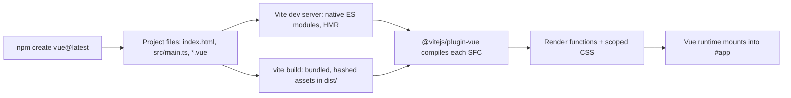

### 1.1 What Vue Is and the Problem It Solves

Vue is a UI framework built around one idea: you describe the page as a function of state, and Vue keeps the DOM in sync when the state changes. You never write `element.textContent = ...` by hand. You change a variable, and the parts of the page that read that variable update.

Three pieces make that work:

| Piece | Job | Where you see it |
| --- | --- | --- |
| Reactivity system (`@vue/reactivity`) | Records which code read which state, and re-runs that code when the state changes. | `ref()`, `reactive()`, `computed()`, `watch()` |
| Template compiler (`@vue/compiler-sfc`) | Turns HTML-like templates into optimised JavaScript render functions at build time. | `<template>` blocks in `.vue` files |
| Renderer (`@vue/runtime-dom`) | Runs render functions, diffs the virtual DOM tree and patches the real DOM. | `createApp(App).mount('#app')` |

Vue calls itself progressive because you can stop at any layer. A single `<script type="module">` tag can enhance one server-rendered page; the same framework scales to a single-page app with routing, a store and SSR.

How it compares with the frameworks people usually weigh it against:

| Concern | Vue 3.5 | React | Svelte 5 | Angular |
| --- | --- | --- | --- | --- |
| Templates | HTML-based templates compiled ahead of time; JSX optional | JSX | Svelte markup compiled to imperative DOM code | HTML templates with control-flow blocks |
| Fine-grained reactivity | Yes, Proxy-based refs; components re-render only when their own dependencies change | No; a state change re-renders the component subtree unless memoised or compiled by React Compiler | Yes, runes (`$state`, `$derived`) | Yes, signals |
| Official router and store | Vue Router, Pinia | None official | SvelteKit routing; stores built in | Router built in; signals or services for state |
| Styling | `<style scoped>`, CSS modules and `v-bind()` in CSS built into the SFC format | Bring your own | Scoped styles built in | Component styles with emulated encapsulation |
| Learning curve | Low to start; Composition API adds depth later | Low to start; hooks rules take practice | Low | Steepest; DI, modules and RxJS history |

### 1.2 Installing the Toolchain and Creating a Project

`create-vue` is the official scaffolder. It generates a Vite project and asks which extras to include.

```bash
node --version             # must print v22.12.0 or newer for Vite 8 + Vitest 5
npm create vue@latest my-app
# Answer the prompts: TypeScript yes, Pinia yes, Vitest yes, ESLint yes, Prettier yes.
cd my-app
npm install
npm run dev                # http://localhost:5173 with hot module replacement
```

To run this guide's starter instead:

```bash
git clone https://github.com/TheLearningHubOrg/learn-vue.git
cd learn-vue
npm ci                     # installs exactly what package-lock.json lists
npm run dev                # development server
npm test                   # Vitest, 34 tests across 7 files
npm run lint               # ESLint with eslint-plugin-vue and typescript-eslint
npm run build              # vue-tsc type check, then vite build into dist/
```

| Script | Command it runs | Use it for |
| --- | --- | --- |
| `dev` | `vite` | Local development. Serves source files as ES modules and swaps edited components in place. |
| `build` | `vue-tsc --noEmit && vite build` | Production output. `vue-tsc` type-checks `.vue` files, which `tsc` alone cannot read. |
| `preview` | `vite preview` | A quick look at `dist/` locally. It is not a production server. |
| `test` | `vitest run` | One pass of the test suite, as CI runs it. |
| `test:watch` | `vitest` | Re-runs affected tests on save. |
| `lint` | `eslint .` | Template and script correctness rules. |

The starter pins TypeScript to the 6.0 line because typescript-eslint's supported range currently stops below 6.1. Revisit the pin when its peer range moves.

### 1.3 Project Anatomy: Every File in the Starter

```text
learn-vue/
├── index.html                  entry HTML; Vite injects the bundle here
├── vite.config.ts              Vite plugins and the Vitest config block
├── tsconfig.json               strict TypeScript, bundler module resolution
├── eslint.config.js            flat ESLint config for .vue and .ts files
├── src/
│   ├── main.ts                 createApp, install Pinia, mount
│   ├── App.vue                 root component composing the board
│   ├── types.ts                Task, TaskStatus, StatusFilter, TaskSummary
│   ├── theme.ts                typed provide/inject for the colour theme
│   ├── lib/tasks.ts            pure functions: filterTasks, summarize, nextStatus
│   ├── composables/useTasks.ts reactive feature state built on lib/tasks.ts
│   ├── stores/counter.ts       Pinia setup store
│   ├── data/seed.ts            initial tasks
│   └── components/
│       ├── BaseCard.vue        default, named and fallback slots
│       ├── MetricCard.vue      typed props with reactive destructure, typed emit
│       ├── TaskFilter.vue      two defineModel bindings
│       ├── TaskForm.vue        form with v-model modifiers and submit.prevent
│       ├── TaskList.vue        v-for with keys, scoped slot, emits
│       └── ThemeToggle.vue     inject consumer
├── tests/                      Vitest + @vue/test-utils specs
├── docker/nginx.conf           SPA fallback, /health, long-cache for hashed assets
└── Dockerfile                  node:24-alpine build, nginx-unprivileged runtime
```

The split between `lib/`, `composables/` and `components/` is deliberate. `lib/tasks.ts` has no Vue import, so its logic is tested as plain functions. `useTasks.ts` wraps that logic in reactive state. Components only render and forward events. When a bug appears, you know which layer to open.

### 1.4 The Single-File Component (SFC) Anatomy

A `.vue` file holds one component's logic, markup and styles. The browser cannot run it directly; `@vitejs/plugin-vue` splits it into blocks and hands each to the right compiler.

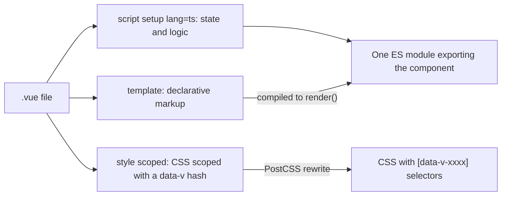

| Block | Compiled by | Output |
| --- | --- | --- |
| `<script setup lang="ts">` | `compileScript`, then Vite's TypeScript transform | A `setup()` function. Every top-level binding (variables, functions, imports) becomes available to the template. |
| `<template>` | `compileTemplate` | A render function with patch flags and cached static nodes (see [Stage 6](#6-stage-6-compiler-ssr-performance--deployment)). |
| `<style scoped>` | PostCSS plugin | Selectors rewritten to `.card[data-v-7ba5bd90]`; the same attribute is stamped on the component's elements. |
| `<style module>` | CSS Modules | Class names hashed and exposed as `$style` / `useCssModule()`. |

You can use a plain `<script>` next to `<script setup>` when you need something that runs once per module rather than once per instance, such as a named export.

### 1.5 Line-by-Line Breakdown: A Metric Card Component

This standalone component shows the three blocks working together. It fakes a network call so you can watch `ref`, `computed` and an event handler interact.

```vue
<script setup lang="ts">
import { ref, computed } from 'vue';

// 1. Reactive state initialization with ref()
const requestCount = ref<number>(14280);
const errorCount = ref<number>(12);
const isRefreshing = ref<boolean>(false);

// 2. Pure memoized derived state with computed()
const errorRatePercentage = computed<string>(() => {
  if (requestCount.value === 0) return '0.00%';
  return ((errorCount.value / requestCount.value) * 100).toFixed(3) + '%';
});

// 3. Methods / Event handlers
async function refreshTelemetry() {
  isRefreshing.value = true;
  try {
    await new Promise((resolve) => setTimeout(resolve, 800));
    requestCount.value += Math.floor(Math.random() * 500);
  } finally {
    isRefreshing.value = false;
  }
}
</script>

<template>
  <div class="metric-card">
    <div class="header">
      <span class="label">Ingress Traffic</span>
      <span class="badge font-mono">{{ errorRatePercentage }} error</span>
    </div>
    <div class="metric-value font-mono">
      {{ requestCount.toLocaleString() }}
    </div>
    <div class="actions">
      <button :disabled="isRefreshing" @click="refreshTelemetry">
        <span v-if="isRefreshing">Querying cluster...</span>
        <span v-else>Sync Telemetry</span>
      </button>
    </div>
  </div>
</template>

<style scoped>
.metric-card {
  padding: 1.5rem;
  background: #0f172a;
  border: 1px solid #1e293b;
  border-radius: 1rem;
  color: #f8fafc;
}
.header {
  display: flex;
  justify-content: space-between;
  align-items: center;
}
.metric-value {
  font-size: 2rem;
  font-weight: 700;
  margin-top: 0.5rem;
}
</style>
```

| Syntax construct | Underlying Mechanism | Architectural Purpose |
| :--- | :--- | :--- |
| `<script setup lang="ts">` | Compile-time SFC syntactic sugar | Top-level variables and functions are automatically exposed directly to the template without `return {}`. |
| `ref<number>(14280)` | Reactive reference wrapper object (`{ value: ... }`) | Wraps primitive values in an object whose `.value` getter/setter triggers dependency tracking. |
| `computed(...)` | Cached dependency evaluation | Only recalculates when `errorCount` or `requestCount` dependencies mutate. |
| `{{ requestCount.toLocaleString() }}` | Text interpolation; top-level refs are unwrapped | The template reads `requestCount`, not `requestCount.value`. |
| `:disabled="isRefreshing"` | `v-bind` directive shorthand | Dynamically binds HTML button disabled attribute to reactive boolean. |
| `@click="refreshTelemetry"` | `v-on` event listener shorthand | Binds click event handler with automatic event-cleanup when component unmounts. |
| `v-if` / `v-else` | Conditional branches compiled to a ternary in the render function | Only one `<span>` exists in the DOM at a time. |
| `try { … } finally { … }` | Plain JavaScript | The button re-enables even if the request throws. |
| `<style scoped>` | PostCSS attribute scoping (`data-v-xxxxxx`) | Isolates CSS rules to this component only, preventing global leakage. |

The starter's [`src/components/MetricCard.vue`](src/components/MetricCard.vue) is the reusable version of this card: it takes the label and value as props instead of owning the state, which is the step [Stage 2](#2-stage-2-components-templates-props--events) teaches.

### 1.6 Bootstrapping the Application in `main.ts`

```ts
// src/main.ts
import { createApp } from 'vue';
import { createPinia } from 'pinia';
import App from './App.vue';
import './style.css';

const app = createApp(App);

app.use(createPinia());

app.config.errorHandler = (err, _instance, info) => {
  // One place to forward render and lifecycle errors to monitoring.
  console.error(`[vue] ${info}:`, err);
};

app.mount('#app');
```

| Line / API | Role | What happens at runtime |
| :--- | :--- | :--- |
| `createApp(App)` | Creates an application instance | Nothing renders yet. The instance holds config, global components, directives and provides for this app only, so two apps on one page do not share them. |
| `app.use(createPinia())` | Installs a plugin | Calls the plugin's `install(app)`. Pinia registers itself with `app.provide` so `useXStore()` can find it. |
| `app.config.errorHandler` | Global error hook | Receives errors thrown in render functions, lifecycle hooks, watchers and event handlers. `info` names the source, for example `render function` or `mounted hook`. |
| `import './style.css'` | Global stylesheet | Vite injects a `<style>` tag in dev and emits a hashed CSS file in the build. |
| `app.mount('#app')` | Renders the root component | Runs `App`'s `setup()`, renders it, replaces the content of `#app` and returns the root component instance. Call it after all `use()` calls. |

### 1.7 The Rendering Model: Template → Render Function → Virtual DOM → DOM

The compiler turns each template into a render function that returns virtual nodes (VNodes), plain objects describing elements. The runtime compares the new VNode tree with the previous one and applies only the differences to the real DOM.

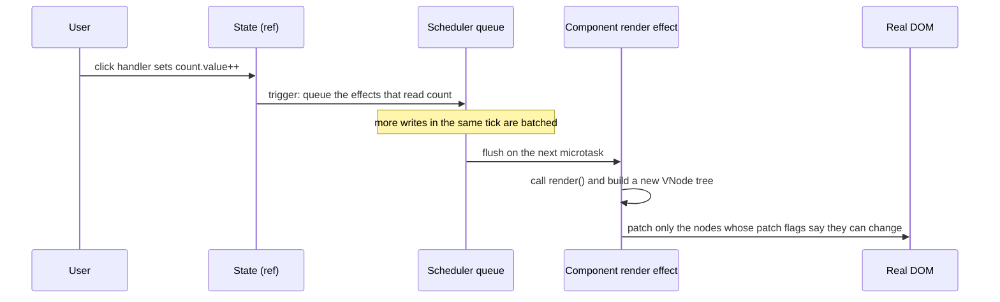

You can see the compiler's output for yourself. The starter's [`tests/compiler.spec.ts`](tests/compiler.spec.ts) compiles templates with `vue/compiler-sfc` and asserts on the generated code:

```ts
import { compileTemplate } from 'vue/compiler-sfc';

const { code } = compileTemplate({
  source: '<p :class="cls">{{ msg }}</p>',
  filename: 'Demo.vue',
  id: 'demo',
});
console.log(code);
// ... _createElementBlock("p", { class: _normalizeClass(_ctx.cls) },
//       _toDisplayString(_ctx.msg), 3 /* TEXT, CLASS */)
```

The trailing `3 /* TEXT, CLASS */` is a patch flag: a bitmask telling the runtime that only this element's text and class can change. When the component re-renders, the runtime checks those two things and skips everything else on the node. That is why Vue templates often outperform hand-written render functions: the compiler knows which parts are static.

### 1.8 Options API vs Composition API

Vue offers two ways to write a component's logic. Both compile to the same runtime and can coexist in one project.

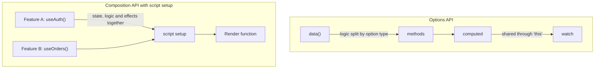

The same counter in both styles:

```vue
<!-- Options API -->
<script lang="ts">
import { defineComponent } from 'vue';

export default defineComponent({
  data: () => ({ count: 0 }),
  computed: {
    double(): number {
      return this.count * 2;
    },
  },
  methods: {
    increment() {
      this.count++;
    },
  },
});
</script>

<template>
  <button @click="increment">{{ count }} (double {{ double }})</button>
</template>
```

```vue
<!-- Composition API -->
<script setup lang="ts">
import { computed, ref } from 'vue';

const count = ref(0);
const double = computed(() => count.value * 2);
const increment = () => count.value++;
</script>

<template>
  <button @click="increment">{{ count }} (double {{ double }})</button>
</template>
```

| Concern | Options API | Composition API (`<script setup>`) |
| --- | --- | --- |
| Code organisation | Grouped by option (`data`, `methods`, `watch`). One feature is spread across several options. | Grouped by feature. A feature can move into a composable unchanged. |
| Reuse | Mixins: name collisions and unclear origin of properties. | Composables: plain functions with explicit inputs and return values. |
| TypeScript | Works through `defineComponent`, but `this` typing has limits. | Inferred from ordinary variables; no `this`. |
| Bundle size | Option names survive minification. | Local variables minify to single letters. |
| When to pick it | Maintaining an existing Options codebase. | New code. This guide uses it everywhere after this section. |

### 1.9 Vite: Dev Server vs Production Build, Environment Variables

In development Vite does not bundle your code. The browser requests `src/main.ts`, Vite compiles that one file on demand and serves it as an ES module, and the browser follows the imports. Editing a component sends a hot update over a WebSocket and Vue swaps the component while keeping its state where possible. `vite build` instead produces a bundled, minified, content-hashed set of files in `dist/` (Vite 8 bundles with Rolldown).

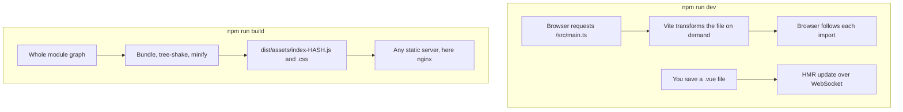

Environment variables reach the client through `import.meta.env`. Only names that start with `VITE_` are exposed, because everything exposed ends up in public JavaScript.

```bash
# .env.production (commit .env.example, never real secrets)
VITE_API_BASE=https://api.example.com
DATABASE_URL=postgres://...   # not exposed: no VITE_ prefix
```

```ts
// src/api.ts
const base = import.meta.env.VITE_API_BASE ?? '/api';
export const isProd = import.meta.env.PROD; // true in vite build output

export async function getJson<T>(path: string): Promise<T> {
  const res = await fetch(`${base}${path}`);
  if (!res.ok) throw new Error(`GET ${path} failed with ${res.status}`);
  return (await res.json()) as T;
}
```

| `import.meta.env` key | Value |
| --- | --- |
| `MODE` | `development` for `vite`, `production` for `vite build`, or whatever `--mode` says |
| `DEV` / `PROD` | Booleans derived from the mode |
| `BASE_URL` | The `base` option, `/` by default; use it when the app is served from a sub-path |
| `VITE_*` | Your own values from `.env`, `.env.local`, `.env.[mode]` |

### 1.10 Pitfalls

| Pitfall | Symptom | Fix |
| --- | --- | --- |
| Old Node version | `You are using Node.js 20.11.0. Vite requires Node.js version 20.19+ or 22.12+.` | Install Node 22.12+ or 24 LTS; pin it in `engines` and CI. |
| Running `vite` or `vite preview` in production | Container answers on 5173 only from inside, or the server is not hardened | Build with `vite build` and serve `dist/` with nginx (see the [Dockerfile](Dockerfile)). |
| Type-checking with `tsc` | `.vue` files are ignored, or `Cannot find module './App.vue'` | Use `vue-tsc --noEmit`, which understands SFCs. |
| Calling `app.use()` after `mount()` | `"getActivePinia()" was called but there was no active Pinia` | Install every plugin before `app.mount()`. |
| Secrets in `VITE_` variables | Keys visible in `dist/assets/*.js` | Keep secrets on the server; expose only public config. |
| Writing `.value` in templates | `{{ count.value }}` renders `undefined` when `count` was unwrapped | Templates unwrap top-level refs; write `{{ count }}`. |
| Global CSS in components | Styles leak into other components | Use `<style scoped>` or CSS modules; keep resets in `style.css`. |
| Opening `index.html` from disk | Blank page, CORS errors for `file://` module scripts | Always go through `npm run dev` or a static server. |

### 1.11 Best Practices

- **Scaffold with `create-vue`**: it keeps Vite, plugin-vue, vue-tsc and ESLint versions compatible with each other.
- **Commit `package-lock.json` and use `npm ci` in CI**: every machine installs the same dependency tree.
- **Use `<script setup lang="ts">` for new components**: less boilerplate, better types and smaller output than `defineComponent` objects.
- **Keep business logic out of `.vue` files**: pure functions in `lib/` test in milliseconds and survive framework upgrades.
- **Set `app.config.errorHandler` early**: unhandled render errors otherwise only reach the console.
- **Type-check in the build script**: Vite strips types without checking them, so a type error would ship silently.
- **Treat everything under `import.meta.env` as public**: it is inlined into the bundle.

### 1.12 Hands-on Exercise

Add a fourth metric card to the starter that shows how many tasks are in progress.

1. Add `inProgress: number` to `TaskSummary` in `src/types.ts` and compute it in `summarize()` in `src/lib/tasks.ts`.
2. Render `<MetricCard label="In progress" :value="summary.inProgress" />` in `src/App.vue`.
3. Extend the `summarize` test in `tests/tasks.spec.ts`.

Expected result: `npm test` passes, and with the seed data the new card shows `1`. Moving a task with "Next status" changes the number without a page reload. The existing "Hours left" card in [`src/App.vue`](src/App.vue) and the `summarize` function in [`src/lib/tasks.ts`](src/lib/tasks.ts) are the worked pattern to copy.

[Back to top ⤴️](#-table-of-contents)

---

## 2. Stage 2: Components, Templates, Props & Events

Components are the unit of reuse in Vue. This stage covers the template language and every channel a component has for talking to others: props in, events out, `v-model` both ways, slots for markup, fallthrough attributes and `provide`/`inject` for deep trees. It assumes Stage 1. By the end you can build and type the starter's task board components yourself.

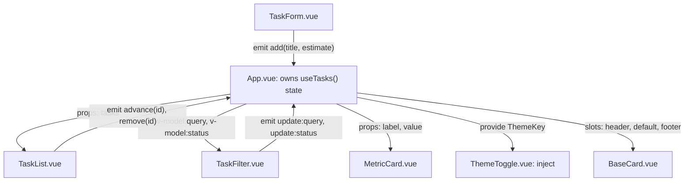

### 2.1 Template Syntax and Directives

Templates are valid HTML plus three additions: `{{ }}` interpolation for text, directives (attributes starting with `v-`), and component tags. Every expression inside them is a JavaScript expression evaluated against the component's scope.

```vue
<script setup lang="ts">
import { ref } from 'vue';

const title = ref('Release checklist');
const url = ref('https://vuejs.org');
const isActive = ref(true);
const html = ref('<em>trusted markup only</em>');
const attrs = { id: 'save', 'aria-label': 'Save changes' };
</script>

<template>
  <h2 :title="title">{{ title.toUpperCase() }}</h2>
  <a :href="url" target="_blank" rel="noopener">Docs</a>
  <!-- same-name shorthand (3.4+): :title is :title="title" -->
  <span :title>hover me</span>
  <p :class="{ active: isActive, muted: !isActive }" :style="{ fontWeight: isActive ? 700 : 400 }">
    Class and style accept objects and arrays.
  </p>
  <button v-bind="attrs">Save</button>
  <div v-html="html"></div>
</template>
```

| Directive | Shorthand | What it does |
| --- | --- | --- |
| `v-bind:attr="expr"` | `:attr="expr"`, or `:attr` when the variable has the same name | Binds an attribute or prop. `v-bind="obj"` spreads an object of attributes. |
| `v-on:event="handler"` | `@event` | Adds an event listener (DOM event or component emit). |
| `v-model="ref"` | none | Two-way binding for inputs and components. |
| `v-if` / `v-else-if` / `v-else` | none | Creates or destroys the element. |
| `v-show="expr"` | none | Toggles `display: none`; the element stays mounted. |
| `v-for="item in list"` | none | Renders a list; needs `:key`. |
| `v-slot:name="props"` | `#name="props"` | Fills a named or scoped slot. |
| `v-html` | none | Sets `innerHTML`. Never use it with user input: it is an XSS hole. |
| `v-text` | none | Sets `textContent`. Same as interpolation for the whole element. |
| `v-once` / `v-memo="[deps]"` | none | Render once / re-render only when listed deps change. |
| `v-pre` / `v-cloak` | none | Skip compilation / hide until mounted (for in-DOM templates). |

Template expressions can call functions and use globals such as `Math` and `Date`, but they cannot declare variables or use statements like `if`. When an expression grows past one line, move it into a `computed`.

### 2.2 Conditional and List Rendering

`v-if` adds and removes elements; `v-show` keeps them and toggles CSS. `v-for` iterates arrays, objects, numbers and anything iterable.

```vue
<script setup lang="ts">
import { ref } from 'vue';

interface Row { id: number; name: string; online: boolean }
const rows = ref<Row[]>([
  { id: 7, name: 'api-1', online: true },
  { id: 9, name: 'api-2', online: false },
]);
const showOffline = ref(false);
</script>

<template>
  <label><input v-model="showOffline" type="checkbox" /> Show offline</label>

  <ul v-if="rows.length > 0">
    <!-- Filter with a wrapping <template>, never v-if on the same element as v-for -->
    <template v-for="(row, index) in rows" :key="row.id">
      <li v-if="row.online || showOffline">{{ index + 1 }}. {{ row.name }}</li>
    </template>
  </ul>
  <p v-else>No servers registered.</p>

  <span v-for="n in 3" :key="n">{{ n }}</span> <!-- renders 1 2 3 -->
</template>
```

The `:key` tells the renderer which DOM node belongs to which item. With stable keys Vue moves existing nodes when the list reorders. With index keys it reuses nodes by position, so local state (an input's text, a child component's data) stays at the old position and appears to jump to a different item.

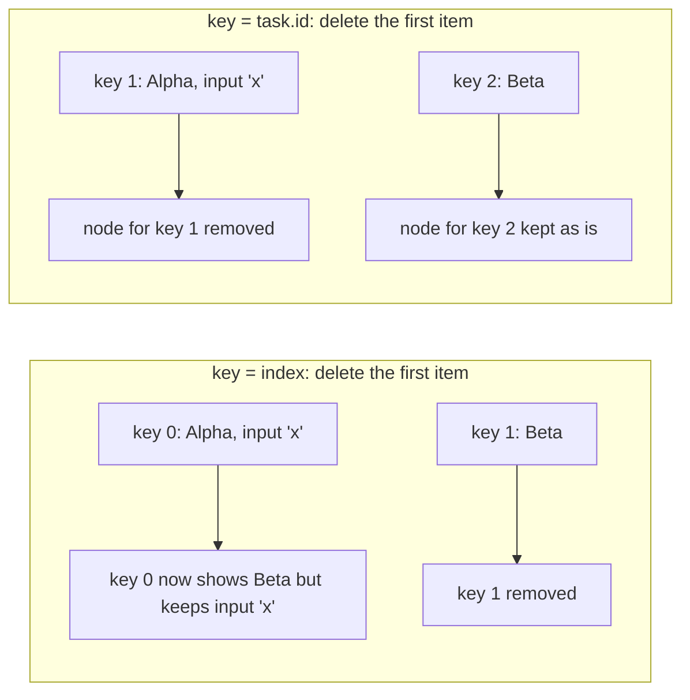

| Choose | When |
| --- | --- |
| `v-if` | The condition rarely changes, or the hidden branch is expensive or must not run its setup. |
| `v-show` | The element toggles often (tabs, dropdowns) and its initial render cost is acceptable. |
| `v-if` on `<template>` | You need to conditionally render several siblings without a wrapper element. |
| Computed filtered list | The filter logic is more than a one-liner, or the same list is used twice. |

### 2.3 Event Handling and Modifiers

`@event` accepts a method name, an inline statement, or an arrow function. Modifiers handle the repetitive parts of DOM events.

```vue
<script setup lang="ts">
function save(event: SubmitEvent) {
  console.log('submitted by', (event.submitter as HTMLButtonElement | null)?.name);
}
function close() {
  console.log('closed');
}
</script>

<template>
  <form @submit.prevent="save">
    <input @keyup.enter="save" @keydown.esc="close" />
    <button name="primary">Save</button>
  </form>
  <div class="overlay" @click.self="close">
    <div class="panel" @click.stop>Clicks inside do not reach the overlay.</div>
  </div>
  <button @click.once="console.log('first click only')">Once</button>
  <div @scroll.passive="() => {}">Scrolling is not blocked by the listener.</div>
  <button @click.ctrl.exact="console.log('ctrl and nothing else')">Ctrl+click</button>
</template>
```

| Modifier | Equivalent | Typical use |
| --- | --- | --- |
| `.prevent` | `event.preventDefault()` | Forms handled in JavaScript, links that act as buttons |
| `.stop` | `event.stopPropagation()` | Clicks inside a panel that must not close the overlay |
| `.self` | Only if `event.target === event.currentTarget` | Backdrop click-to-close |
| `.once` | Listener removed after the first call | One-time onboarding actions |
| `.capture` | `addEventListener(..., { capture: true })` | Intercept before children see the event |
| `.passive` | `{ passive: true }` | Touch and scroll listeners on mobile |
| `.enter`, `.esc`, `.tab`, `.space`, `.up`... | Key filter on `event.key` | Keyboard shortcuts |
| `.ctrl`, `.alt`, `.shift`, `.meta`, `.exact` | Modifier-key filters | Shortcuts that must not fire for other combinations |

### 2.4 Form Input Bindings with `v-model`

On native elements, `v-model` is shorthand for a value binding plus an input listener, and it picks the right pair for each element type. The starter's [`TaskForm.vue`](src/components/TaskForm.vue):

```vue
<script setup lang="ts">
import { ref } from 'vue';

const emit = defineEmits<{
  add: [title: string, estimate: number];
}>();

const title = ref('');
const estimate = ref(1);

function submit() {
  if (title.value.trim() === '') return;
  emit('add', title.value, estimate.value);
  title.value = '';
  estimate.value = 1;
}
</script>

<template>
  <form class="task-form" @submit.prevent="submit">
    <label>
      Title
      <input v-model="title" required data-test="title" />
    </label>
    <label>
      Hours
      <input v-model.number="estimate" type="number" min="1" step="1" data-test="estimate" />
    </label>
    <button type="submit">Add task</button>
  </form>
</template>
```

| Line / API | Role | What happens at runtime |
| :--- | :--- | :--- |
| `v-model="title"` | Text input binding | Sets `value` from `title` and assigns `title.value = $event.target.value` on every `input` event. |
| `v-model.number="estimate"` | Numeric cast | Runs `parseFloat` on the input; if parsing fails the raw string is kept, so still validate. |
| `@submit.prevent="submit"` | Form handler | Pressing Enter in any field submits; `.prevent` stops the page reload. |
| `emit('add', title.value, estimate.value)` | Output | The parent decides what "add" means; the form stays reusable. |
| `title.value = ''` | Reset | The bound input clears because the ref changed. |

| Element | Bound property | Event | Notes |
| --- | --- | --- | --- |
| `<input type="text">`, `<textarea>` | `value` | `input` | `.lazy` switches to `change`; `.trim` trims |
| `<input type="checkbox">` | `checked` | `change` | Bound to an array, it collects the checked `value`s |
| `<input type="radio">` | `checked` | `change` | The ref holds the selected `value` |
| `<select>` | `value` | `change` | With `multiple`, the ref is an array |

### 2.5 Typed Props with `defineProps`

Props are a component's inputs. With `lang="ts"`, declare them as a type and the compiler generates the runtime declaration. Since 3.5 you can destructure them and keep reactivity. The starter's [`MetricCard.vue`](src/components/MetricCard.vue):

```vue
<script setup lang="ts">
// Vue 3.5+: destructured props stay reactive, and defaults use plain JS syntax.
const {
  label,
  value,
  hint,
  variant = 'primary',
} = defineProps<{
  label: string;
  value: number | string;
  hint?: string;
  variant?: 'primary' | 'success' | 'warning';
}>();

const emit = defineEmits<{
  inspect: [label: string];
}>();
</script>

<template>
  <article class="metric" :class="`metric--${variant}`">
    <div class="metric-head">
      <span class="metric-label">{{ label }}</span>
      <span v-if="hint" class="metric-hint">{{ hint }}</span>
    </div>
    <div class="metric-value" data-test="value">{{ value }}</div>
    <button type="button" class="metric-inspect" @click="emit('inspect', label)">Inspect</button>
  </article>
</template>
```

| Line / API | Role | What happens at runtime |
| :--- | :--- | :--- |
| `defineProps<{...}>()` | Compiler macro | No import needed. The compiler reads the type and emits `props: { label: { type: String, required: true }, ... }`. |
| `variant = 'primary'` | Default value | Compiled into the runtime `default`; applies when the parent passes nothing or `undefined`. |
| `{{ label }}` | Reactive read | Compiled to `__props.label`, so the template updates when the parent passes a new label. |
| `value: number \| string` | Union type | Becomes `type: [Number, String]`; in development a wrong type logs a warning. |
| `hint?: string` | Optional prop | `undefined` when omitted; `v-if="hint"` hides the badge. |

Props flow one way. A child must not assign to a prop; Vue warns `Attempting to mutate prop "label". Props are readonly.` If a child needs an editable copy, initialise a local `ref(label)` and accept that it will not follow later parent changes, or use `defineModel` (2.7) for genuine two-way state.

Watching a destructured prop needs a getter, because `label` in plain script is just the current value:

```ts
import { watch } from 'vue';
// inside the same <script setup> as the destructure above
watch(() => label, (next, prev) => console.log(`label ${prev} -> ${next}`));
```

Runtime declarations still exist for JavaScript projects or custom validators:

```ts
const props = defineProps({
  status: {
    type: String,
    required: true,
    validator: (v: string) => ['todo', 'doing', 'done'].includes(v),
  },
});
```

### 2.6 Typed Events with `defineEmits`

Events are a component's outputs. The named-tuple syntax (3.3+) declares each event and its argument list:

```vue
<script setup lang="ts">
import type { Task } from '../types';

defineProps<{ tasks: Task[] }>();

const emit = defineEmits<{
  advance: [id: number];
  remove: [id: number];
}>();
</script>

<template>
  <ul>
    <li v-for="task in tasks" :key="task.id">
      {{ task.title }}
      <button type="button" @click="emit('advance', task.id)">Next status</button>
      <button type="button" @click="emit('remove', task.id)">Remove</button>
    </li>
  </ul>
</template>
```

The parent listens with `@advance="advance"`. Calling `emit('advance', 'x')` fails type-checking, and in the parent the handler's parameter is inferred as `number`.

| Line / API | Role | What happens at runtime |
| :--- | :--- | :--- |
| `defineEmits<{ advance: [id: number] }>()` | Declares the event | Generates `emits: ['advance', 'remove']`. Declared events are removed from fallthrough attributes. |
| `emit('advance', task.id)` | Fires the event | Vue looks up `onAdvance` on the parent's VNode props and calls it synchronously. |
| `@advance="advance"` (parent) | Listener | Compiled to the prop `onAdvance`. Component events do not bubble; only the direct parent hears them. |

Because component events do not bubble, a grandparent that needs to know must be wired explicitly, or the state must live higher (a composable, `provide`/`inject`, or a store).

### 2.7 Two-Way Component Binding with `defineModel()`

Before 3.4, two-way binding on a component meant declaring a `modelValue` prop, emitting `update:modelValue`, and usually a writable `computed` to glue them. `defineModel()` generates all three and returns a ref you can read and assign.

```vue
<!-- components/SearchInput.vue -->
<script setup lang="ts">
// Declares two-way bound model with modifiers
const model = defineModel<string>({ required: true });
const [limit, limitModifiers] = defineModel<number>('limit', { default: 10 });
</script>

<template>
  <div class="search-box">
    <input
      v-model="model"
      type="text"
      placeholder="Search data..."
      class="input-field"
    />
    <span class="limit-indicator">Max: {{ limit }}</span>
    <span v-if="limitModifiers.capped">capped</span>
  </div>
</template>
```

**Parent Component Consumer:**

```vue
<script setup lang="ts">
import { ref } from 'vue';
import SearchInput from './components/SearchInput.vue';

const searchQuery = ref('');
const resultLimit = ref(25);
</script>

<template>
  <!-- Native clean two-way synchronization -->
  <SearchInput v-model="searchQuery" v-model:limit.capped="resultLimit" />
  <p>Active Query: {{ searchQuery }}</p>
</template>
```

The starter's [`TaskFilter.vue`](src/components/TaskFilter.vue) uses two named models, and `App.vue` binds both with `v-model:query="query" v-model:status="status"`:

```ts
const query = defineModel<string>('query', { required: true });
const status = defineModel<StatusFilter>('status', { default: 'all' });
```

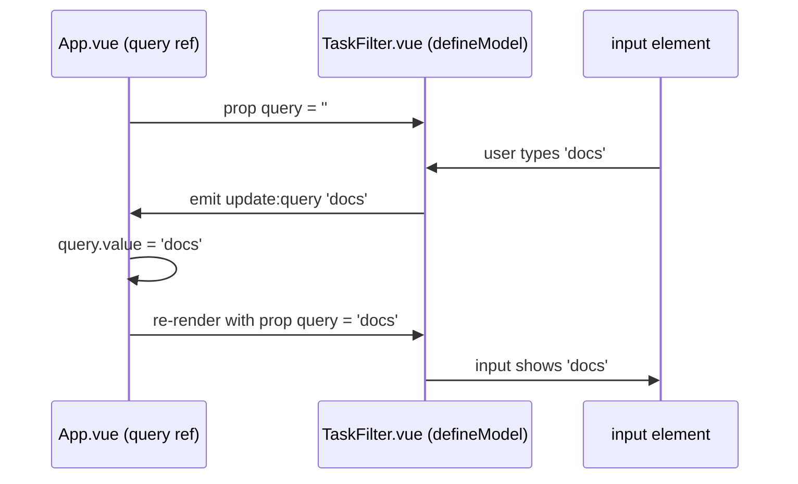

What the macro expands to, roughly:

```ts
// const query = defineModel<string>('query', { required: true }) becomes
const props = defineProps<{ query: string; queryModifiers?: Record<string, true> }>();
const emit = defineEmits<{ 'update:query': [value: string] }>();
const query = useModel(props, 'query'); // a ref whose setter emits update:query
```

Custom modifiers arrive in the second tuple element. A `set` transformer can act on them:

```ts
const [title, modifiers] = defineModel<string, 'capitalize'>({
  set(value) {
    return modifiers.capitalize ? value.charAt(0).toUpperCase() + value.slice(1) : value;
  },
});
```

If the parent does not bind `v-model` at all, the ref behaves as local state, so the component still works standalone.

### 2.8 Slots: Default, Named, Scoped and Fallback

Props pass data; slots pass markup. The parent's slot content is compiled in the parent's scope, so it can use the parent's variables, and the child decides where it appears.

The starter's [`BaseCard.vue`](src/components/BaseCard.vue):

```vue
<script setup lang="ts">
defineProps<{ title?: string }>();

// defineSlots only adds types; it generates no runtime code.
defineSlots<{
  header?: () => unknown;
  default?: () => unknown;
  footer?: () => unknown;
}>();
</script>

<template>
  <section class="card">
    <header v-if="$slots.header || title" class="card-header">
      <slot name="header">
        <h2>{{ title }}</h2>
      </slot>
    </header>
    <div class="card-body">
      <slot />
    </div>
    <footer v-if="$slots.footer" class="card-footer">
      <slot name="footer" />
    </footer>
  </section>
</template>
```

A scoped slot passes data back up to the parent's slot content. [`TaskList.vue`](src/components/TaskList.vue) exposes each task so the parent can choose how a row looks:

```vue
<!-- inside TaskList.vue -->
<li v-for="task in tasks" :key="task.id">
  <slot name="item" :task="task">
    <span class="task-title">{{ task.title }}</span>
  </slot>
</li>
```

```vue
<!-- a parent -->
<TaskList :tasks="visible">
  <template #item="{ task }">
    <strong>{{ task.title }}</strong> due in {{ task.estimate }}h
  </template>
  <template #empty>Nothing matches "{{ query }}".</template>
</TaskList>
```

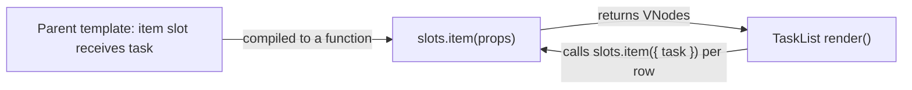

| Slot kind | Child side | Parent side | Use |
| --- | --- | --- | --- |
| Default | `<slot />` | Content between the tags | Wrapper components |
| Named | `<slot name="footer" />` | `<template #footer>` | Layout regions |
| Fallback | Content inside `<slot>…</slot>` | Omit the slot | Sensible default markup |
| Scoped | `<slot name="item" :task="task" />` | `<template #item="{ task }">` | Lists, tables and renderless components |
| Conditional | `v-if="$slots.footer"` | Pass or omit | Avoid empty wrapper elements |

Every slot compiles to a function, which is why scoped slots cost the same as normal ones in Vue 3 and why the child re-renders slot content only when the data it passes changes.

### 2.9 Fallthrough Attributes and `inheritAttrs`

Attributes and listeners the parent passes but the child does not declare as props or emits are fallthrough attributes. With a single root element, Vue adds them to that root: `class` and `style` merge, other attributes override, listeners attach as native listeners.

```vue
<!-- BaseInput.vue: put attributes on the input, not on the wrapper label -->
<script setup lang="ts">
defineOptions({ inheritAttrs: false });
const model = defineModel<string>();
defineProps<{ label: string }>();
</script>

<template>
  <label class="field">
    {{ label }}
    <input v-model="model" v-bind="$attrs" />
  </label>
</template>
```

```vue
<!-- usage: placeholder, maxlength and @focus land on the <input> -->
<BaseInput v-model="email" label="Email" placeholder="you@example.com" maxlength="80" @focus="track" />
```

| Situation | Behaviour | What to do |
| --- | --- | --- |
| Single root, default | Attrs land on the root | Nothing |
| Multiple roots | Dev warning `Extraneous non-props attributes ... could not be automatically inherited` | Bind `v-bind="$attrs"` on one root |
| Wrapper around a native input | Attrs land on the wrapper | `defineOptions({ inheritAttrs: false })` + `v-bind="$attrs"` on the input |
| Reading attrs in script | `useAttrs()` | The object is not reactive; read it in render or `onBeforeUpdate` |

### 2.10 Dependency Injection with `provide` and `inject`

Passing the same prop through five layers of components that do not use it is prop drilling. `provide` makes a value available to every descendant; `inject` reads it from the closest ancestor that provided it. The starter's [`src/theme.ts`](src/theme.ts) wraps both behind typed helpers:

```ts
import { inject, provide, readonly, ref, type InjectionKey, type Ref } from 'vue';

export type Theme = 'light' | 'dark';

export interface ThemeContext {
  theme: Readonly<Ref<Theme>>;
  toggle: () => void;
}

// A Symbol key typed with InjectionKey gives inject() a precise return type.
export const ThemeKey: InjectionKey<ThemeContext> = Symbol('theme');

export function provideTheme(initial: Theme = 'dark'): ThemeContext {
  const theme = ref<Theme>(initial);
  const context: ThemeContext = {
    // Consumers can read the theme but only change it through toggle().
    theme: readonly(theme),
    toggle: () => {
      theme.value = theme.value === 'dark' ? 'light' : 'dark';
    },
  };
  provide(ThemeKey, context);
  return context;
}

export function useTheme(): ThemeContext {
  const context = inject(ThemeKey, null);
  if (!context) {
    throw new Error('useTheme() was called without provideTheme() in an ancestor component');
  }
  return context;
}
```

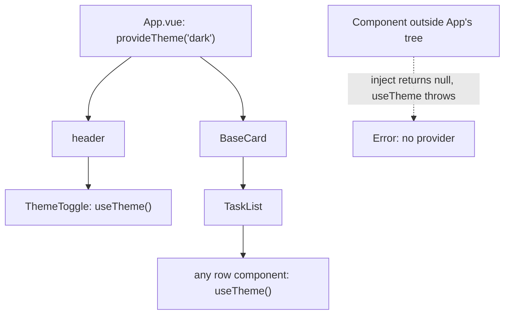

| Line / API | Role | What happens at runtime |
| :--- | :--- | :--- |
| `InjectionKey<ThemeContext>` | Typed key | `inject(ThemeKey)` returns `ThemeContext \| undefined` instead of `unknown`. A Symbol cannot collide with another library's string key. |
| `readonly(theme)` | Write protection | Descendants that try `theme.value = 'x'` get a dev warning and no change. All writes go through `toggle`. |
| `provide(ThemeKey, context)` | Registers the value | Stored on the current component instance; must be called synchronously in `setup`. |
| `inject(ThemeKey, null)` | Looks up the ancestor chain | Returns the nearest provided value or the default `null`. |
| `throw new Error(...)` | Fail fast | A missing provider becomes a clear error instead of `Cannot read properties of undefined`. The starter tests this case. |

Use `app.provide(key, value)` in `main.ts` for app-wide values such as a configured API client. Use a store (Stage 5) instead when state must be shared by components that are not in one subtree, inspected in devtools, or serialised for SSR.

### 2.11 Dynamic, Async and Cached Components

```vue
<script setup lang="ts">
import { defineAsyncComponent, ref, shallowRef } from 'vue';
import ChartTab from './ChartTab.vue';
import TableTab from './TableTab.vue';

// Loaded on first use; a separate chunk in the build.
const ReportTab = defineAsyncComponent({
  loader: () => import('./ReportTab.vue'),
  delay: 200,          // show loadingComponent only if loading takes longer than this
  timeout: 10_000,
});

const tabs = { chart: ChartTab, table: TableTab, report: ReportTab };
const current = shallowRef(tabs.chart); // component objects must not be made deeply reactive
const name = ref<keyof typeof tabs>('chart');

function select(key: keyof typeof tabs) {
  name.value = key;
  current.value = tabs[key];
}
</script>

<template>
  <button v-for="(_, key) in tabs" :key="key" @click="select(key)">{{ key }}</button>
  <KeepAlive :max="2">
    <component :is="current" />
  </KeepAlive>
</template>
```

| Tool | What it does | Watch out for |
| --- | --- | --- |
| `<component :is>` | Renders whichever component (or tag name string) the expression holds | Store the component in `shallowRef`, or Vue warns about making a component reactive. |
| `defineAsyncComponent` | Splits the component into its own chunk and loads it on first render | Provide `errorComponent` for flaky networks. |
| `<KeepAlive>` | Caches inactive component instances instead of unmounting them | Cached components get `onActivated`/`onDeactivated`, not `onMounted` again. Bound the cache with `max`. |

### 2.12 Pitfalls

| Pitfall | Symptom | Fix |
| --- | --- | --- |
| Mutating a prop | `[Vue warn]: Attempting to mutate prop "query". Props are readonly.` | Emit an event or use `defineModel`. |
| `v-if` and `v-for` on one element | `Property "task" was accessed during render but is not defined` | Move `v-for` to a wrapping `<template>` or filter in a `computed`. |
| Index or missing `:key` | Input text or child state sticks to the wrong row after delete or sort | Key by a stable id. |
| Passing an object literal as a prop default | `Invalid default value for prop "options": Props with type Object/Array must use a factory function` (runtime declarations) | Use `default: () => ({})`, or destructured defaults with type-based props. |
| Watching a destructured prop directly | `watch(count, ...)` warns `Invalid watch source` | `watch(() => count, ...)`. |
| Expecting component events to bubble | Grandparent listener never fires | Re-emit, or lift state into a composable/store. |
| Multiple roots and attrs | `Extraneous non-props attributes (class) were passed to component but could not be automatically inherited` | Bind `$attrs` on one root. |
| `v-html` with user content | Stored XSS | Render text, or sanitise with a vetted library on the server. |
| `inject()` called after an `await` in setup | `inject() can only be used inside setup() or functional components.` | Call `inject` synchronously at the top of `setup`. |
| Component held in `ref()` | `Vue received a Component that was made a reactive object` | Use `shallowRef` or `markRaw`. |

### 2.13 Best Practices

- **Type props and emits with TypeScript generics**: the compiler generates runtime checks and the parent gets inference for free.
- **Keep props one-way and state at the lowest common owner**: data flow stays traceable in devtools.
- **Use `defineModel` for any "value + update" pair**: it removes the boilerplate where most two-way binding bugs live.
- **Prefer slots over boolean props for layout variations**: `<template #footer>` scales; `showFooter`, `footerText`, `footerAlign` props do not.
- **Wrap `provide`/`inject` in a `provideX`/`useX` pair with an `InjectionKey`**: one place owns the type, the default and the error message.
- **Expose read-only state from providers**: consumers change it through functions you control.
- **Key lists by stable ids from the data**: never by index for lists that change order or length.
- **Name components in PascalCase, multi-word**: avoids clashes with current and future HTML elements (`TaskList`, not `List`).

### 2.14 Hands-on Exercise

Build `TaskFilter.vue` from scratch: a search box and a status `<select>` that the parent binds with `v-model:query` and `v-model:status`. Requirements:

1. Use two `defineModel` calls; `status` defaults to `'all'`.
2. Trim the search text with a `v-model` modifier.
3. Write a test that mounts a parent holding a `ref('')`, types into the input, and asserts the parent ref changed.

Expected output: typing `  docs ` emits `update:query` with `'docs'`, and selecting "Done" emits `update:status` with `'done'`. The solution is [`src/components/TaskFilter.vue`](src/components/TaskFilter.vue) with its tests in [`tests/components.spec.ts`](tests/components.spec.ts) (the `TaskFilter (defineModel)` block). Stretch goal: add a `capitalize` modifier to a third model and test it.

[Back to top ⤴️](#-table-of-contents)

---

## 3. Stage 3: Reactivity & State

Reactivity is what makes a Vue app update itself. This stage explains how Vue tracks which code depends on which state, the rules for `ref`, `reactive`, `computed` and watchers, when updates actually reach the DOM, and where each piece of state should live. It assumes Stages 1 and 2. By the end you can write and test the starter's [`useTasks`](src/composables/useTasks.ts) composable and predict when every effect in it runs.

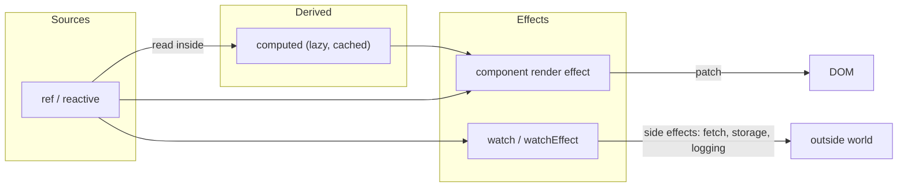

### 3.1 How Proxy-Based Dependency Tracking Works

Every reactive read and write goes through a hook. A read calls `track`, which records "the effect that is running right now depends on this property". A write calls `trigger`, which finds the effects that recorded that property and schedules them to run again. Effects are render functions, computed getters and watchers.

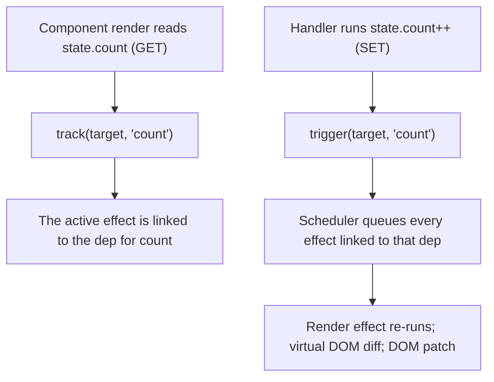

`reactive()` implements the hooks with an ES `Proxy` around the object. `ref()` implements them with a getter and setter on `.value`. A minimal model of both, close to what Vue does in spirit:

```ts
type Effect = () => void;
let active: Effect | null = null;
const deps = new WeakMap<object, Map<PropertyKey, Set<Effect>>>();

function track(target: object, key: PropertyKey) {
  if (!active) return;
  let byKey = deps.get(target);
  if (!byKey) deps.set(target, (byKey = new Map()));
  let set = byKey.get(key);
  if (!set) byKey.set(key, (set = new Set()));
  set.add(active);
}

function trigger(target: object, key: PropertyKey) {
  deps.get(target)?.get(key)?.forEach((effect) => effect());
}

export function reactive<T extends object>(obj: T): T {
  return new Proxy(obj, {
    get(t, k, r) {
      track(t, k);
      return Reflect.get(t, k, r);
    },
    set(t, k, v, r) {
      const ok = Reflect.set(t, k, v, r);
      trigger(t, k);
      return ok;
    },
  });
}

export function effect(fn: Effect) {
  const run = () => {
    active = run;
    try { fn(); } finally { active = null; }
  };
  run();
}

// demo
const state = reactive({ count: 0 });
effect(() => console.log('count is', state.count)); // logs: count is 0
state.count++;                                      // logs: count is 1
```

The real implementation adds what this toy lacks: deep conversion of nested objects on access, array and collection (`Map`, `Set`) instrumentation, cleanup of dependencies that are no longer read, batching through a scheduler, and (since 3.5) version counters that let a `computed` skip work when its inputs have not changed. [M1](#m1-masterclass-inside-the-reactivity-system) walks through those internals.

Vue 3 replaced Vue 2's `Object.defineProperty` approach with Proxies:

| Capability | Vue 2 (`Object.defineProperty`) | Vue 3 (`Proxy`) |
| --- | --- | --- |
| Adding a new property | Not detected; needed `Vue.set` | Detected |
| Deleting a property | Not detected; needed `Vue.delete` | Detected |
| `arr[i] = x`, `arr.length = 0` | Not detected | Detected |
| `Map`, `Set`, `WeakMap` | Not reactive | Reactive through instrumented methods |
| Initial cost | Walks and converts the whole object up front | Converts nested objects lazily, on first access |
| Identity | Same object, mutated in place | `reactive(obj) !== obj`; the proxy is a new object |

### 3.2 `ref()` in Depth and the Unwrapping Rules

`ref()` holds any value in `.value`. It is the default choice because it works for primitives, can be reassigned wholesale, and survives being passed around or destructured from a returned object.

```ts
import { ref, isRef, type Ref } from 'vue';

const count = ref(0);            // Ref<number>
count.value++;                   // .value required in JavaScript

const user = ref({ name: 'Ada', tags: ['admin'] });
user.value.tags.push('ops');     // nested objects are made deeply reactive
user.value = { name: 'Linus', tags: [] }; // replacing the whole value is reactive too

function double(n: Ref<number>) {
  return n.value * 2;            // pass the ref, not count.value, to keep the link
}
console.log(isRef(count), double(count)); // true 2
```

Where Vue unwraps a ref for you, and where it does not:

| Context | Unwrapped? | Example |
| --- | --- | --- |
| Top-level binding in a template | Yes | `{{ count }}`, `:disabled="isLoading"` |
| Property of a plain object in a template | Only as the final value of `{{ }}` | `{{ obj.count }}` renders, `{{ obj.count + 1 }}` gives `[object Object]1` |
| Property of a `reactive()` object | Yes | `state.count` where `state = reactive({ count: ref(0) })` |
| Element of a reactive array or `Map` value | No | `list[0].value` |
| Passed as a prop | Yes, the child receives the value | `<MetricCard :value="count" />` |

The starter destructures the refs returned from `useTasks()` in [`App.vue`](src/App.vue) so they become top-level bindings and the template can drop `.value`:

```ts
// Destructure the refs so the template can use them without .value.
const { query, status, visible, summary, add, advance, remove } = useTasks(seedTasks);
```

### 3.3 `reactive()` and Its Limits

`reactive()` returns a deep Proxy of an object. It reads more naturally (no `.value`) but has three limits that `ref()` does not: it only accepts objects, it cannot be reassigned, and destructuring or spreading it copies plain values.

```ts
import { ref, reactive, toRefs, isRef } from 'vue';

// 1. ref() works for both primitives and objects
const count = ref(0);
count.value++; // .value required in JS, auto-unwrapped in <template>

// 2. reactive() creates deep Proxy only for objects (cannot wrap primitives)
const state = reactive({
  user: { name: 'Elena', role: 'Architect' },
  preferences: { theme: 'dark' }
});

// CAVEAT: Destructuring reactive() breaks reactivity!
// const { name } = state.user; // Reactivity lost!

// SOLUTION: Use toRefs() to preserve reactive links
const { user, preferences } = toRefs(state);
// user.value.name remains reactive!
console.log(isRef(user), preferences.value.theme); // true 'dark'
```

The starter's [`tests/reactivity.spec.ts`](tests/reactivity.spec.ts) proves the destructuring rule:

```ts
it('destructuring reactive() loses reactivity, toRefs() keeps it', () => {
  const state = reactive({ count: 0 });
  const { count: plain } = state;
  const { count: linked } = toRefs(state);

  state.count = 3;
  expect(plain).toBe(0);
  expect(isRef(linked)).toBe(true);
  expect(linked.value).toBe(3);
});
```

| Decision point | `ref()` | `reactive()` |
| --- | --- | --- |
| Primitives | Yes | No (`value cannot be made reactive: 1` warning) |
| Replace the whole value | `x.value = next` | Not possible; `state = reactive({...})` breaks every existing reference |
| Destructure / spread | Keeps the ref if you destructure an object of refs | Loses reactivity; use `toRefs()` |
| Pass to a function | The ref itself keeps the link | The proxy keeps the link, its properties do not |
| Syntax noise | `.value` in script | None |
| Recommendation | Default for everything | Grouping a few related fields that never get replaced |

`toRef(state, 'key')` makes a single linked ref, and `toRef(() => props.id)` turns a getter into a read-only ref. Both are handy for passing one piece of a reactive object into a composable.

### 3.4 `computed()`: Lazy, Cached, Derived State

A `computed` is a derived value with its own cache. It runs its getter only when something reads it, remembers the result, and marks itself dirty when one of its dependencies changes. Reading it again while clean returns the cache without running the getter.

```ts
import { computed, ref } from 'vue';

const price = ref(120);
const quantity = ref(3);
const total = computed(() => price.value * quantity.value);   // ComputedRef<number>

// Writable computed: get derives, set writes back to the sources.
const first = ref('Ada');
const last = ref('Lovelace');
const fullName = computed({
  get: () => `${first.value} ${last.value}`,
  set: (value: string) => {
    [first.value, last.value = ''] = value.split(' ');
  },
});
fullName.value = 'Grace Hopper'; // first = 'Grace', last = 'Hopper'

// 3.4+: the getter receives the previous value, useful to keep a stable result.
const evensOnly = computed<number>((previous) => (price.value % 2 === 0 ? price.value : previous ?? 0));
console.log(total.value, fullName.value, evensOnly.value); // 360 'Grace Hopper' 120
```

The caching behaviour is tested in the starter:

```ts
it('computed caches until a dependency changes', () => {
  const count = ref(1);
  const getter = vi.fn(() => count.value * 2);
  const double = computed(getter);

  expect(getter).not.toHaveBeenCalled(); // lazy: nothing runs until read
  expect(double.value).toBe(2);
  expect(double.value).toBe(2);
  expect(getter).toHaveBeenCalledTimes(1); // second read hit the cache

  count.value = 5;
  expect(double.value).toBe(10);
  expect(getter).toHaveBeenCalledTimes(2);
});
```

| Use | `computed` | A method called from the template |
| --- | --- | --- |
| Runs | Once per dependency change, on read | On every render of the component |
| Side effects | Not allowed; getters must be pure | Allowed but discouraged in templates |
| Arguments | None (return a function from a computed if you must) | Any |
| Typical use | Filtered lists, totals, formatted values | Event handlers, formatting that takes arguments |

Since 3.4, a computed only notifies its own subscribers when its new value differs (`Object.is`) from the old one. A filter whose result did not change therefore does not re-render the list, even though its inputs changed.

### 3.5 `watch()` vs `watchEffect()` and Flush Timing

Watchers are for side effects: fetching, writing to storage, logging, imperatively driving a third-party widget. Anything that only derives a value belongs in a `computed`.

```ts
import { ref, watch, watchEffect } from 'vue';

const query = ref('');
const results = ref<string[]>([]);

// 1. Explicit watch: Lazy, provides oldValue and newValue
watch(query, (newVal, oldVal) => {
  console.log(`Query changed from "${oldVal}" to "${newVal}"`);
});

// 2. watchEffect: Eagerly runs immediately, automatically tracks any accessed reactive property
const stopWatcher = watchEffect((onCleanup) => {
  const controller = new AbortController();

  onCleanup(() => {
    // Abort pending fetch when query changes before response arrives
    controller.abort();
  });

  fetch(`/api/search?q=${encodeURIComponent(query.value)}`, { signal: controller.signal })
    .then(res => res.json())
    .then(data => { results.value = data; })
    .catch(() => {});
});

// Stop watcher when needed
// stopWatcher();
```

`watchEffect` only tracks what it reads synchronously. Reads after the first `await` inside it are not tracked, which is why the URL is built before `fetch` is called.

Watch sources and options:

```ts
import { reactive, ref, watch } from 'vue';

const page = ref(1);
const filters = reactive({ status: 'all', tags: [] as string[] });

watch([page, () => filters.status], ([p, s], [oldP, oldS]) => {
  console.log(`page ${oldP} -> ${p}, status ${oldS} -> ${s}`);
});

watch(filters, () => console.log('any nested change'), { deep: true });
watch(filters, () => console.log('top level and one below'), { deep: 1 }); // 3.5: depth limit
watch(page, (p) => console.log('first change only', p), { once: true });  // 3.4+
watch(page, (p) => console.log('runs now and on change', p), { immediate: true });
```

When a watcher runs relative to the DOM update is controlled by `flush`:

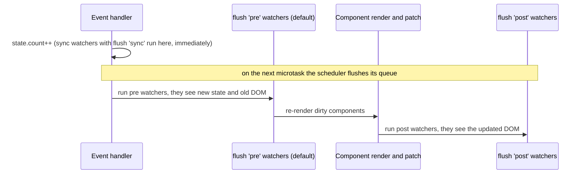

| | `watch` | `watchEffect` |
| --- | --- | --- |
| Dependencies | Explicit source: ref, getter, reactive object or array of these | Whatever the callback reads synchronously |
| First run | Lazy unless `immediate: true` | Immediately |
| Old value | Yes | No |
| Good for | Reacting to one specific change; comparing old and new | Effects that read many sources, such as syncing several refs to a URL |
| Cleanup | `onWatcherCleanup()` (3.5) or the third callback argument | `onWatcherCleanup()` or the `onCleanup` argument |
| Stop | Call the returned handle, or `handle.stop()`; `pause()`/`resume()` in 3.5 | Same |

`flush: 'post'` (or `watchPostEffect`) is the right choice when the callback measures or focuses DOM elements. `flush: 'sync'` runs on every write, bypassing batching; reserve it for tests and rare cases where intermediate values matter.

### 3.6 The Update Scheduler and `nextTick()`

State changes do not update the DOM immediately. Vue queues the affected effects and flushes the queue once, in a microtask. Three writes in one handler produce one render.

```ts
it('watch() callbacks are batched and run before the next tick', async () => {
  const count = ref(0);
  const seen: number[] = [];
  const stop = watch(count, (value) => seen.push(value));

  count.value++;
  count.value++;
  count.value++;
  expect(seen).toEqual([]); // nothing yet: the job is queued
  await nextTick();
  expect(seen).toEqual([3]); // one run with the final value
  stop();
});
```

`nextTick()` returns a promise that resolves after the current flush, so code after `await nextTick()` sees the updated DOM:

```vue
<script setup lang="ts">
import { nextTick, ref, useTemplateRef } from 'vue';

const items = ref<string[]>([]);
const list = useTemplateRef<HTMLUListElement>('list');

async function addAndScroll(text: string) {
  items.value.push(text);
  // The <li> does not exist yet; wait for the patch.
  await nextTick();
  list.value?.lastElementChild?.scrollIntoView({ behavior: 'smooth' });
}
</script>

<template>
  <ul ref="list"><li v-for="(item, i) in items" :key="i">{{ item }}</li></ul>
  <button @click="addAndScroll(`row ${items.length + 1}`)">Add</button>
</template>
```

In tests, `await wrapper.trigger(...)` and `await wrapper.setValue(...)` already wait for `nextTick`, which is why the starter's component tests can assert on the DOM right after them.

### 3.7 Shallow APIs, `markRaw`, `toRaw` and `readonly`

Deep reactivity costs a Proxy per nested object and a dependency per property read. For large or foreign data you can opt out:

```ts
import { markRaw, readonly, shallowReactive, shallowRef, toRaw, triggerRef } from 'vue';

// 10,000 rows from an API: replace the array, never mutate rows in place.
const rows = shallowRef<{ id: number; total: number }[]>([]);
async function load() {
  rows.value = await (await fetch('/api/rows')).json(); // one trigger, no per-row proxies
}

// If you do mutate in place, tell Vue explicitly.
rows.value.push({ id: 1, total: 10 });
triggerRef(rows);

// Only top-level keys are reactive.
const form = shallowReactive({ name: '', address: { city: '' } });

// Third-party instances must never be proxied.
class MapWidget { zoom = 3; }
const widget = markRaw(new MapWidget());

// Plain object for postMessage, structuredClone or a library that compares identity.
const plain = toRaw(form);

// Read-only view for consumers (the starter's theme.ts does this).
const settings = readonly({ locale: 'en' });
console.log(load, widget, plain, settings);
```

| API | Tracks | Use it for |
| --- | --- | --- |
| `shallowRef` | Only `.value` reassignment | Large immutable data, component objects, class instances |
| `triggerRef` | Forces a `shallowRef` to notify | After an in-place mutation of a `shallowRef` value |
| `shallowReactive` | Only top-level properties | Objects whose nested values are managed elsewhere |
| `markRaw` | Never made reactive | Map, chart and editor instances, large lookup tables |
| `toRaw` | Returns the original object | Serialising, worker messages, identity comparisons |
| `readonly` / `shallowReadonly` | Reads tracked, writes rejected | Exposing state from a provider or store |

The starter's tests show that `shallowRef` ignores nested writes until `triggerRef` runs ([`tests/reactivity.spec.ts`](tests/reactivity.spec.ts)).

### 3.8 Lifecycle Hooks and Template Refs

`<script setup>` runs once per instance, when the instance is created; that replaces `beforeCreate` and `created`. Hooks registered there run later at fixed points:

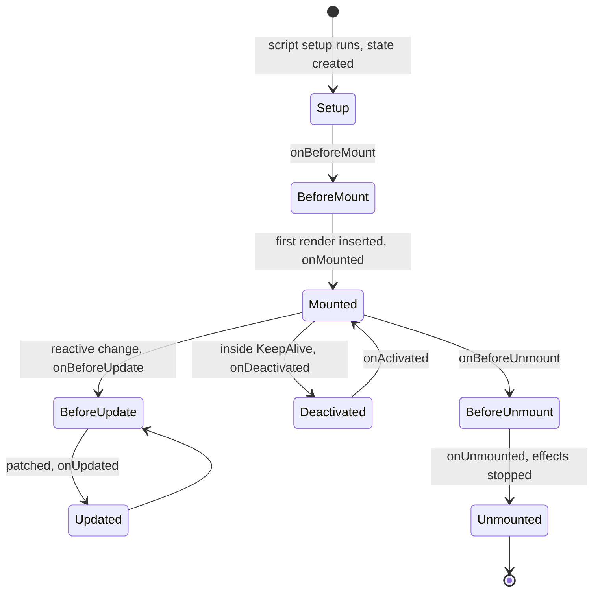

```vue
<script setup lang="ts">
import { onBeforeUnmount, onMounted, ref, useTemplateRef } from 'vue';

const width = ref(0);
const box = useTemplateRef<HTMLDivElement>('box');
let observer: ResizeObserver | undefined;

onMounted(() => {
  // The element exists only after mount.
  observer = new ResizeObserver(([entry]) => (width.value = Math.round(entry.contentRect.width)));
  if (box.value) observer.observe(box.value);
});

onBeforeUnmount(() => observer?.disconnect()); // anything you start, you stop
</script>

<template>
  <div ref="box" class="box">Width: {{ width }}px</div>
</template>
```

| Hook | Runs | Typical work |
| --- | --- | --- |
| top of `<script setup>` | Instance creation | Create state, call composables, register hooks, `provide` |
| `onMounted` | After the first render is in the DOM | Measure elements, start observers, init non-Vue widgets |
| `onUpdated` | After a re-render patched the DOM | Rarely needed; prefer `watch(..., { flush: 'post' })` |
| `onBeforeUnmount` / `onUnmounted` | Before / after removal | Remove global listeners, disconnect observers, clear timers |
| `onActivated` / `onDeactivated` | Entering / leaving a `KeepAlive` cache | Pause polling while hidden |
| `onErrorCaptured` | A descendant threw | Error boundaries; return `false` to stop propagation |
| `onServerPrefetch` | SSR only, before server render | Fetch data the server must render |

Watchers and computeds created synchronously in `setup` are stopped automatically on unmount. Timers, DOM listeners on `window` and observers are not; clean them up in `onBeforeUnmount` or with `onScopeDispose` (Stage 4).

### 3.9 Where State Lives: Local, Composable, Provided or Store

The starter keeps the task board's state in a composable, [`src/composables/useTasks.ts`](src/composables/useTasks.ts), built on the pure functions in [`src/lib/tasks.ts`](src/lib/tasks.ts):

```ts
import { computed, ref } from 'vue';
import { filterTasks, nextStatus, summarize } from '../lib/tasks';
import type { StatusFilter, Task } from '../types';

/**
 * Feature state for the task board. Every call creates independent state,
 * which is what separates a composable from a global store.
 */
export function useTasks(initial: readonly Task[] = []) {
  // Copy the seed so two boards never share the same objects.
  const tasks = ref<Task[]>(initial.map((task) => ({ ...task })));
  const query = ref('');
  const status = ref<StatusFilter>('all');
  let nextId = initial.reduce((max, task) => Math.max(max, task.id), 0) + 1;

  const visible = computed(() => filterTasks(tasks.value, query.value, status.value));
  const summary = computed(() => summarize(tasks.value));

  function add(title: string, estimate = 1): Task | null {
    const clean = title.trim();
    if (clean === '' || !Number.isFinite(estimate) || estimate <= 0) return null;
    const task: Task = { id: nextId++, title: clean, status: 'todo', estimate };
    tasks.value.push(task);
    return task;
  }

  function advance(id: number): void {
    const task = tasks.value.find((item) => item.id === id);
    if (task) task.status = nextStatus(task.status);
  }

  function remove(id: number): void {
    tasks.value = tasks.value.filter((item) => item.id !== id);
  }

  return { tasks, query, status, visible, summary, add, advance, remove };
}
```

| Line / API | Role | What happens at runtime |
| :--- | :--- | :--- |
| `initial.map((task) => ({ ...task }))` | Defensive copy | The seed array stays untouched; the test "gives every caller independent state" depends on it. |
| `ref<Task[]>(...)` | Source of truth | The array and each task object become deep proxies on access, so `task.status = ...` in `advance` triggers. |
| `computed(() => filterTasks(...))` | Derived list | Re-runs only when `tasks`, `query` or `status` change; the list component re-renders only when the result differs. |
| `tasks.value.push(task)` | In-place mutation | Tracked by the array proxy; `visible` and `summary` go dirty. |
| `tasks.value = tasks.value.filter(...)` | Replacement | Also reactive; a new array is simpler than splicing by index. |
| `return { ... }` | Public API | Returns refs, not `.value`s, so callers stay connected to the state. |

The App watches one derived number to show a notice, a side effect that a computed could not do:

```ts
// watch() with a getter source: runs only when the done count changes.
watch(
  () => summary.value.done,
  (done, previous) => {
    if (done > previous) flash(`Task finished: ${done} done`);
  },
);
```

| Where | Lifetime | Shared by | Pick it when |
| --- | --- | --- | --- |
| `ref` inside a component | That instance | That component | Only this component cares (an open/closed flag, a form draft) |
| Composable (`useTasks()`) | The caller's instance | Whoever receives the returned refs | Reusable logic; each caller gets its own copy |
| Composable state at module scope | The whole page session | Every importer | Rarely; it is a hand-made singleton store and leaks across SSR requests |
| `provide` / `inject` | The providing component | One subtree | Theme, form context, a configured client for a section of the app |
| Pinia store | The app (per request on SSR) | Everyone | Cross-cutting state: the session, a cart, cached entities; devtools and SSR serialisation matter |

### 3.10 Pitfalls

| Pitfall | Symptom | Fix |
| --- | --- | --- |
| Destructuring `reactive()` or a store | Values freeze at their initial state; no error | `toRefs(state)` or `storeToRefs(store)` |
| Reassigning a `reactive()` variable | Template keeps showing the old object | Use `ref()` and assign `.value`, or `Object.assign(state, next)` |
| Forgetting `.value` in script | `count++` on a ref: `Assignment to constant variable` or a `NaN` | Write `count.value++`; vue-tsc catches most cases |
| Mutating state inside `computed` | A dev warning about a computed mutating its own dependency, stale values, or an infinite update loop | Keep getters pure; move writes to a watcher or action |
| Watcher that writes its own source | `Maximum recursive updates exceeded in component <App>` | Guard the write, derive with `computed`, or restructure the data |
| Reading after `await` in `watchEffect` | Effect stops reacting to that value | Read all sources before the first `await`, or use `watch` with explicit sources |
| `watch(state.count, ...)` on a reactive property | `Invalid watch source: 0` | `watch(() => state.count, ...)` |
| Measuring the DOM right after a state change | Old sizes or `null` element | `await nextTick()` or `flush: 'post'` |
| Deep reactivity on huge data | Slow initial render, high memory, sluggish scroll | `shallowRef` and immutable replacement |
| Proxying a third-party instance | Library throws on private fields, e.g. `Cannot read private member #map from an object whose class did not declare it` | `markRaw()` or keep it in a non-reactive variable |
| Timers or listeners never cleared | Callbacks keep firing after navigation; memory grows | Clear them in `onBeforeUnmount` / `onScopeDispose` |

### 3.11 Best Practices

- **Default to `ref()`**: one rule for every type, explicit `.value` in script, safe to reassign and return.
- **Derive with `computed`, react with `watch`**: if no side effect is involved it should not be a watcher.
- **Keep business rules in pure functions**: `useTasks` is a thin reactive shell over `lib/tasks.ts`, so most tests need no Vue at all.
- **Return refs from composables, not raw values**: callers stay reactive and can destructure.
- **Copy inputs you will mutate**: never let a composable mutate a caller's array or a module-level seed.
- **Prefer `watch` with explicit sources in shared code**: the dependency list is visible in review.
- **Use `shallowRef` for data you replace, not edit**: API responses, chart series, large lists.
- **Stop what you start**: every `setInterval`, `addEventListener` and observer created in a component has a matching cleanup.
- **Test reactivity with `nextTick`, not timers**: the batching model is deterministic.

### 3.12 Hands-on Exercise

Extend `useTasks` with an `estimateFilter` ref and a `rename(id, title)` function.

1. `estimateFilter` is `ref<number | null>(null)`. When set, `visible` only includes tasks with `estimate <= estimateFilter`.
2. `rename` trims the title, ignores empty strings and returns `true` on success.
3. In `App.vue`, add a `watch` that writes the current `query` to `localStorage` under `learn-vue:query`, and read it back as the initial value.
4. Add tests in `tests/useTasks.spec.ts`: setting `estimateFilter = 2` on the seed data leaves tasks `1, 2, 3`; renaming task 4 to `'  '` returns `false` and leaves the title unchanged.

Expected output: `npm test` passes with your new cases, and reloading the page keeps the search text. The current [`src/composables/useTasks.ts`](src/composables/useTasks.ts) and [`tests/useTasks.spec.ts`](tests/useTasks.spec.ts) are the pattern to extend; [Stage 4](#4-stage-4-composables-data-fetching--routing) shows a reusable `useLocalStorage` you can swap in for step 3.

[Back to top ⤴️](#-table-of-contents)

---

## 4. Stage 4: Composables, Data Fetching & Routing

Composables package stateful logic so any component can reuse it; the router maps URLs to components and guards access to them. This stage builds on Stage 3's reactivity rules.

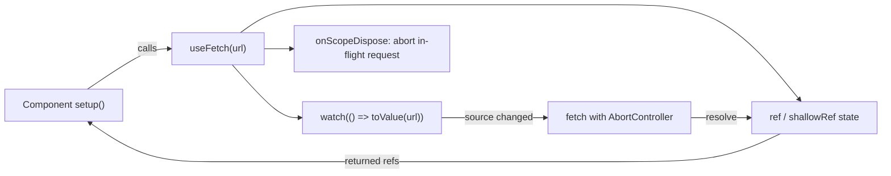

### 4.1 Composable Design Principles

| Convention | Why |
| --- | --- |
| Name it `useX` and call it synchronously at the top of `setup` | Lifecycle hooks and `onScopeDispose` inside it attach to the calling component. |
| Accept `MaybeRefOrGetter<T>` and read with `toValue()` | Callers can pass a plain value, a ref or a getter like `() => props.id`. |
| Return an object of refs | Callers can destructure without losing reactivity. |
| Clean up every side effect with `onScopeDispose` | Works in components and in `effectScope()`, so the composable is also usable from stores and tests. |
| Keep the pure logic in a separate module | The composable stays a thin reactive layer, as with `useTasks` over `lib/tasks.ts`. |

### 4.2 Production Composable: `useFetch` with Abort Support

The first version of this guide used `watchEffect(() => execute())` and an `any`-typed catch. That version had two problems: an aborted request's `finally` could set `isLoading` to `false` while the newer request was still running, and the effect tracked whatever `execute` happened to read before its first `await`. This version fixes both with an explicit source and a per-request controller check.

```ts
// composables/useFetch.ts
import { onScopeDispose, ref, shallowRef, toValue, watch, type MaybeRefOrGetter } from 'vue';

export function useFetch<T>(url: MaybeRefOrGetter<string>, { immediate = true } = {}) {
  const data = shallowRef<T | null>(null);
  const error = shallowRef<Error | null>(null);
  const isLoading = ref(false);
  let controller: AbortController | null = null;

  async function execute(): Promise<void> {
    controller?.abort(); // cancel the previous request
    const current = (controller = new AbortController());
    isLoading.value = true;
    error.value = null;
    try {
      const res = await fetch(toValue(url), { signal: current.signal });
      if (!res.ok) throw new Error(`HTTP ${res.status} ${res.statusText}`);
      data.value = (await res.json()) as T;
    } catch (err) {
      if ((err as Error).name !== 'AbortError') error.value = err as Error;
    } finally {
      // Only the latest request may clear the loading flag.
      if (controller === current) isLoading.value = false;
    }
  }

  watch(() => toValue(url), execute, { immediate });
  onScopeDispose(() => controller?.abort());

  return { data, error, isLoading, refetch: execute };
}
```

```vue
<script setup lang="ts">
import { useFetch } from '../composables/useFetch';

const { id } = defineProps<{ id: number }>();
const { data: user, error, isLoading } = useFetch<{ name: string }>(() => `/api/users/${id}`);
</script>

<template>
  <p v-if="isLoading">Loading...</p>
  <p v-else-if="error">Failed: {{ error.message }}</p>
  <p v-else-if="user">{{ user.name }}</p>
</template>
```

### 4.3 Production Composable: `useLocalStorage`

```ts
// composables/useLocalStorage.ts
import { ref, watch, type Ref } from 'vue';

export function useLocalStorage<T>(key: string, fallbackValue: T) {
  const readValue = (): T => {
    try {
      const item = window.localStorage.getItem(key);
      return item ? JSON.parse(item) : fallbackValue;
    } catch {
      return fallbackValue;
    }
  };

  const storedValue = ref<T>(readValue()) as Ref<T>;

  watch(
    storedValue,
    (newVal) => {
      try {
        window.localStorage.setItem(key, JSON.stringify(newVal));
      } catch (err) {
        console.warn(`Failed to persist key "${key}" to localStorage:`, err);
      }
    },
    { deep: true }
  );

  return storedValue;
}
```

The `as Ref<T>` cast is needed because `ref<T>()` returns `Ref<UnwrapRef<T>>`, which TypeScript cannot prove equal to `Ref<T>` for an open generic `T`. The `try` blocks matter: `localStorage` throws in some private browsing modes and when the quota is full.

### 4.4 Effect Cleanup with `effectScope` and `onScopeDispose`

Every component instance owns an effect scope; watchers and computeds created in its `setup` belong to it and stop on unmount. `effectScope()` gives you the same container outside components, for example in a store or a test.

```ts
import { effectScope, onScopeDispose, ref, watch } from 'vue';

const scope = effectScope();

scope.run(() => {
  const ticks = ref(0);
  const id = setInterval(() => ticks.value++, 1000);
  watch(ticks, (t) => console.log('tick', t));
  onScopeDispose(() => clearInterval(id)); // runs when the scope stops
});

// Later: stops the watcher and clears the interval in one call.
scope.stop();
```

### 4.5 Vue Router: Routes, Lazy Loading and Navigation Guards

Vue Router 5 is the current stable line. It folds the file-based routing previously shipped as `unplugin-vue-router` into the main package; the runtime API from v4 shown here (`createRouter`, `createWebHistory`, guards, `useRoute`, `useRouter`) carries over.

```ts
// src/router.ts
import { createRouter, createWebHistory, type RouteRecordRaw } from 'vue-router';
import { useAuthStore } from './stores/auth';

declare module 'vue-router' {
  interface RouteMeta {
    requiresAuth?: boolean;
    roles?: Array<'ADMIN' | 'ENGINEER' | 'VIEWER'>;
  }
}

const routes: RouteRecordRaw[] = [
  { path: '/', name: 'home', component: () => import('./views/HomeView.vue') },
  {
    path: '/admin',
    name: 'admin',
    component: () => import('./views/AdminView.vue'), // separate chunk, loaded on first visit
    meta: { requiresAuth: true, roles: ['ADMIN'] },
  },
  { path: '/tasks/:id(\\d+)', name: 'task', component: () => import('./views/TaskView.vue'), props: true },
  { path: '/:pathMatch(.*)*', name: 'not-found', component: () => import('./views/NotFound.vue') },
];

export const router = createRouter({
  history: createWebHistory(import.meta.env.BASE_URL),
  routes,
  scrollBehavior: (_to, _from, saved) => saved ?? { top: 0 },
});

router.beforeEach((to) => {
  const auth = useAuthStore();
  if (to.meta.requiresAuth && !auth.isAuthenticated) {
    return { name: 'home', query: { redirect: to.fullPath } };
  }
  if (to.meta.roles && auth.currentUser && !to.meta.roles.includes(auth.currentUser.role)) {
    return false; // cancel the navigation
  }
});
```

The full resolution order of guards, from the first trigger to the DOM update:

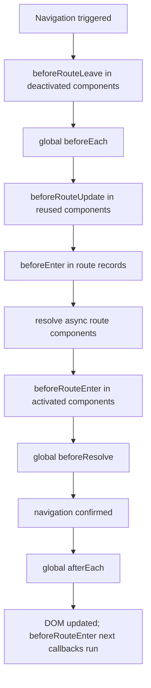

The nginx config in [`docker/nginx.conf`](docker/nginx.conf) falls back to `index.html` for unknown paths, which `createWebHistory` needs so that a reload on `/tasks/4` does not return a 404.

### 4.6 Pitfalls

| Pitfall | Symptom | Fix |
| --- | --- | --- |
| Calling a composable inside a handler or after `await` | `onUnmounted is called when there is no active component instance` | Call it synchronously at the top of `setup`. |
| Module-level state in a composable | State shared across components and, on SSR, across users | Create state inside the function, or use a store. |
| Race between two fetches | Older response overwrites newer data | Abort the previous request, or compare a request id before writing. |
| No server fallback for history mode | Reload on a deep link returns 404 | `try_files $uri $uri/ /index.html;` in nginx. |
| Guard that never resolves | Navigation hangs with no error | Return a value (or nothing) from guards; avoid the legacy `next()` callback. |

### 4.7 Best Practices

- **Accept `MaybeRefOrGetter` inputs**: the same composable works with constants, refs and props.
- **Use `shallowRef` for fetched data**: the response is replaced, not edited.
- **Lazy-load every route except the landing page**: the first bundle stays small.
- **Type `RouteMeta` through module augmentation**: guards get checked access to `requiresAuth` and `roles`.
- **Return redirects from guards instead of calling `router.push` inside them**: avoids duplicate navigations.

[Back to top ⤴️](#-table-of-contents)

---

## 5. Stage 5: Pinia, Forms & Testing

Pinia is Vue's official store library and the replacement for Vuex. This stage covers store design and the testing setup the starter uses.

### 5.1 The Pinia Store Architecture: Setup Stores vs Option Stores

Pinia offers full TypeScript inference without mutations or string-based action dispatch:

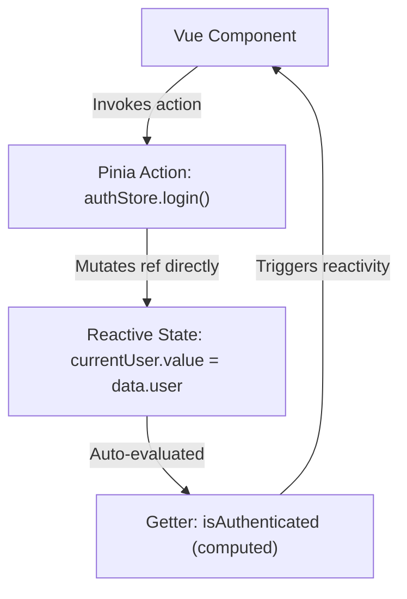

| | Setup store | Option store |
| --- | --- | --- |
| Syntax | `defineStore('id', () => { ...; return {...} })` | `defineStore('id', { state, getters, actions })` |
| State / getters / actions | `ref` / `computed` / functions | `state()` / `getters` / `actions` |
| Can use composables and `watch` inside | Yes | Only inside actions |
| `$reset()` | Not provided; write your own | Built in |
| Must return all state | Yes, or SSR and devtools miss it | Not applicable |

The starter's [`src/stores/counter.ts`](src/stores/counter.ts) is a setup store with its own `reset()`. Destructure stores with `storeToRefs(store)` for state and getters; actions can be destructured directly.

### 5.2 Production Auth Store

```ts
// stores/auth.ts
import { defineStore } from 'pinia';
import { ref, computed } from 'vue';

export interface User {
  id: string;
  email: string;
  role: 'ADMIN' | 'ENGINEER' | 'VIEWER';
}

export const useAuthStore = defineStore('auth', () => {
  // State
  const currentUser = ref<User | null>(null);
  const token = ref<string | null>(localStorage.getItem('auth_token'));
  const isAuthenticating = ref<boolean>(false);

  // Getters (computed)
  const isAuthenticated = computed(() => currentUser.value !== null && token.value !== null);
  const isAdmin = computed(() => currentUser.value?.role === 'ADMIN');

  // Actions
  async function login(credentials: { email: string; pass: string }) {
    isAuthenticating.value = true;
    try {
      const res = await fetch('/api/login', {
        method: 'POST',
        headers: { 'Content-Type': 'application/json' },
        body: JSON.stringify(credentials)
      });
      if (!res.ok) throw new Error(`Login failed with ${res.status}`);
      const data = await res.json();
      currentUser.value = data.user;
      token.value = data.token;
      localStorage.setItem('auth_token', data.token);
    } finally {
      isAuthenticating.value = false;
    }
  }

  function logout() {
    currentUser.value = null;
    token.value = null;
    localStorage.removeItem('auth_token');
  }

  return {
    currentUser,
    token,
    isAuthenticating,
    isAuthenticated,
    isAdmin,
    login,
    logout
  };
});
```

Storing a bearer token in `localStorage` exposes it to any script that runs on the page. For production, prefer an `HttpOnly` session cookie set by the server and keep only the user profile in the store.

### 5.3 Component Testing with Vitest & Vue Test Utils

The starter runs Vitest in a jsdom environment, configured in [`vite.config.ts`](vite.config.ts):

```ts
import { defineConfig } from 'vitest/config';
import vue from '@vitejs/plugin-vue';

export default defineConfig({
  plugins: [vue()],
  server: {
    port: 5173,
  },
  test: {
    environment: 'jsdom',
    include: ['tests/**/*.spec.ts'],
  },
});
```

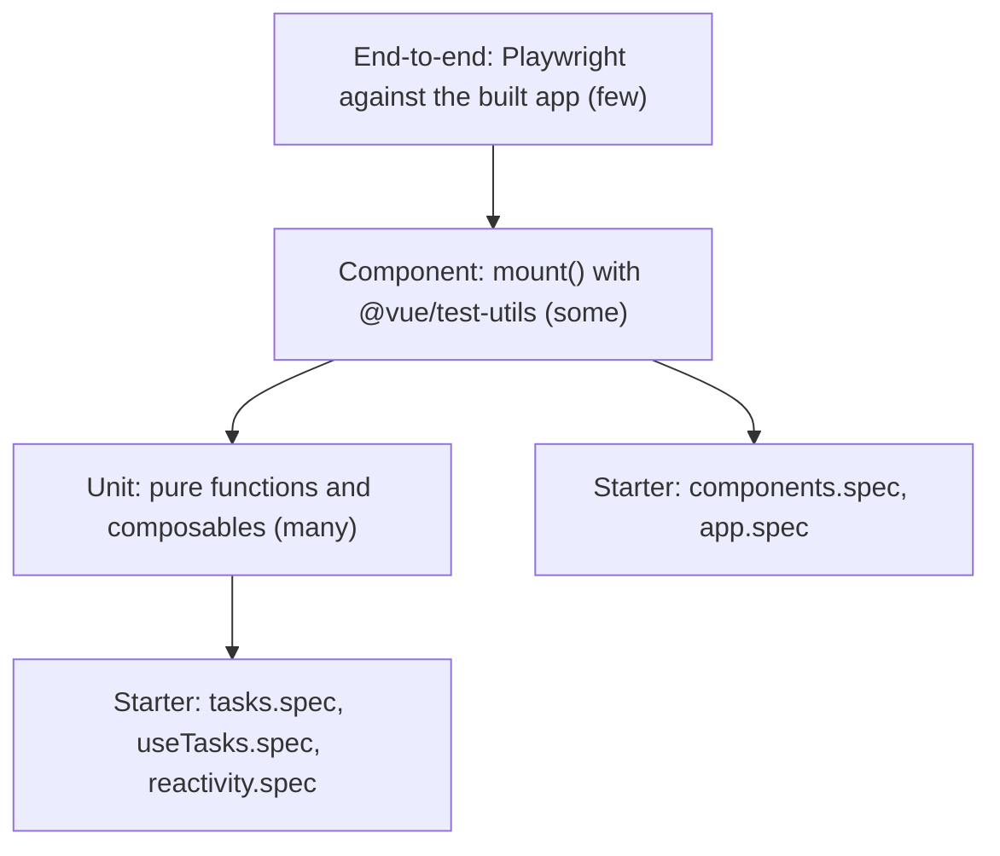

A suite for the generic `DataTable` from [M2](#m2-masterclass-generic-typed-components) testing props, emits, user interactions and async updates:

```ts
// tests/DataTable.spec.ts
import { describe, it, expect } from 'vitest';
import { mount } from '@vue/test-utils';
import DataTable from '../src/components/DataTable.vue';

describe('DataTable.vue', () => {
  const sampleItems = [
    { id: 1, name: 'Service Alpha', latency: 12 },
    { id: 2, name: 'Service Beta', latency: 45 },
    { id: 3, name: 'Service Gamma', latency: 8 },
  ];

  const columns = [
    { key: 'name', header: 'Service', sortable: true },
    { key: 'latency', header: 'P99 Latency', sortable: true },
  ];

  it('renders table headers and row items correctly', () => {
    const wrapper = mount(DataTable, {
      props: { items: sampleItems, columns, pageSize: 5 },
    });

    expect(wrapper.text()).toContain('Service Alpha');
    expect(wrapper.text()).toContain('Service Beta');
    expect(wrapper.findAll('tbody tr')).toHaveLength(3);
  });

  it('sorts records ascending and descending when clicking sortable header', async () => {
    const wrapper = mount(DataTable, {
      props: { items: sampleItems, columns },
    });

    const latencyHeader = wrapper.findAll('th').find((th) => th.text().includes('P99 Latency'));
    expect(latencyHeader).toBeDefined();

    // 1. First click: Sort ascending (8ms, 12ms, 45ms)
    await latencyHeader!.trigger('click');
    let rows = wrapper.findAll('tbody tr');
    expect(rows[0].text()).toContain('Service Gamma'); // 8ms

    // 2. Second click: Sort descending (45ms, 12ms, 8ms)
    await latencyHeader!.trigger('click');
    rows = wrapper.findAll('tbody tr');
    expect(rows[0].text()).toContain('Service Beta'); // 45ms
  });

  it('emits row-click event with payload when clicking a row', async () => {
    const wrapper = mount(DataTable, {
      props: { items: sampleItems, columns },
    });

    await wrapper.find('tbody tr').trigger('click');
    expect(wrapper.emitted('row-click')).toBeTruthy();
    expect(wrapper.emitted('row-click')![0][0]).toEqual(sampleItems[0]);
  });
});
```

Stores are tested by giving each test a fresh Pinia, as the starter's [`tests/app.spec.ts`](tests/app.spec.ts) does with `beforeEach(() => setActivePinia(createPinia()))`.

### 5.4 Pitfalls

| Pitfall | Symptom | Fix |
| --- | --- | --- |
| Destructuring a store | Values never update | `const { count } = storeToRefs(store)` |
| Using a store outside `setup` before Pinia is installed | `getActivePinia()` error at import time | Call `useStore()` inside functions, after `app.use(pinia)`. |
| Not returning a ref from a setup store | State missing from devtools and SSR payload | Return every piece of state. |
| Shared Pinia across tests | Tests pass alone and fail together | Fresh `createPinia()` per test. |
| Asserting before the DOM updates | Test sees old text | `await` the `trigger` / `setValue` call or `nextTick()`. |

### 5.5 Best Practices

- **One store per domain concept**: `auth`, `cart`, `tasks`, not one global store.
- **Keep components free of fetch calls**: actions or composables own I/O.
- **Test behaviour through the DOM**: query by text or `data-test`, not component internals.
- **Use `$patch` for multi-field updates**: one subscription notification and one devtools entry.

[Back to top ⤴️](#-table-of-contents)

---

## 6. Stage 6: Compiler, SSR, Performance & Deployment

This stage looks at what the compiler does for performance, how server rendering changes the rules, and how the starter ships as a container.

### 6.1 Compiler-Informed Virtual DOM (Patch Flags & Static Caching)

A plain virtual DOM compares every node of the old and new trees. Vue's compiler analyses the template first and tells the runtime which parts can change:

```mermaid
flowchart LR
    TEMPLATE["Template"] -->|"Static analysis"| HOIST["Static subtrees created once and cached"]
    TEMPLATE -->|"Patch flag analysis"| DYN["Dynamic nodes marked with bitwise patch flags"]
    DYN -->|"Block tree"| BLOCK["Parent block keeps a flat list of dynamic descendants"]
    BLOCK -->|"Runtime fast path"| DIRECT["Patch only flagged parts of flagged nodes"]
```

- **Patch flags**: dynamic nodes receive a bitmask (`1 /* TEXT */`, `2 /* CLASS */`, `4 /* STYLE */`, `8 /* PROPS */`), so the patcher checks only the parts that can change. The starter's [`tests/compiler.spec.ts`](tests/compiler.spec.ts) asserts on these flags.
- **Block tree**: a block node collects its dynamic descendants into a flat array, so the diff skips static structure entirely instead of walking it.
- **Static caching**: elements without bindings are created once and reused on every render. Up to 3.4 the compiler hoisted them to module-level constants; since 3.5 it caches them on the component's render cache instead, with the same effect on re-render cost.

### 6.2 Teleport and Suspense

`<Teleport to="body">` renders part of a component's template elsewhere in the document while it stays a logical child for props, events and `provide`/`inject`. [M3](#m3-masterclass-accessible-overlays-with-teleport) builds an accessible dialog with it. `<Suspense>` shows a fallback until async setup (top-level `await` in `<script setup>`) in its subtree resolves; it is still marked experimental, so keep its use contained.

```vue
<template>
  <Suspense>
    <DashboardPanel /> <!-- has top-level await in its script setup -->
    <template #fallback>Loading dashboard...</template>
  </Suspense>
</template>
```

### 6.3 SSR Hydration and Cross-Request State

With SSR the server renders HTML and the client hydrates it, attaching listeners to the existing DOM instead of recreating it. Hydration expects the client's first render to produce the same markup.

```mermaid
sequenceDiagram
    participant B as Browser
    participant S as Node server
    participant A as createSSRApp per request
    B->>S: GET /tasks
    S->>A: new app, new Pinia, new router
    A-->>S: renderToString(app) and pinia.state.value
    S-->>B: HTML + serialised state in a script tag
    B->>B: createSSRApp, restore pinia.state.value, mount (hydrate)
    Note over B: mismatch if first client render differs from server HTML
```

Two rules follow. First, create the app, store and router inside a per-request factory; module-level state is shared by every request the server handles and leaks one user's data to another. Second, keep the first client render deterministic: no `Date.now()`, `Math.random()` or `window` reads during render. Use `onMounted` for client-only values, `useId()` for ids, and `data-allow-mismatch` (3.5) for values such as timestamps that legitimately differ.

### 6.4 Deploying the Starter: Multi-Stage Docker on Unprivileged nginx

```dockerfile
# ---- build ------------------------------------------------------------------
FROM node:24-alpine AS build
WORKDIR /app
COPY package.json package-lock.json ./
RUN npm ci
COPY . .
RUN npm run build

# ---- runtime: nginx-unprivileged runs as uid 101 and listens on 8080 ---------
FROM nginxinc/nginx-unprivileged:1.29-alpine AS runtime
COPY docker/nginx.conf /etc/nginx/conf.d/default.conf
COPY --from=build /app/dist /usr/share/nginx/html
EXPOSE 8080
HEALTHCHECK --interval=30s --timeout=3s CMD wget -qO- http://127.0.0.1:8080/health || exit 1
CMD ["nginx", "-g", "daemon off;"]
```

```bash
docker build -t learn-vue .
docker run --rm -p 8080:8080 learn-vue
curl http://localhost:8080/health    # ok
```

```mermaid
flowchart LR
    SRC["Source + lockfile"] --> BUILD["node:24-alpine: npm ci, vue-tsc, vite build"]
    BUILD -->|"dist/ only"| RUN["nginx-unprivileged: non-root, port 8080"]
    RUN --> H["/health returns ok for CI and orchestrators"]
    RUN --> F["unknown paths fall back to index.html"]
    RUN --> C["hashed assets cached for a year"]
```

CI ([`.github/workflows/ci.yml`](.github/workflows/ci.yml)) runs lint, tests and the build on Node 22 and 24, then builds this image and curls `/health` on port 8080.

### 6.5 Pitfalls

| Pitfall | Symptom | Fix |
| --- | --- | --- |
| Hydration mismatch | `Hydration text content mismatch` warning, flicker, lost listeners | Deterministic first render; client-only values in `onMounted`. |
| Singleton app or store on the server | One user sees another user's data | Per-request `createSSRApp`, `createPinia`, `createRouter`. |
| Serving `dist/` from a dev server | Slow, unhardened, wrong port | nginx or a CDN; `vite preview` is for local checks only. |
| Long-caching `index.html` | Users stuck on an old release | `no-cache` for HTML, immutable caching only for hashed assets. |

### 6.6 Best Practices

- **Let the compiler optimise**: templates get patch flags and static caching; hand-written render functions do not.
- **Measure before using `v-memo` or `v-once`**: they trade memory and correctness risk for speed.
- **Run as non-root and expose one port**: the image, `EXPOSE` and CI's `APP_PORT` all say 8080.
- **Ship a health endpoint**: orchestrators and CI need a cheap liveness check.

[Back to top ⤴️](#-table-of-contents)

---

## M1. Masterclass: Inside the Reactivity System

Stage 3 described `track` and `trigger`. This masterclass looks at the data structures Vue 3.5 uses to make them cheap, and at the change coming in 3.6.

### M1.1 How It Works Internally: Deps, Links and Version Counters

Since 3.5 every reactive property that has been read inside an effect owns a `Dep`. Every subscriber (a render effect, a `watch`, a `computed`) keeps a doubly linked list of `Link` nodes, one per dependency it read during its last run. The same `Link` also sits in the dep's list of subscribers, so both directions can be walked and unlinked in constant time.

```mermaid
flowchart LR
    subgraph Sources
        D1["Dep: tasks"]
        D2["Dep: query"]
    end
    subgraph Subscribers
        C["computed visible"]
        R["render effect of TaskList"]
    end
    D1 -->|"Link: version 4"| C
    D2 -->|"Link: version 2"| C
    C -->|"Link: version 7"| R
    G["globalVersion counter"] -.->|"bumped on every reactive write"| C
```

Three counters make updates cheap:

- Each `Dep` has a `version` that increments on every write.
- Each `Link` remembers the dep version seen during the subscriber's last run. On the next run, links whose dep was not read again are removed, so a branch that stopped reading `query` stops depending on it.
- A global version increments on any reactive write. A computed that saw the same global version last time can return its cache without checking a single dependency.

When a source changes, the subscribers are notified (push), but a computed does not re-run until someone reads it (pull). When it does re-run and produces the same value (`Object.is`), its own version does not increase, so effects downstream of it see no change and skip their run.

Vue 3.6 (release candidate at the time of writing) replaces this implementation with one based on `alien-signals`, keeping the public API. Code written against `ref`, `computed` and `watch` does not change.

### M1.2 Worked Example: Proving the Computed Short-Circuit

This Vitest file is [`tests/internals.spec.ts`](tests/internals.spec.ts) in the starter. It shows that a downstream effect does not run when a computed's value stays the same, and that a branch's dependencies are dropped once it stops being read.

```ts
// tests/internals.spec.ts
import { describe, expect, it } from 'vitest';
import { computed, ref, watchEffect } from 'vue';

describe('reactivity internals', () => {
  it('skips subscribers when a computed value does not change', () => {
    const n = ref(1);
    const isOdd = computed(() => n.value % 2 === 1);
    let runs = 0;
    const stop = watchEffect(
      () => {
        void isOdd.value;
        runs++;
      },
      { flush: 'sync' },
    );

    n.value = 3; // isOdd re-evaluates to true again
    expect(runs).toBe(1); // the effect did not run a second time
    n.value = 4; // now false
    expect(runs).toBe(2);
    stop();
  });

  it('drops dependencies of a branch that is no longer taken', () => {
    const showDetails = ref(true);
    const details = ref('a');
    let runs = 0;
    const stop = watchEffect(
      () => {
        runs++;
        if (showDetails.value) void details.value;
      },
      { flush: 'sync' },
    );

    showDetails.value = false; // run 2: details not read this time
    details.value = 'b'; // no longer a dependency
    expect(runs).toBe(2);
    stop();
  });
});
```

### M1.3 Trade-offs: Vue Refs vs Other Reactivity Models

| Model | Granularity | Change detection | Cost model | Ergonomics |
| --- | --- | --- | --- | --- |
| Vue refs and proxies | Per property | Automatic tracking on read | Proxy access and link bookkeeping per read | Mutate plain-looking objects; `.value` on refs |
| React state | Per component | `setState` schedules a re-render of the subtree | Re-render and diff; memoisation or React Compiler to prune | Immutable updates, hook rules |
| Signals (Angular, Solid, Preact) | Per signal | Automatic tracking on call | Similar to Vue; no Proxy for objects | Call `count()` to read; nested objects need their own signals |
| Svelte 5 runes | Per `$state` field (deep proxies for objects) | Compiler-inserted tracking | Similar to Vue | Plain variable syntax, compiler-only |

### M1.4 Production Checklist

- [ ] Large lists and API payloads live in `shallowRef` and are replaced, not edited.
- [ ] Third-party instances are wrapped in `markRaw`.
- [ ] No computed getter writes to state.
- [ ] Watchers have explicit sources in shared code, and clean up with `onWatcherCleanup`.
- [ ] Performance work starts from a Vue DevTools or browser profiler trace, not from guesses.

[Back to top ⤴️](#-table-of-contents)

---

## M2. Masterclass: Generic Typed Components

Generic components (3.3+) let one component accept rows of any shape while the parent keeps full type checking of slot props and events.

### M2.1 How It Works Internally

```mermaid
flowchart TD
    A["script setup generic='T extends Record'"] --> B["vue-tsc wraps the component in a generic function type"]
    B --> C["Parent passes items: Service[]"]
    C --> D["T inferred as Service"]
    D --> E["columns keys checked against keyof Service"]
    D --> F["slot props value and item typed as Service fields"]
    D --> G["row-click handler receives Service"]
```

The `generic` attribute only affects types. At runtime the component is an ordinary component; vue-tsc and Volar use the attribute to type the component as a generic function, so inference happens at each usage site.

### M2.2 Complete Worked Example: `DataTable.vue`

This version improves on the guide's first draft in two ways: the page size is a `computed`, so changing the `pageSize` prop takes effect, and rows are keyed by a `rowKey` prop instead of their index, so sorting does not reuse the wrong row elements.

```vue
<!-- components/DataTable.vue -->
<script setup lang="ts" generic="T extends Record<string, any>">
import { ref, computed } from 'vue';

interface Column<K> {
  key: keyof K;
  header: string;
  sortable?: boolean;
}

const props = defineProps<{
  items: T[];
  columns: Column<T>[];
  pageSize?: number;
  rowKey?: keyof T;
}>();

const emit = defineEmits<{
  (e: 'row-click', item: T): void;
}>();

const sortKey = ref<keyof T | null>(null);
const sortAscending = ref<boolean>(true);
const currentPage = ref<number>(1);
const effectivePageSize = computed(() => props.pageSize ?? 10);

function toggleSort(key: keyof T) {
  if (sortKey.value === key) {
    sortAscending.value = !sortAscending.value;
  } else {
    sortKey.value = key;
    sortAscending.value = true;
  }
}

const sortedItems = computed(() => {
  if (!sortKey.value) return props.items;
  const key = sortKey.value;
  return [...props.items].sort((a, b) => {
    const valA = a[key];
    const valB = b[key];
    if (valA === valB) return 0;
    const res = valA > valB ? 1 : -1;
    return sortAscending.value ? res : -res;
  });
});

const paginatedItems = computed(() => {
  const start = (currentPage.value - 1) * effectivePageSize.value;
  return sortedItems.value.slice(start, start + effectivePageSize.value);
});

const totalPages = computed(() => Math.max(1, Math.ceil(props.items.length / effectivePageSize.value)));

function keyOf(item: T, index: number): PropertyKey {
  return props.rowKey ? (item[props.rowKey] as PropertyKey) : index;
}
</script>

<template>
  <div class="table-container">
    <table class="data-table">
      <thead>
        <tr>
          <th
            v-for="col in columns"
            :key="String(col.key)"
            :class="{ sortable: col.sortable }"
            :aria-sort="sortKey === col.key ? (sortAscending ? 'ascending' : 'descending') : undefined"
            @click="col.sortable && toggleSort(col.key)"
          >
            {{ col.header }}
            <span v-if="sortKey === col.key">{{ sortAscending ? '▲' : '▼' }}</span>
          </th>
        </tr>
      </thead>
      <tbody>
        <tr
          v-for="(item, idx) in paginatedItems"
          :key="keyOf(item, idx)"
          @click="emit('row-click', item)"
        >
          <td v-for="col in columns" :key="String(col.key)">
            <!-- Scoped Slot fallback with default raw text -->
            <slot :name="`cell-${String(col.key)}`" :item="item" :value="item[col.key]">
              {{ item[col.key] }}
            </slot>
          </td>
        </tr>
      </tbody>
    </table>

    <div class="pagination">
      <button :disabled="currentPage === 1" @click="currentPage--">Prev</button>
      <span>Page {{ currentPage }} of {{ totalPages }}</span>
      <button :disabled="currentPage >= totalPages" @click="currentPage++">Next</button>
    </div>
  </div>
</template>

<style scoped>
.table-container {
  overflow-x: auto;
  border: 1px solid #1e293b;
  border-radius: 0.75rem;
  background: #0f172a;
}
.data-table {
  width: 100%;
  border-collapse: collapse;
  color: #f1f5f9;
}
th, td {
  padding: 0.75rem 1rem;
  text-align: left;
  border-bottom: 1px solid #1e293b;
}
th.sortable {
  cursor: pointer;
  user-select: none;
}
th.sortable:hover {
  color: #38bdf8;
}
.pagination {
  display: flex;
  justify-content: space-between;
  align-items: center;
  padding: 0.75rem 1rem;
}
</style>
```

```vue
<!-- usage: T is inferred as Service -->
<script setup lang="ts">
import DataTable from './components/DataTable.vue';

interface Service { id: number; name: string; latency: number }
const services: Service[] = [
  { id: 1, name: 'api', latency: 12 },
  { id: 2, name: 'worker', latency: 45 },
];
</script>

<template>
  <DataTable
    :items="services"
    :columns="[{ key: 'name', header: 'Service', sortable: true }, { key: 'latency', header: 'P99', sortable: true }]"
    row-key="id"
    @row-click="(s) => console.log(s.name)"
  >
    <template #cell-latency="{ value }">{{ value }} ms</template>
  </DataTable>
</template>
```

The Stage 5 test suite for this component is in [5.3](#53-component-testing-with-vitest--vue-test-utils).

### M2.3 Trade-offs vs Alternatives

| Approach | Type safety for rows | Flexibility | Cost |
| --- | --- | --- | --- |
| Generic SFC (`generic="T"`) | Full: columns, slot props and events | Template-driven, scoped slots per cell | Small; you own sorting and paging logic |
| `Record<string, any>` props, no generic | None; typos in column keys compile | Same | Same |
| Render function / TSX component | Full | Maximum | Harder to read for template-first teams |
| Headless table library (for example TanStack Table) | Full | Sorting, filtering, grouping, virtualisation included | Extra dependency and API to learn |

### M2.4 Production Checklist

- [ ] Rows keyed by a stable id (`rowKey`), never by index.
- [ ] Sort state exposed with `aria-sort` for screen readers.
- [ ] Large datasets paginated or virtualised; the source array held in `shallowRef`.
- [ ] Slot names documented, with fallback content for every slot.
- [ ] Tests cover sorting both directions, paging bounds and emitted payloads.

[Back to top ⤴️](#-table-of-contents)

---

## M3. Masterclass: Accessible Overlays with Teleport

Modals, toasts and popovers must escape `overflow: hidden` and stacking contexts of their parents, yet stay logically owned by the component that opened them.

### M3.1 How It Works Internally

```mermaid
flowchart LR
    subgraph Logical["Component tree (props, events, inject)"]
        P["SettingsPage"] --> M["ModalDialog"]
        M --> S["slot content"]
    end
    subgraph DOM["Document"]
        APP["div#app"] --> PAGE["settings markup"]
        BODY["body"] --> OV["div.modal-overlay"]
    end
    M -.->|"Teleport to=body moves the rendered nodes"| OV
```

`<Teleport>` renders its children with the normal patch algorithm but inserts the resulting nodes into the target element. The component tree is unchanged, so the dialog still receives props, emits to its parent and can `inject` from ancestors. Since 3.5, `defer` lets the target be an element rendered later in the same update.

### M3.2 Complete Worked Example: `ModalDialog.vue`

This version adds what the first draft lacked for accessibility: the dialog is labelled by its title, receives focus when it opens, and returns focus to the element that opened it.

```vue
<!-- components/ModalDialog.vue -->
<script setup lang="ts">
import { nextTick, onMounted, onUnmounted, useId, useTemplateRef, watch } from 'vue';

const isOpen = defineModel<boolean>('isOpen', { required: true });

defineProps<{
  title?: string;
}>();

const titleId = useId();
const dialog = useTemplateRef<HTMLElement>('dialog');
let previouslyFocused: HTMLElement | null = null;

watch(isOpen, async (open) => {
  if (open) {
    previouslyFocused = document.activeElement as HTMLElement | null;
    await nextTick();
    dialog.value?.focus();
  } else {
    previouslyFocused?.focus();
  }
});

function handleKeydown(e: KeyboardEvent) {
  if (e.key === 'Escape' && isOpen.value) {
    isOpen.value = false;
  }
}

onMounted(() => {
  window.addEventListener('keydown', handleKeydown);
});

onUnmounted(() => {
  window.removeEventListener('keydown', handleKeydown);
});
</script>

<template>
  <Teleport to="body">
    <Transition name="fade">
      <div v-if="isOpen" class="modal-overlay" @click.self="isOpen = false">
        <div
          ref="dialog"
          class="modal-card"
          role="dialog"
          aria-modal="true"
          :aria-labelledby="title ? titleId : undefined"
          tabindex="-1"
        >
          <header class="modal-header">
            <h3 v-if="title" :id="titleId">{{ title }}</h3>
            <button class="close-btn" aria-label="Close" @click="isOpen = false">&times;</button>
          </header>
          <div class="modal-body">
            <slot />
          </div>
          <footer class="modal-footer">
            <slot name="footer">
              <button class="btn-cancel" @click="isOpen = false">Cancel</button>
              <button class="btn-confirm" @click="isOpen = false">Confirm</button>
            </slot>
          </footer>
        </div>
      </div>
    </Transition>
  </Teleport>
</template>

<style scoped>
.modal-overlay {
  position: fixed;
  inset: 0;
  background: rgba(15, 23, 42, 0.75);
  backdrop-filter: blur(6px);
  display: flex;
  align-items: center;
  justify-content: center;
  z-index: 999;
}
.modal-card {
  background: #1e293b;
  border: 1px solid #334155;
  border-radius: 1rem;
  max-width: 32rem;
  width: 90%;
  padding: 1.5rem;
  box-shadow: 0 25px 50px -12px rgba(0, 0, 0, 0.5);
}
.modal-header {
  display: flex;
  justify-content: space-between;
  align-items: center;
  margin-bottom: 1rem;
}
.fade-enter-active, .fade-leave-active {
  transition: opacity 0.2s ease;
}
.fade-enter-from, .fade-leave-to {
  opacity: 0;
}
</style>
```

```vue
<script setup lang="ts">
import { ref } from 'vue';
import ModalDialog from './components/ModalDialog.vue';
const open = ref(false);
</script>

<template>
  <button @click="open = true">Delete project</button>
  <ModalDialog v-model:isOpen="open" title="Delete project?">
    This removes the project for every member.
  </ModalDialog>
</template>
```

### M3.3 Trade-offs vs Alternatives

| Approach | Focus handling | Stacking and scroll lock | Effort |
| --- | --- | --- | --- |
| `Teleport` + custom markup (above) | You implement focus in, focus restore and focus trap | You control `z-index`; add scroll lock yourself | Medium |
| Native `<dialog>` with `showModal()` | Browser moves focus, `inert`s the page, closes on Esc | Top layer: no `z-index` fights | Low; style `::backdrop`, call methods from a template ref |
| Headless UI library (for example Reka UI) | Complete, tested | Handled | Lowest effort, adds a dependency |
| No Teleport (render in place) | Same as custom | Breaks inside `overflow: hidden` or transformed parents | Low, but fragile |

### M3.4 Production Checklist

- [ ] `role="dialog"`, `aria-modal="true"` and `aria-labelledby` pointing at a visible title.
- [ ] Focus moves into the dialog on open and back to the trigger on close.
- [ ] Tab stays inside the dialog (focus trap) for modal dialogs.
- [ ] Escape and backdrop click close it, unless the action is destructive and needs confirmation.
- [ ] Page scrolling is locked while open; `prefers-reduced-motion` disables the transition.

[Back to top ⤴️](#-table-of-contents)

---

## M4. Masterclass: Real-Time Composables

WebSocket connections, debounced inputs and polling all hold resources over time. Composables are the right home for them as long as they clean up after themselves.

### M4.1 How It Works Internally: The Connection Lifecycle

```mermaid
stateDiagram-v2
    [*] --> Connecting: connect()
    Connecting --> Open: onopen, start heartbeat
    Open --> Closed: onclose, stop heartbeat
    Closed --> Waiting: autoReconnect and retries left
    Waiting --> Connecting: backoff timer fires
    Closed --> [*]: manual close() or retries exhausted
    Open --> [*]: scope disposed, close()
```

The composable owns three resources: the socket, the heartbeat interval and the reconnect timer. Each must be released on every path into a terminal state, which is why `close()` and `onScopeDispose` share one function.

### M4.2 Complete Worked Example: `useWebSocket` and a Debounced Ref

The first draft's `close()` set `options.autoReconnect = false`, but the reconnect check read a destructured copy, so a manual close still reconnected. This version tracks manual closure in its own flag and clears every timer.

```ts
// composables/useWebSocket.ts
import { onScopeDispose, ref, shallowRef } from 'vue';

export interface UseWebSocketOptions {
  autoReconnect?: boolean;
  heartbeatIntervalMs?: number;
  maxRetries?: number;
}

export function useWebSocket<T = unknown>(url: string, options: UseWebSocketOptions = {}) {
  const { autoReconnect = true, heartbeatIntervalMs = 30_000, maxRetries = 5 } = options;

  const data = shallowRef<T | string | null>(null);
  const isConnected = ref(false);
  const error = shallowRef<Event | null>(null);

  let socket: WebSocket | null = null;
  let retryCount = 0;
  let manuallyClosed = false;
  let heartbeatTimer: ReturnType<typeof setInterval> | undefined;
  let reconnectTimer: ReturnType<typeof setTimeout> | undefined;

  function connect() {
    socket = new WebSocket(url);

    socket.onopen = () => {
      isConnected.value = true;
      retryCount = 0;
      startHeartbeat();
    };

    socket.onmessage = (event: MessageEvent<string>) => {
      try {
        data.value = JSON.parse(event.data) as T;
      } catch {
        data.value = event.data;
      }
    };

    socket.onerror = (err) => {
      error.value = err;
    };

    socket.onclose = () => {
      isConnected.value = false;
      stopHeartbeat();
      if (!manuallyClosed && autoReconnect && retryCount < maxRetries) {
        retryCount++;
        const delay = Math.min(1000 * 2 ** retryCount, 15_000); // exponential backoff, capped
        reconnectTimer = setTimeout(connect, delay);
      }
    };
  }

  function startHeartbeat() {
    stopHeartbeat();
    heartbeatTimer = setInterval(() => {
      if (socket?.readyState === WebSocket.OPEN) socket.send(JSON.stringify({ type: 'ping' }));
    }, heartbeatIntervalMs);
  }

  function stopHeartbeat() {
    clearInterval(heartbeatTimer);
  }

  function send(payload: unknown) {
    if (socket?.readyState === WebSocket.OPEN) {
      socket.send(typeof payload === 'string' ? payload : JSON.stringify(payload));
    }
  }

  function close() {
    manuallyClosed = true;
    clearTimeout(reconnectTimer);
    stopHeartbeat();
    socket?.close();
  }

  connect();
  onScopeDispose(close);

  return { data, isConnected, error, send, close };
}
```

A `customRef` controls exactly when reads are tracked and writes are announced, which is all a debounce needs:

```ts
// composables/useDebouncedRef.ts
import { customRef } from 'vue';

export function useDebouncedRef<T>(value: T, delayMs = 300) {
  let timeoutId: ReturnType<typeof setTimeout> | undefined;

  return customRef<T>((track, trigger) => ({
    get() {
      track();
      return value;
    },
    set(newValue) {
      clearTimeout(timeoutId);
      timeoutId = setTimeout(() => {
        value = newValue;
        trigger();
      }, delayMs);
    },
  }));
}
```

```vue
<script setup lang="ts">
import { watch } from 'vue';
import { useDebouncedRef } from '../composables/useDebouncedRef';
import { useWebSocket } from '../composables/useWebSocket';

const search = useDebouncedRef('', 400);
const { data, isConnected, send } = useWebSocket<{ hits: number }>('wss://example.test/search');

watch(search, (q) => send({ type: 'search', q })); // fires 400 ms after typing stops
</script>

<template>
  <input v-model="search" placeholder="Search live" />
  <p>{{ isConnected ? 'live' : 'offline' }}: {{ data }}</p>
</template>
```

### M4.3 Trade-offs: WebSocket vs Server-Sent Events vs Polling

| Transport | Direction | Reconnect | Infrastructure | Use it for |
| --- | --- | --- | --- | --- |
| WebSocket | Both ways | Hand-written (above) | Sticky sessions or a pub/sub backplane; proxies must allow upgrades | Chat, collaborative editing, games |
| Server-Sent Events (`EventSource`) | Server to client | Built into the browser, with `Last-Event-ID` | Plain HTTP; works through most proxies | Notifications, live dashboards, LLM token streams |
| Polling with `useFetch` + interval | Client pulls | Trivial | None | Low-frequency status that tolerates seconds of delay |

### M4.4 Production Checklist

- [ ] Every timer, socket and listener is released in `onScopeDispose`.
- [ ] Reconnect uses capped exponential backoff, ideally with jitter.
- [ ] Manual close never triggers reconnect.
- [ ] Incoming messages are validated before they reach state.
- [ ] Connection state is visible to the user.

[Back to top ⤴️](#-table-of-contents)

---

## M5. Masterclass: Flagship Blueprint: A Production Task Dashboard

This blueprint grows the starter into a deployable product, using the pieces from every stage.

### M5.1 How It Fits Together

```mermaid
flowchart TD
    R["Vue Router: lazy routes, auth guard"] --> V["Views: Board, TaskDetail, Admin"]
    V --> C["Components: BaseCard, TaskList, TaskFilter, DataTable, ModalDialog"]
    V --> U["Composables: useTasks, useFetch, useWebSocket"]
    U --> L["lib/tasks.ts pure rules"]
    V --> P["Pinia: auth, tasks cache"]
    P --> API["REST API"]
    U --> WS["WebSocket: live task updates"]
    B["vite build"] --> IMG["Docker: nginx-unprivileged on 8080"]
    IMG --> CI["CI: lint, test, build, curl /health"]
```

### M5.2 Worked Example: The Starter as Phase One

The starter in this repository is the runnable first phase: typed components, the `useTasks` composable over pure rules, a Pinia store, 34 tests, a production image and CI. Build the rest in this order, keeping `npm test` green after each step:

| Phase | Add | Guide section |
| --- | --- | --- |
| 1 | Starter as shipped | Stages 1-3 |
| 2 | `src/router.ts` with `/`, `/tasks/:id`, a 404 route | [4.5](#45-vue-router-routes-lazy-loading-and-navigation-guards) |
| 3 | `useFetch` loading tasks from an API; `useTasks` seeded from it | [4.2](#42-production-composable-usefetch-with-abort-support) |
| 4 | Auth store and `requiresAuth` routes | [5.2](#52-production-auth-store) |
| 5 | `DataTable` admin view and `ModalDialog` delete confirmation | [M2](#m2-masterclass-generic-typed-components), [M3](#m3-masterclass-accessible-overlays-with-teleport) |
| 6 | Live updates through `useWebSocket` | [M4](#m4-masterclass-real-time-composables) |

### M5.3 Trade-offs: SPA vs SSR for the Dashboard

| Option | First paint | SEO | Operational cost | Fit for an authenticated dashboard |
| --- | --- | --- | --- | --- |
| SPA on nginx (starter) | After JS loads | Poor | Static hosting | Good: content is behind login anyway |
| SSR with Nuxt | HTML immediately | Good | Node servers, per-request state discipline | Worth it only for public pages |
| Static pre-rendering | HTML immediately | Good | Build-time only | Marketing pages, docs |

### M5.4 Production Checklist

- [ ] `npm run lint`, `npm test` and `npm run build` pass in CI on every pull request.
- [ ] The image runs as non-root, exposes 8080 and answers `/health`.
- [ ] `index.html` is served with `no-cache`; hashed assets are immutable.
- [ ] `app.config.errorHandler` forwards errors to monitoring.
- [ ] Routes are lazy-loaded; the initial bundle is measured on every release.

[Back to top ⤴️](#-table-of-contents)

---

## 7. Stage 7: Staff Vue Architect Interview Handbook & Cheatsheet

### 7.1 Core Concepts (Q1-Q17)

#### Q1. Why is `.value` required when manipulating a `ref` in JavaScript but omitted in templates?

JavaScript primitives (numbers, booleans, strings) are passed by value, not by reference. To make a primitive reactive, Vue must wrap it in an object whose `value` property has a tracking getter and a triggering setter. In templates, the compiler unwraps top-level refs for you, so `{{ count }}` reads `count.value`. The unwrapping is shallow: a ref nested inside a plain object is only unwrapped when it is the final value of an interpolation, not inside a larger expression.

#### Q2. What happens when you destructure a `reactive()` object and how do you prevent it?

Destructuring reads each property once and assigns the current value to a plain local variable, so the variables no longer go through the Proxy and nothing tracks them. Use `toRefs(state)` to get an object of refs linked to the original properties, or `toRef(state, 'key')` for one property. For Pinia stores the equivalent is `storeToRefs(store)`.

#### Q3. What is the difference between `v-if` and `v-show` at the DOM and lifecycle level?

`v-if` creates and destroys the element or component. A component inside it runs `setup`, `onMounted` and `onUnmounted` every time the condition flips, and its local state is lost. `v-show` renders once and toggles `display: none`, so the component stays mounted and keeps its state. Choose `v-if` when the branch is expensive or rarely shown, `v-show` when it toggles often.

#### Q4. What is the difference between `toRef` and `toRefs`?

`toRef(object, 'key')` creates a ref linked to one property of a reactive object; reading and writing it goes through to the source. `toRefs(object)` does the same for every property and returns a plain object of refs, which is what makes safe destructuring possible. `toRef(() => props.id)` (3.3+) creates a read-only ref from a getter.

#### Q5. What is `unref()`?

`unref(val)` is shorthand for `isRef(val) ? val.value : val`. It lets a function accept either a ref or a plain value. It does not call getters; for that use `toValue()`.

#### Q6. What is `toValue()` in Vue 3.3+?

`toValue(source)` normalises a `MaybeRefOrGetter<T>`: it returns `.value` for a ref, calls a function and returns its result, and returns any other value unchanged. Composables use it so callers can pass a constant, a ref or a getter such as `() => props.id`, and calling it inside a `watch` getter or `computed` makes the source reactive.

#### Q7. How do you dynamically bind multiple attributes at once?

Pass an object to `v-bind` without an argument: `<button v-bind="{ id: 'btn-1', disabled: true }">`. Explicit attributes on the same element and the object are merged; since Vue 3, the order matters and later bindings win.

#### Q8. What is the difference between event modifiers `.prevent`, `.stop`, and `.capture`?

`.prevent` calls `event.preventDefault()`; `.stop` calls `event.stopPropagation()`; `.capture` attaches the listener in the capture phase rather than the bubbling phase. Modifiers chain and order matters: `@click.prevent.self` prevents the default for clicks on the element and its children, while `@click.self.prevent` only prevents it for clicks on the element itself.

#### Q9. What are Dynamic Components and how are they rendered?

`<component :is="current" />` renders whatever `current` holds: a component definition, a registered component name or an HTML tag name. Switching unmounts the old component unless it is wrapped in `<KeepAlive>`. Store component definitions in `shallowRef` or `markRaw` them, otherwise Vue makes the component object deeply reactive and warns.

#### Q10. What are the lifecycle hooks in the Composition API?

`onBeforeMount`, `onMounted`, `onBeforeUpdate`, `onUpdated`, `onBeforeUnmount`, `onUnmounted`, `onErrorCaptured`, `onActivated`, `onDeactivated`, `onServerPrefetch`, plus the dev-only `onRenderTracked` and `onRenderTriggered`. They must be registered synchronously during `setup`. The diagram in [3.8](#38-lifecycle-hooks-and-template-refs) shows the order.

#### Q11. Why are `beforeCreate` and `created` absent in `<script setup>`?

`<script setup>` is the body of the component's `setup()` function, which runs at instance creation. Code at its top level already runs at the moment `beforeCreate` and `created` would have fired, so separate hooks would add nothing.

#### Q12. What is the difference between slots and scoped slots in Vue 3?

In Vue 3 every slot is compiled to a function. A scoped slot is one where the child passes arguments to that function (`<slot :item="item" />`) and the parent receives them (`#default="{ item }"`). A normal slot is the same function called with no arguments. Because slots are functions, the child controls when they render, and slot content only re-renders when what it reads changes.

#### Q13. What is the difference between `useAttrs()` and `defineProps()`?

`defineProps` declares the inputs a component expects; they are reactive and typed. Anything the parent passes that is neither a declared prop nor a declared emit becomes a fallthrough attribute, available through `useAttrs()` or `$attrs` and, by default, applied to the single root element. `useAttrs()` returns an object that is always current but not reactive, so do not watch it.

#### Q14. How do you disable automatic fallthrough attribute inheritance?

Call `defineOptions({ inheritAttrs: false })` in `<script setup>`, then bind `v-bind="$attrs"` on the element that should receive them, typically the native `<input>` inside a wrapper. `class` and `style` are part of `$attrs` in Vue 3, so they move too.

#### Q15. How do you listen to native DOM events on a component's root element?

Any listener the parent passes that the child has not declared in `defineEmits` falls through like other attributes and is attached to the child's root element as a native listener. Declaring the event in `defineEmits` stops that, which is why declaring every emitted event matters: otherwise a component that emits `click` and also has a root `<button>` fires the handler twice.

#### Q16. How do you implement custom two-way component binding with modifiers in Vue 3.4+?

Destructure the modifiers from `defineModel` and transform values in a `set` option:

```ts
const [model, modifiers] = defineModel<string, 'capitalize'>({
  set(value) {
    return modifiers.capitalize ? value.charAt(0).toUpperCase() + value.slice(1) : value;
  },
});
```

The parent writes `v-model.capitalize="name"`. For a named model, modifiers come from `v-model:title.capitalize` and arrive the same way.

#### Q17. What is the purpose of `defineOptions()` in Vue 3.3+?

It declares component options that have no Composition API equivalent, such as `name` or `inheritAttrs`, directly inside `<script setup>`, so you no longer need a second plain `<script>` block for them. It cannot reference local variables, because it is hoisted out of `setup`.

### 7.2 Internals & Performance (Q18-Q34)

#### Q18. How does Vue 3's Proxy-based reactivity differ from Vue 2's `Object.defineProperty`?

Vue 2 converted each existing key into a getter and setter when the object was made reactive. It therefore could not see new keys, deleted keys or array index writes (`arr[0] = x`), needed `Vue.set`, and paid the conversion cost for the whole object up front. Vue 3 wraps the object in a `Proxy` that intercepts get, set, has, deleteProperty and ownKeys, so additions, deletions, `in` checks and array writes are tracked. Nested objects are proxied lazily when first accessed, and `Map`/`Set` are supported through instrumented methods. The price is identity: `reactive(obj) !== obj`, and destructuring escapes the proxy.

#### Q19. What are patch flags in Vue 3's template compiler?

Patch flags are numeric bitmasks the compiler attaches to dynamic VNodes, describing which parts can change: `1` text, `2` class, `4` style, `8` specific props, `16` full props, and so on. During a re-render the patcher checks `vnode.patchFlag & FLAG` and updates only those parts, skipping static attributes. Combined with block trees, which collect dynamic descendants into a flat array, the diff touches only nodes that can actually change. The starter's [`tests/compiler.spec.ts`](tests/compiler.spec.ts) shows the compiler emitting `/* TEXT, CLASS */`.

#### Q20. What is the purpose of `shallowRef()` and when should it be used over `ref()`?

`ref()` makes an object value deeply reactive by passing it through `reactive()`. For large datasets (thousands of rows, a scene graph, a parsed document) that means a Proxy per nested object and a dependency per property read. `shallowRef()` tracks only `.value` itself: replacing the value triggers, mutating inside it does not. Use it for data you replace rather than edit, and call `triggerRef()` after the rare in-place change.

#### Q21. How does `computed()` achieve caching and dirty checking?

A computed is a subscriber and a dependency at once. It runs its getter lazily on first read, caches the result and records its dependencies. When a dependency changes it is marked dirty but does not re-run. On the next read it re-runs only if a dependency version actually changed; since 3.5 a global version counter lets it skip even that check when nothing reactive changed anywhere. If the new value equals the old one (`Object.is`), the computed does not bump its own version, so effects that depend on it do not run (since 3.4). [M1](#m1-masterclass-inside-the-reactivity-system) has tests that demonstrate both behaviours.

#### Q22. What is the difference between `watch` with `{ immediate: true }` and `watchEffect`?

Both run once immediately. `watch` still has an explicit source, so it only re-runs when that source changes, and it gives you the old and new values (`undefined` as the old value on the immediate run). `watchEffect` tracks whatever it reads during each run, which is convenient but means dependencies can change between runs and reads after an `await` are not tracked.

#### Q23. What is the role of `triggerRef()`?

It forces the subscribers of a `shallowRef` to run after you mutated something inside its value without reassigning `.value`, for example after `list.value.push(item)`. With a normal `ref` it is unnecessary.

#### Q24. What does `nextTick()` do and when should it be used?

State changes are batched: Vue queues affected effects and flushes them in a microtask. `nextTick()` returns a promise that resolves after the current flush, so code after `await nextTick()` sees the patched DOM. Use it to measure or focus an element that a state change just created, and in tests that assert on the DOM after changing state directly.

#### Q25. What is the purpose of `customRef()`?

`customRef((track, trigger) => ({ get, set }))` creates a ref where you decide when reads are tracked and when writes notify subscribers. Debounced and throttled refs are the common uses: the setter stores the value and calls `trigger()` only after a delay. [M4](#m4-masterclass-real-time-composables) has an implementation.

#### Q26. How do you optimise large lists in Vue 3?

Render only what is visible with a virtual scroller (for example `@tanstack/vue-virtual`), hold the data in `shallowRef` and replace it immutably, key rows by stable ids, move per-row derived values into the data or a single computed, and use `v-memo` on rows whose output depends on a few fields. Measure with the profiler first: the slow part is often a deep watcher or a computed that re-sorts on every keystroke.

#### Q27. What is the difference between `v-memo` and `v-once`?

`v-once` renders an element and its subtree once and treats it as static afterwards. `v-memo="[a, b]"` re-renders the subtree only when one of the listed values changes, otherwise reusing the previous VNodes. `v-memo` helps large `v-for` lists where only a few rows change, such as selection state; with wrong dependencies it shows stale output, so it is a measured optimisation, not a default.

#### Q28. What does `toRaw()` do?

It returns the original object behind a reactive or readonly proxy. Use it for reads that must not be tracked, for identity comparisons, and before handing data to APIs that cannot handle proxies, such as `structuredClone` or `postMessage`.

#### Q29. What is the difference between `shallowReactive` and `reactive`?

`reactive` proxies nested objects on access, so every level is tracked. `shallowReactive` tracks only its own top-level properties; nested objects are returned as they are, and refs inside it are not unwrapped. Use it when nested values are managed by something else or are large and immutable.

#### Q30. How does `<KeepAlive>` cache component instances?

When a component inside `<KeepAlive>` is switched out, Vue moves its DOM into a detached container and keeps the instance in a cache keyed by component, instead of unmounting it. Switching back re-inserts the DOM and calls `onActivated`; leaving calls `onDeactivated`. `include`, `exclude` and `max` control what is cached; with `max` the least recently used instance is evicted.

#### Q31. How are single-file component scoped styles implemented?

The SFC compiler gives the component an id hash, stamps a `data-v-<hash>` attribute on every element its template renders, and rewrites each selector in `<style scoped>` to require that attribute, for example `.card[data-v-7ba5bd90]`. A child component's root element receives both the parent's and its own attribute, so the parent can style the child's root but nothing deeper.

#### Q32. How do you target child component elements from scoped parent styles?

Use `:deep()`: `.wrapper :deep(.child-class) { color: red; }` compiles to `.wrapper[data-v-x] .child-class`, moving the attribute selector to the part before `:deep`.

#### Q33. How do you target slotted content in scoped styles?

Slot content belongs to the parent, so the child's scoped styles do not match it by default. Use `:slotted(.slot-item) { padding: 1rem; }` in the child.

#### Q34. How do you write global rules from a scoped style block?

Use `:global(body.dark-mode) { background: #000; }`, or put global rules in a separate non-scoped `<style>` block in the same file.

### 7.3 Architecture & Design (Q35-Q46)

#### Q35. What is the difference between `provide` / `inject` and Pinia?

`provide`/`inject` scopes a value to one subtree: a form passing context to its fields, a design-system root passing a theme. Each provider instance creates its own value, which is often what you want. Pinia is application-wide (or per request on the server), shows up in devtools with time-travel and state editing, supports plugins and is serialised for SSR hydration. Rule of thumb: if two unrelated parts of the app need the same state, or you need to inspect it, use a store; if the state belongs to one widget's subtree, provide it.

#### Q36. How does `<Teleport>` work and what problem does it solve?

`<Teleport to="body">` renders its children into another DOM location while keeping them in the component's logical tree, so props, emits, `provide`/`inject` and reactivity behave as if they were rendered in place. It solves overlays clipped by `overflow: hidden` or trapped in a parent's stacking context. [M3](#m3-masterclass-accessible-overlays-with-teleport) builds an accessible dialog with it.

#### Q37. What is the purpose of `<Suspense>`?

`<Suspense>` waits for async dependencies in its subtree, such as components with top-level `await` in `<script setup>` or async components, and shows its `#fallback` slot until all of them resolve. It is still marked experimental, its API may change, and errors must be handled with `onErrorCaptured` in a parent. Many teams prefer explicit loading state from a composable for that reason.

#### Q38. How does Vue Router handle 404 routes?

With a catch-all route placed last: `{ path: '/:pathMatch(.*)*', name: 'NotFound', component: NotFound }`. The repeated param captures the full path as an array, so you can also redirect to it with `router.push({ name: 'NotFound', params: { pathMatch: to.path.substring(1).split('/') } })`. The server still needs an `index.html` fallback for history mode.

#### Q39. What is the execution order of Vue Router navigation guards?

Leave guards in deactivated components, global `beforeEach`, `beforeRouteUpdate` in reused components, `beforeEnter` in route records, resolution of async route components, `beforeRouteEnter` in activated components, global `beforeResolve`, confirmation, global `afterEach`, the DOM update, and finally the callbacks passed to `next` in `beforeRouteEnter`. The flowchart in [4.5](#45-vue-router-routes-lazy-loading-and-navigation-guards) shows the sequence.

#### Q40. How do you handle lazy-loaded routes in Vue Router?

Use a dynamic import as the component: `component: () => import('./views/Dashboard.vue')`. Vite emits a separate chunk per import, and the router loads it during navigation, before `beforeRouteEnter`. Group related routes into one chunk only if they are almost always visited together.

#### Q41. How does Pinia handle server-side rendering hydration?

On the server you create a fresh Pinia per request, render the app, then serialise `pinia.state.value` into the HTML (escaped to avoid XSS, for example with `devalue`). On the client you create Pinia, set `pinia.state.value` to the serialised state before any store is used, and mount. Nuxt's Pinia module does this for you. The rule that makes it work is per-request instances: a module-level Pinia on a server leaks state between users.

#### Q42. What is the difference between `$patch` and direct property mutation in Pinia?

Direct assignment changes one property and notifies subscribers for that change. `store.$patch({ a: 1, b: 2 })` or `store.$patch((state) => { ... })` applies several changes as one mutation: `$subscribe` callbacks fire once and devtools shows one entry. The function form is needed for array operations such as `push`.

#### Q43. How do you reset a Pinia setup store?

Setup stores do not get the built-in `$reset()` that option stores have, because Pinia cannot know the initial values of arbitrary `ref`s. Write a `reset()` action that reassigns each ref, as the starter's [`counter`](src/stores/counter.ts) store does, or keep the initial state in a factory function and assign from it.

#### Q44. How do you handle errors globally in Vue 3?

Set `app.config.errorHandler = (err, instance, info) => { ... }` before mounting; it receives errors from render functions, setup, lifecycle hooks, watchers and component event handlers. Use `onErrorCaptured` in a component to build error boundaries for a subtree. Promise rejections outside Vue's call paths (a bare `fetch().then`) still need `window.addEventListener('unhandledrejection', ...)`.

#### Q45. How do you test Vue components with Vitest?

Mount with `@vue/test-utils` (`mount(Component, { props, slots, global: { plugins } })`), interact with `await wrapper.get('button').trigger('click')` or `await input.setValue('x')`, and assert on rendered text, attributes and `wrapper.emitted()`. Keep most logic in pure functions and composables, which test without mounting. The starter's [`tests/`](tests) folder has 34 examples of each style.

#### Q46. Why is Vue 3 a strong choice for large applications?

It combines templates the compiler can optimise (patch flags, static caching, block trees) with a Composition API that organises code by feature and types well with TypeScript. The runtime is small and tree-shakable, and the core ecosystem (Vue Router, Pinia, Vite, Vitest, Vue DevTools) is maintained by the same team, so major upgrades arrive in step. The trade-offs are a smaller hiring pool than React in some markets and a reactivity model whose edge cases (destructuring, `.value`, deep vs shallow) teams must learn.

### 7.4 Scenario & Debugging Questions (Q47-Q52)

#### Q47. A page freezes and the console shows "Maximum recursive updates exceeded". Walk me through it.

**Diagnosis.** Vue's scheduler counts how often the same job runs within one flush and, in development, stops after 100 runs with this warning naming the component. Something in that component writes to state that its own render, computed or watcher reads: a watcher that pushes to the array it watches, a computed with a side effect, or a child that emits on every render and a parent that answers by changing the prop.

**Fix.** Find the write with the Vue DevTools timeline or `onRenderTriggered`, then break the cycle: derive with `computed` instead of copying in a watcher, compare before writing (`if (next !== current.value)`), or move the write to an event handler.

**Prevent.** Keep computeds pure, lint for side effects in computed getters (`vue/no-side-effects-in-computed-properties`), and review watchers that write to their own sources.

#### Q48. After deleting a row, the next row shows the deleted row's input text. Why?

**Diagnosis.** The list is keyed by index (or not keyed). When item 0 is deleted, the item that used to be at index 1 now has key 0, so Vue patches the existing DOM node and component instance for key 0 with the new data. Uncontrolled DOM state, such as an input's typed text or a child component's local state, stays with the node.

**Fix.** Key by a stable id: `:key="task.id"`, as the starter's [`TaskList.vue`](src/components/TaskList.vue) does.

**Prevent.** Enable `vue/require-v-for-key` and `vue/valid-v-for` in ESLint, and treat index keys as a review comment unless the list is static.

#### Q49. A chart library crashes after you store its instance in a `ref`. What is going on?

**Diagnosis.** `ref()` makes the instance deeply reactive, so the library now calls its own methods through a Proxy. Classes with private fields (`#state`) throw `Cannot read private member ... from an object whose class did not declare it`, and libraries that compare identity or rely on internal caches misbehave or slow down.

**Fix.** Wrap it: `const chart = shallowRef<Chart>()` and assign `markRaw(new Chart(...))`, or keep it in a plain `let` variable if the template never needs it.

**Prevent.** A team rule: third-party instances always go through `markRaw`, and lint review flags `ref(new ...)`.

#### Q50. `worker.postMessage(state)` throws `DataCloneError`. How do you fix it?

**Diagnosis.** `postMessage` uses the structured clone algorithm, which cannot clone Proxy objects. `state` is a reactive proxy.

**Fix.** Send the raw data: `worker.postMessage(toRaw(state))` for a flat object, or `structuredClone(toRaw(state))` first. Nested values may still be proxies if they were assigned from other reactive objects, so for complex state use `JSON.parse(JSON.stringify(state))` or a deep `toRaw` helper.

**Prevent.** Wrap worker communication in one module that serialises outgoing data, so components never call `postMessage` with reactive objects.

#### Q51. A component shows a cart count that never changes, although the Pinia store updates. Why?

**Diagnosis.** The component destructured the store: `const { count } = useCartStore()`. That reads `count` once, so the local variable is a plain number. Devtools shows the store changing while the component does not.

**Fix.** `const { count } = storeToRefs(useCartStore())`, or use `cart.count` in the template. Actions can be destructured directly because they are functions bound to the store.

**Prevent.** ESLint rules or code review for store destructuring, and a team convention of `storeToRefs` for state and getters.

#### Q52. After enabling SSR, the console shows "Hydration text content mismatch" and buttons stop working on one page. Walk me through it.

**Diagnosis.** The client's first render produced different markup from the server's HTML. Typical causes are values that differ between environments during render (`Date.now()`, `Math.random()`, `window.innerWidth`, locale-dependent formatting), browser-only branches such as `v-if="typeof window !== 'undefined'"`, and invalid HTML that the browser's parser rewrote (a `<div>` inside a `<p>`). Vue patches what it can, but listeners on mismatched nodes may not attach.

**Fix.** Make the first render deterministic: move client-only values into `onMounted`, render them in a `<ClientOnly>` wrapper (Nuxt), use `useId()` for ids, format dates with a fixed locale and time zone, and mark unavoidable differences with `data-allow-mismatch` (3.5).

**Prevent.** Run the production SSR build in CI with an end-to-end test that fails on hydration warnings, and validate HTML nesting in component reviews.

### 7.5 Staff Cheatsheet

| Need | Vue answer | Gotcha |
| --- | --- | --- |
| Primitive or replaceable state | `const x = ref(0)` | `.value` in script, not in templates |
| Grouped fields, never replaced | `reactive({ ... })` | Destructuring loses reactivity; use `toRefs` |
| Derived value | `computed(() => ...)` | Getter must be pure |
| Side effect on change | `watch(source, cb)` | Use a getter for props and reactive properties |
| Effect with auto-tracking | `watchEffect(fn)` | Reads after `await` are not tracked |
| Wait for the DOM | `await nextTick()` | Not needed after `await wrapper.trigger()` in tests |
| Typed props with defaults | `const { a = 1 } = defineProps<{ a?: number }>()` | Watch with `() => a` |
| Two-way binding | `defineModel<T>('name')` | Parent uses `v-model:name` |
| Typed events | `defineEmits<{ save: [id: number] }>()` | Events do not bubble |
| Pass markup | `<slot name="x" :item="item" />` | Slot content is in the parent's scope |
| Deep context | `provide(Key, value)` / `inject(Key)` | Call synchronously in `setup` |
| Large immutable data | `shallowRef(data)` | `triggerRef` after in-place edits |
| Third-party instance | `markRaw(instance)` | Never `ref(new Lib())` |
| Element access | `useTemplateRef<HTMLElement>('key')` | `null` until mounted |
| Stable SSR ids | `useId()` | Call in `setup`, not in render |
| Global store | `defineStore('id', () => {...})` | `storeToRefs` to destructure |
| Lazy route | `component: () => import('./View.vue')` | Server needs `index.html` fallback |
| Global errors | `app.config.errorHandler` | Set before `mount()` |

| Composition API Function | Primary Purpose | Code Pattern |
| :--- | :--- | :--- |
| `ref(initial)` | Primitive & object reactive wrapper | `const count = ref(0); count.value++;` |
| `reactive(obj)` | Deep Proxy object | `const user = reactive({ name: 'Elena' });` |
| `computed(fn)` | Cached memoized derived state | `const total = computed(() => price.value * qty.value);` |
| `watch(source, cb)` | Lazy change observer with old/new values | `watch(id, (newId) => fetchItem(newId));` |
| `watchEffect(fn)` | Eager auto-tracking effect with cleanup | `watchEffect((onCleanup) => { ... });` |
| `defineModel()` | Two-way binding macro | `const value = defineModel<string>();` |
| `toRefs(obj)` | Safely destructure reactive object | `const { name } = toRefs(userState);` |
| `shallowRef(init)` | Performance optimization for large datasets | `const list = shallowRef([]); list.value = next;` |

[Back to top ⤴️](#-table-of-contents)

---

## 🧪 Example Projects

| Project | Builds on | What you practise | Stretch goal |
| --- | --- | --- | --- |
| [Starter task board](./src) (in this repo) | [Stage 1](#1-stage-1-setup-project-anatomy--the-rendering-model)-[Stage 3](#3-stage-3-reactivity--state) | SFCs, typed props and emits, `defineModel`, slots, `provide`/`inject`, a tested composable | Persist tasks with `useLocalStorage` and add drag-and-drop reordering |
| Markdown notes app | [2.4](#24-form-input-bindings-with-v-model), [3.5](#35-watch-vs-watcheffect-and-flush-timing) | `v-model` on a textarea, a debounced preview, `watch` writing to storage | Split view with synchronised scrolling via `useTemplateRef` |
| Weather dashboard | [4.2](#42-production-composable-usefetch-with-abort-support), [2.11](#211-dynamic-async-and-cached-components) | `useFetch` with abort, loading and error states, async components | Offline cache and a `KeepAlive` tab per city |
| Admin console with roles | [4.5](#45-vue-router-routes-lazy-loading-and-navigation-guards), [5.2](#52-production-auth-store) | Lazy routes, typed `RouteMeta`, guards, an auth store | Session cookie auth against a real API |
| Generic data grid | [M2](#m2-masterclass-generic-typed-components) | `generic="T"`, scoped cell slots, sorting and paging | Virtual scrolling for 100,000 rows |
| Accessible dialog kit | [M3](#m3-masterclass-accessible-overlays-with-teleport) | `Teleport`, focus management, ARIA | Focus trap and a toast queue sharing one overlay layer |
| Live order feed | [M4](#m4-masterclass-real-time-composables) | `useWebSocket`, backoff, `shallowRef` buffers | Switch to Server-Sent Events and compare |
| Production dashboard | [M5](#m5-masterclass-flagship-blueprint-a-production-task-dashboard) | Everything above, Docker and CI | SSR for the public landing page only |

## 📝 Cheat Sheets

### CLI / Commands

```bash
npm create vue@latest my-app        # scaffold (TypeScript, Pinia, Router, Vitest, ESLint prompts)
npm ci                              # clean install from the lockfile
npm run dev                         # Vite dev server on http://localhost:5173
npm run dev -- --host 0.0.0.0       # expose the dev server on the LAN
npm run build                       # vue-tsc --noEmit && vite build -> dist/
npm run preview                     # serve dist/ locally for a quick check
npm test                            # vitest run
npx vitest --ui                     # browser UI for tests (needs @vitest/ui)
npx vitest run tests/tasks.spec.ts  # one file
npx vitest -t "defineModel"         # tests whose name matches
npx vue-tsc --noEmit                # type-check .vue and .ts files
npm run lint -- --fix               # ESLint autofix
npx vite build --mode staging       # use .env.staging
npx vite-bundle-visualizer          # inspect bundle composition
docker build -t learn-vue . && docker run --rm -p 8080:8080 learn-vue
```

### Template and Script Quick Reference

| Task | Code |
| --- | --- |
| Interpolate text | `{{ message }}` |
| Bind an attribute | `:href="url"` or `:href` when the variable is named `href` |
| Class and style objects | `:class="{ active: isActive }" :style="{ color }"` |
| Listen to an event | `@click="save"`, `@submit.prevent="save"`, `@keyup.enter="save"` |
| Conditional | `v-if="a"` / `v-else-if="b"` / `v-else` / `v-show="c"` |
| List | `v-for="item in items" :key="item.id"` |
| Form binding | `v-model.trim="name"`, `v-model.number="age"`, `v-model.lazy="bio"` |
| Typed props | `const { size = 'md' } = defineProps<{ size?: 'sm' \| 'md' }>()` |
| Typed emits | `const emit = defineEmits<{ change: [value: string] }>()` |
| Model | `const model = defineModel<string>({ required: true })` |
| Named slot | `<slot name="footer" />` and `<template #footer>...</template>` |
| Scoped slot | `<slot :item="item" />` and `<template #default="{ item }">` |
| Template ref | `const el = useTemplateRef<HTMLInputElement>('input')` |
| Provide / inject | `provide(Key, value)` / `inject(Key, fallback)` |
| Async component | `defineAsyncComponent(() => import('./Big.vue'))` |
| Scoped CSS escape | `:deep(.x)`, `:slotted(.x)`, `:global(.x)` |
| CSS bound to state | `color: v-bind(themeColor);` inside `<style>` |

## 📚 Resources

- [Vue documentation](https://vuejs.org/guide/introduction.html)
- [Vue API reference](https://vuejs.org/api/)
- [Vue core repository and changelog](https://github.com/vuejs/core/blob/main/CHANGELOG.md)
- [Vue blog (release announcements)](https://blog.vuejs.org/)
- [Vue 3 migration guide](https://v3-migration.vuejs.org/)
- [Pinia documentation](https://pinia.vuejs.org/)
- [Vue Router documentation](https://router.vuejs.org/)
- [Vue Test Utils documentation](https://test-utils.vuejs.org/)
- [Vite documentation](https://vite.dev/guide/)
- [Vitest documentation](https://vitest.dev/guide/)
- [eslint-plugin-vue rules](https://eslint.vuejs.org/rules/)

## 🤝 Contributing

Contributions are welcome. Read the [contributing guide](https://github.com/TheLearningHubOrg/.github/blob/main/CONTRIBUTING.md) and the [code of conduct](https://github.com/TheLearningHubOrg/.github/blob/main/CODE_OF_CONDUCT.md) before you open a pull request. Commit messages follow [Conventional Commits](https://www.conventionalcommits.org/), which drive the automated changelog.

## 📄 License

This project is licensed under the MIT License. See the [LICENSE](LICENSE) file for details.

## 🙏 Acknowledgments

- [Vue](https://vuejs.org/) and its maintainers
- [Vite](https://vite.dev/) and [@vitejs/plugin-vue](https://github.com/vitejs/vite-plugin-vue) for the build pipeline
- [Pinia](https://pinia.vuejs.org/) for state management
- [Vitest](https://vitest.dev/), [Vue Test Utils](https://test-utils.vuejs.org/) and [jsdom](https://github.com/jsdom/jsdom) for the test suite
- [ESLint](https://eslint.org/), [eslint-plugin-vue](https://eslint.vuejs.org/) and [typescript-eslint](https://typescript-eslint.io/) for linting
- [nginx](https://nginx.org/) for the production image

## 🌐 Connect with me

- [Twitter](https://twitter.com/manthan_ank)
- [LinkedIn](https://www.linkedin.com/in/manthanank)
- [Facebook](https://www.facebook.com/manthanank/)
- [Instagram](https://www.instagram.com/manthan_ank/)
- [YouTube](https://www.youtube.com/@manthanank)
- [GitHub](https://github.com/manthanank)

## ☕ Support

If you like this learning repository and find it useful, consider buying me a coffee or sponsoring me through GitHub Sponsors. Your support helps me keep these guides up to date. Thank you!

[](https://www.buymeacoffee.com/manthanank)

[](https://github.com/sponsors/manthanank)

---

Show your support by 🌟 the repository.
